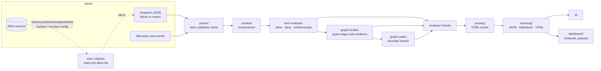

# AWS Cloud Attack Path Analyzer

[](https://github.com/ahmedhany-cys/aws-cloud-attack-path-analyzer/actions/workflows/ci.yml)
[](LICENSE)
[](pyproject.toml)

Offline, graph-based analysis of AWS IAM permission relationships. Given a snapshot of an
account's identities, policies, buckets and functions, the analyzer works out **which identities
could reach administrative control or sensitive data, through which trust relationships, with
what evidence**, and what least-privilege change would close each path. It runs entirely offline
on synthetic or exported configuration, and optionally collects a snapshot from a real account
through a read-only, opt-in adapter.

Every finding states whether it is an *observed* configuration fact, an *inference* from several
facts, a *hypothesis* that depends on another account, or something the evaluator *could not
decide*. Scores are prioritization heuristics and the reports say so.

---

## Contents

1. [The problem](#the-problem)
2. [Key features](#key-features)
3. [Architecture](#architecture)
4. [How the permission graph works](#how-the-permission-graph-works)
5. [A synthetic example](#a-synthetic-example)
6. [Commands and output](#commands-and-output)
7. [Installation](#installation)
8. [Offline usage](#offline-usage)
9. [Optional AWS setup](#optional-aws-setup)
10. [Supported IAM semantics](#supported-iam-semantics)
11. [Threat model](#threat-model)
12. [Security design decisions](#security-design-decisions)
13. [Testing and results](#testing-and-results)
14. [Performance](#performance)
15. [Known limitations](#known-limitations)
16. [Cost considerations](#cost-considerations)
17. [Teardown and cleanup](#teardown-and-cleanup)
18. [Contributing](#contributing)
19. [License](#license)

---

## The problem

IAM misconfigurations rarely look dangerous one policy at a time. A role trusts the whole
account; a user may assume any role; a function's execution role has `s3:*`; a bucket policy
grants `GetObject` to `*` and nobody remembers whether Block Public Access is on. Each is a line
in a JSON document. Together they are a path from a leaked access key to a customer-data bucket.

Reviewing those relationships by hand does not scale, and tools that grep for `*` and call
everything critical train people to ignore them. What is needed is an evaluator that applies the
actual IAM rules (explicit deny wins, boundaries intersect, cross-account needs both sides,
conditions matter), a graph that connects identities through trust, and findings that are honest
about what the configuration proves.

## Key features

* **Offline first.** Analyze a JSON snapshot or a directory of policy documents with no AWS
  account, no credentials and no network. The core package has **zero runtime dependencies**.
* **Tri-state IAM evaluator.** Explicit deny precedence, permissions boundaries, resource
  policies (S3 bucket, Lambda, role trust), same-account versus cross-account combination rules,
  26 condition operators with `IfExists` and set operators, policy variables. Anything that
  depends on request-time context is reported as **indeterminate**, never guessed.
* **Permission-relationship graph.** Observed structure (membership, attachments, trust, Lambda
  execution roles) plus evaluator-backed `can-assume` and `can-access` edges, each carrying the
  statements that justify it. Bounded reachability search to administrative principals and
  sensitive buckets.
* **Twenty checks** covering administrative access, wildcard grants, anonymous and cross-account
  trust, broad `sts:AssumeRole` and `iam:PassRole`, IAM/credential/Lambda write permissions,
  public and cross-account exposure (with Block Public Access handling), sensitive-data access,
  multi-hop paths, evaluation limitations and inventory coverage.
* **Findings you can audit.** Id, severity, score with full breakdown, confidence, evidence kind,
  affected principal and resource, the exact policy statements, preconditions, impact,
  least-privilege remediation with a template policy, read-only verification commands and AWS
  documentation references.
* **Transparent scoring** from a TOML model you can replace (`--scoring-config`).
* **Three report formats**: JSON, Markdown with Mermaid path diagrams, and standalone HTML with
  a strict Content-Security-Policy. Plus an optional local Streamlit dashboard.
* **Read-only AWS adapter** (opt-in): collects IAM, S3 and Lambda configuration through a botocore
  allow list that rejects any non-read-only operation, handles pagination, throttling and
  access-denied responses, and records what it could not see as coverage gaps.
* **Built-in self-check**: `python -m attackpath validate` replays eleven synthetic scenarios
  against recorded expectations, the same mechanism the regression suite uses.

## Architecture



Each layer is a separate package with one responsibility; data flows one way and nothing
downstream of the parser can reach AWS. The full description is in
[docs/architecture.md](docs/architecture.md).

**Why these components.** Python because the audience (security engineers) reads and extends it;
the standard library alone for the core because a tool that reads security configuration should
carry the smallest possible supply chain; `boto3` only behind an extra and only for read-only
calls; `GetAccountAuthorizationDetails` because it returns users, groups, roles and policy
documents in one paginated call instead of hundreds; S3 and Lambda because bucket policies,
Block Public Access and execution roles are where identity meets data and code; Streamlit because
a local dashboard should not require a web stack; a purpose-built graph because the analyzer needs
typed, evidence-carrying edges, deterministic ordering and hard limits rather than a general
graph library.

## How the permission graph works

Nodes are accounts, users, groups, roles, managed policies, buckets, functions, external accounts
and principals, the anonymous caller, and AWS services. Edges are typed:

| Edge | Meaning | How it is established |
|---|---|---|
| `member-of`, `has-policy`, `executes-as` | observed structure | read from the snapshot |
| `trusts` | a trust policy names this principal (classified as same-account, cross-account, anonymous, service, federated) | trust-policy parsing |
| `can-assume` | the caller can obtain the role | evaluator: trust policy *and*, where AWS requires it, the caller's own `sts:AssumeRole` permission; anonymous and external callers become hypotheses with stated preconditions |
| `can-access` | the identity can read / list / write / delete / re-policy the bucket | evaluator over identity policy + boundary + bucket policy + Block Public Access, one decision per access class |

Path search starts at every user, role, function, external account and anonymous node, walks
`can-assume` and `executes-as` edges, and stops at an administrative principal or at a sensitive
bucket reached through a final `can-access` edge. Depth, per-pair and total path counts are
capped and truncation is reported. The primary path for a source/target pair is the shortest,
then the one with the strongest evidence.

Two design decisions keep reports readable. Access that exists only because a bucket policy grants
to everyone is reported once as a public-exposure finding, not once per principal. And permissions
that would let an identity change configuration (`iam:PassRole`, policy writes, credential
creation, function code updates) are reported as configuration findings with concrete
least-privilege fixes rather than being chained into speculative multi-step scenarios; see the
scope decision in [docs/methodology.md](docs/methodology.md).

## A synthetic example

`fixtures/sample_environment.json` is a fictional account (`111111111111`) with five users, nine
roles, eight buckets and four functions that mixes insecure and secure configuration. Running the
analyzer on it produces 43 findings; the top of the list:

| Severity | Check | Finding |
|---|---|---|
| critical | `PATH-ADMIN` | User `legacy-automation` (2022 access key, no MFA) can reach role `ops-admin-legacy` in 1 step: it may `sts:AssumeRole` on `*` and the role trusts the whole account |
| critical | `TRUST-ANONYMOUS` | Role `vendor-support-access` can be assumed by any AWS principal (`Principal: "*"`, no condition) and holds `AmazonS3FullAccess` |
| critical | `ADMIN` | Role `ops-admin-legacy` has administrative permissions (`Action: *` on `Resource: *`) |
| high | `ADMIN` | User `break-glass-admin` has administrative permissions, scored lower because MFA is enforced and it has no access keys |
| high | `PASSROLE-BROAD` | User `ci-deployer` may pass any role to AWS services and also holds `lambda:CreateFunction` |
| high | `LAMBDA-PUBLIC-INVOKE` | Function `public-webhook` can be invoked by anyone and runs under a role with S3 full access |
| high | `SENSITIVE-ACCESS` | Workload role `lambda-image-resizer` can read/write/delete sensitive bucket `customer-pii-exports` |
| high | `PATH-SENSITIVE` | Any AWS principal can reach bucket `customer-pii-exports` in 2 steps via `vendor-support-access` |
| high | `S3-PUBLIC-POLICY` | Bucket `legacy-backups` is publicly readable through its bucket policy |
| low | `S3-PUBLIC-POLICY` | Bucket `archive-with-restricted-policy` has a public statement that `RestrictPublicBuckets` makes inert |
| informational | `SENSITIVE-ACCESS` | Role `finance-reporting` can read the PII bucket **only if** `aws:SourceVpce` matches: indeterminate, low confidence |

What is *not* reported matters as much: user `analyst-readonly` inherits `s3:GetObject` on `*`
from a group but carries an explicit `Deny` for the PII bucket, so no access finding exists for
that pair; role `lambda-thumbnailer-least-priv`, scoped to its two low-sensitivity buckets,
produces nothing above informational. The complete reports are in
[reports/sample/](reports/sample/) (labelled as synthetic) and every scenario is walked through
in [docs/incident-scenarios.md](docs/incident-scenarios.md).

## Commands and output

```bash
python -m attackpath analyze --input fixtures/sample_environment.json --output reports/
python -m attackpath analyze --input fixtures/iam_policies/ --format json
python -m attackpath analyze --input fixtures/sample_environment.json --format html
python -m attackpath analyze --input fixtures/sample_environment.json --format markdown
python -m attackpath validate
python -m attackpath version
python -m attackpath aws-scan --profile sandbox --region us-east-1 --confirm
python -m attackpath dashboard --input fixtures/sample_environment.json
```

Console output of the first command (the three report files are written to `reports/`):

```text
environment: synthetic-demo-account (synthetic, account 111111111111)
findings: critical=3, high=20, medium=10, low=6, informational=4
  [CRITICAL     ] APA-PATH-ADMIN-3c421bec  User legacy-automation can reach role ops-admin-legacy in 1 step(s)
  [CRITICAL     ] APA-TRUST-ANONYMOUS-ee839b9d  Role vendor-support-access can be assumed by any AWS principal
  [CRITICAL     ] APA-ADMIN-50535443  Role ops-admin-legacy has administrative permissions
  [HIGH         ] APA-ASSUME-BROAD-96c697bf  User legacy-automation may assume any role matching a broad pattern
  [HIGH         ] APA-ADMIN-5133d772  User break-glass-admin has administrative permissions
  [HIGH         ] APA-PASSROLE-BROAD-51c8c2a1  User ci-deployer may pass any role to AWS services
  [HIGH         ] APA-LAMBDA-PUBLIC-INVOKE-bcd469ea  Function public-webhook can be invoked by anyone
  [HIGH         ] APA-LAMBDA-WRITE-0f217123  User ci-deployer may change the code or configuration of any Lambda function
  ... 35 more
limitations/warnings: 1 (see report)
wrote reports/attackpath-report.json
wrote reports/attackpath-report.md
wrote reports/attackpath-report.html
```

Useful options: `--min-severity high` to drop noise, `--fail-on high` for a non-zero exit status in
pipelines (exit code 3), `--check PATH-ADMIN` to run one check, `--max-depth 6` for deeper path
search, `--scoring-config my.toml` to replace the scoring model, `--max-input-mb` to tighten the
input size limit. Exit codes: 0 success, 1 analyzer error, 2 usage error, 3 `--fail-on` triggered,
4 self-check failure.

## Installation

Requires Python 3.11 or newer.

```bash
git clone https://github.com/ahmedhany-cys/aws-cloud-attack-path-analyzer.git
cd aws-cloud-attack-path-analyzer
python3 -m venv .venv && source .venv/bin/activate
pip install .                      # offline analyzer, no third-party dependencies
pip install ".[aws]"               # + boto3 for the read-only collector
pip install ".[dashboard]"         # + streamlit and pandas for the local dashboard
pip install -e ".[dev]"            # + test, lint, type-check and security tooling
```

`make install` creates the virtual environment and installs the dev extra;
`make check` runs everything CI runs.

## Offline usage

The default and primary mode. Inputs are either an **environment snapshot** (one JSON file, schema
in [docs/input-format.md](docs/input-format.md)) or **standalone IAM policy documents** (a file or
a directory), analyzed in policy-only mode where each document becomes the policy of a synthetic
principal. Snapshots can be hand-written fixtures, exports from your own tooling, or the output
of `aws-scan`.

```bash
python -m attackpath validate --input my-snapshot.json      # schema check with warnings
python -m attackpath analyze  --input my-snapshot.json --output out/
python -m attackpath analyze  --input policies/ --format markdown --min-severity medium
```

Nothing in offline mode opens a network connection; `boto3` is not even imported.

## Optional AWS setup

`aws-scan` collects a snapshot from an account you administer, using an AWS CLI profile you
select. It is read-only by construction: a botocore handler rejects any API operation outside
the documented allow list before the request is built, root credentials are refused, `--confirm`
is required, and nothing is uploaded anywhere. The least-privilege IAM policy for the scan
identity, the exact operations called, cost notes and troubleshooting are in
[docs/aws-setup.md](docs/aws-setup.md).

```bash
pip install ".[aws]"
python -m attackpath aws-scan --profile sandbox --region us-east-1           # prints the plan, makes no call
python -m attackpath aws-scan --profile sandbox --region us-east-1 --confirm # collects scans/<account>-<time>.json
python -m attackpath analyze --input scans/<account>-<time>.json --output reports/<account>/
```

Scan output is written with mode `0600` into `scans/`, which is Git-ignored. Live scanning is
never part of CI or of any test.

## Supported IAM semantics

Implemented: explicit deny precedence; implicit deny; action wildcards; resource wildcards and
`NotAction`/`NotResource`; policy variables resolved from the snapshot (otherwise indeterminate);
principal matching for `*`, account roots, user and role ARNs, assumed-role sessions, services and
`NotPrincipal`; 26 condition operators (`String*`, `Arn*`, `Bool`, `Numeric*`, `Date*`,
`IpAddress`/`NotIpAddress`, `Null`, `BinaryEquals`) with `IfExists`, `ForAnyValue`/`ForAllValues`;
permissions boundaries; S3 bucket policies, Lambda resource policies and role trust policies with
same-account/cross-account combination rules; the special role-trust rule that a trust policy
naming a principal directly needs no identity-policy allow while one naming the account root does.

Not implemented (reported, not guessed): service control policies, session policies, VPC endpoint
policies, resource policies of other services, S3 object ACLs and access points, Identity Center.
Details and consequences: [docs/methodology.md](docs/methodology.md) and
[docs/limitations.md](docs/limitations.md).

## Threat model

The analyzer considers four starting points, each with its own exposure weight: compromised
credentials of an IAM user (raised by long-lived keys and console access without MFA), a
compromised workload acting as its execution role, another AWS account named in a trust or bucket
policy, and an anonymous caller admitted by `Principal: "*"`. Assets are administrative control,
buckets declared sensitive, workload integrity and the identity configuration itself. The model of
the tool itself (malicious snapshots, compromised dependencies, misconfigured CI, careless
operators) and the mitigations for each are in [docs/threat-model.md](docs/threat-model.md).

## Security design decisions

* Standard-library JSON parsing only, size and nesting-depth limits, strict schema validation with
  unknown elements rejected, entity/graph/path limits that fail loudly instead of exhausting memory.
* HTML reports escape every string, contain no JavaScript and set `default-src 'none'`; Markdown
  escapes HTML and table metacharacters, including inside code spans.
* No telemetry, no outbound traffic in offline mode, no execution of anything from the input.
* AWS adapter: operation allow list enforced at the botocore layer, root refusal, explicit opt-in,
  credentials never logged, `0600` output, access-denied and throttling handled as coverage gaps.
* Repository: zero runtime dependencies, Dependabot, `pip-audit`, `bandit`, `detect-secrets`
  baseline and `gitleaks` in CI, GitHub Actions pinned to commit SHAs with a read-only token and
  no secrets, synthetic fixtures with non-AWS-looking key ids.

The full list with file references is in [docs/security.md](docs/security.md).

## Testing and results

```bash
make check            # ruff, mypy --strict, pytest, bandit, pip-audit, self-check
make test             # pytest with coverage
python -m attackpath validate --verbose
```

The suite covers policy parsing, allow/deny behaviour, wildcards, action and resource matching,
conditions, trust relationships, graph construction, path discovery and de-duplication, scoring,
serialization, all three report formats, invalid input, missing fields, unsupported constructs,
unknown conditions, partial inventory, AWS pagination/throttling/access-denied handling with
stubbed clients, CLI argument validation, safe defaults, property-based tests (Hypothesis) and a
regression test for every defect fixed during development.

Results of the full local run that preceded publication (macOS, Apple M2, Python 3.14.7):

| Gate | Result |
|---|---|
| `pytest` | **247 passed, 0 failed, 0 skipped** (unit, integration, regression, property-based, stubbed AWS adapter, dashboard AppTest) |
| coverage | 94 % of 4 635 statements |
| `ruff check` / `ruff format --check` | clean |
| `mypy --strict` | clean, 52 source files |
| `bandit` | 0 issues |
| `pip-audit` | no known vulnerabilities |
| `detect-secrets` (tracked files) | no findings against the committed baseline |
| `attackpath validate` | 11 scenarios, 37 expectations met, 0 failed |
| wheel build + install in a clean virtualenv | `attackpath validate` passes with zero third-party packages installed |

CI repeats the same gates on Python 3.11, 3.12, 3.13 and 3.14 (badge above). The test suite
verifies the AWS adapter against stubbed botocore clients. The adapter was also run once, read-only,
against a real account on 2026-10-27 with an IAM user that did not hold the IAM and Lambda read
permissions from [docs/aws-setup.md](docs/aws-setup.md): the `--confirm` gate, the STS identity
check, the S3 inventory and the handling of access-denied responses as coverage gaps behaved as
designed, and the run ended with two informational coverage findings. The IAM and Lambda inventories
have therefore been exercised against stubbed responses only. No resources were created or modified.

## Performance

Measured with `python scripts/benchmark.py --sizes 100,500,2000 --repeat 3` (deterministic
synthetic environments; median of three runs; macOS, Apple M2, 8 GiB, Python 3.14.7):

| Principals | Buckets | Graph edges | Paths | Findings | Median time |
|---:|---:|---:|---:|---:|---:|
| 100 | 10 | 354 | 185 | 135 | 0.08 s |
| 500 | 50 | 8 765 | 4 372 | 2 480 | 2.0 s |
| 2 000 | 200 | 116 228 | 10 000 (cap reached) | 21 657 | 30.3 s |

The generator deliberately over-grants (a tenth of all roles get `s3:*`), which is why finding
counts grow so fast; the sample environment with 14 principals analyzes in a fraction of a second.
Cost is dominated by the per-principal, per-bucket access evaluation (five decisions per pair);
large accounts should be scanned per region and, if needed, analyzed with `--min-severity` to keep
reports readable. Path enumeration stops at the configured cap and says so in the report.

## Known limitations

The analyzer reasons about one account's static snapshot with a conservative evaluator: SCPs,
session policies and VPC endpoint policies are not modelled; only IAM, S3 and Lambda are
inventoried; sensitivity is declared, not inferred; request-time conditions become preconditions
rather than decisions; path search is bounded; scores are heuristics; and configuration-changing
permissions are reported as grants rather than chained into speculative scenarios. Each point and
its consequence is listed in [docs/limitations.md](docs/limitations.md).

## Cost considerations

* Offline analysis costs nothing and creates nothing.
* `aws-scan` creates no resources and makes read-only control-plane calls only. IAM, STS and
  Lambda control-plane requests are not billed per request on the AWS pricing pages at the time
  of writing. S3 `ListBuckets` and the per-bucket `GetBucket*` calls count as S3 requests, which
  are billed per thousand requests at a fraction of a cent; a scan of a few hundred buckets makes
  a few thousand such requests. Check the current
  [S3 pricing page](https://aws.amazon.com/s3/pricing/) for your region before scanning very large
  accounts, and remember that API calls are recorded by CloudTrail if a trail is configured.
* The dashboard and the CI pipeline run on your own machine or on GitHub's runners; no cloud
  resources are provisioned by this project.

## Teardown and cleanup

```bash
make clean                                   # caches, coverage and local report output
pip uninstall aws-cloud-attack-path-analyzer # or: make uninstall
rm -rf .venv scans/                          # virtual environment and any local scan snapshots
```

There is nothing to tear down in AWS: the project never deploys infrastructure. If you created an
IAM identity for scanning (see [docs/aws-setup.md](docs/aws-setup.md)), remove it with your usual
IAM process when it is no longer needed.

## Contributing

See [CONTRIBUTING.md](CONTRIBUTING.md) for the development workflow, the rules every check must
follow (evidence, honest evidence kinds, synthetic fixtures, read-only AWS access) and how to add a
check or scenario. Security issues: [SECURITY.md](SECURITY.md).

## License

[MIT](LICENSE). The MIT license is compatible with the permissive licenses of the optional
dependencies (`boto3`/`botocore` Apache-2.0, `streamlit` Apache-2.0, `pandas` BSD-3-Clause).
