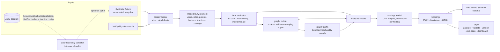

# Architecture

The analyzer is a pipeline of small, separately testable layers. Data flows one way: inputs are
parsed into an immutable model, the evaluator answers authorization questions about that model,
the graph records the answers as typed relationships, the checks turn relationships into findings,
and the reporters render findings. No layer reaches back into AWS; the optional collector sits at
the very front and produces the same snapshot format a fixture would.

## Packages

| Package | Responsibility | Key types |
|---|---|---|
| `attackpath.models` | Immutable data model shared by every layer | `Environment`, `PolicyDocument`, `Statement`, `Finding`, `AnalysisReport` |
| `attackpath.parser` | Strict validation of untrusted JSON into the model | `load_input`, `parse_environment`, `parse_policy_document` |
| `attackpath.iam` | AWS authorization semantics | `PolicyEvaluator`, `Decision`, `PrincipalIdentity`, condition operators |
| `attackpath.graph` | Permission-relationship graph and path search | `AttackGraph`, `Node`, `Edge`, `find_attack_paths` |
| `attackpath.analysis` | Checks that turn relationships into findings | `analyze`, `AnalysisContext`, one module per check family |
| `attackpath.scoring` | Transparent, configurable prioritization | `Scorer`, `ScoringConfig` |
| `attackpath.reporting` | Rendering with escaping | `render_json`, `render_markdown`, `render_html` |
| `attackpath.aws` | Optional read-only collector | `AwsInventoryCollector`, `install_safeguards`, `scan_command` |
| `attackpath.dashboard` | Optional local Streamlit UI | `launch`, `app.py` |
| `attackpath.selfcheck` | Built-in scenario verification (`attackpath validate`) | `run_all` |

## The evaluator

`PolicyEvaluator.evaluate(principal, action, resource, resource_policy=..., resource_account=...)`
returns a `Decision` of `allowed`, `explicit-deny`, `implicit-deny` or `indeterminate` together with
the statements that matched (as evidence), the reasons for any uncertainty and the list of policy
documents that were referenced but missing. Internally every match is a three-valued `Tri`:

* action patterns are matched case-insensitively with `*`/`?` wildcards;
* resource patterns are matched case-sensitively; a policy variable that cannot be resolved from
  the request context makes the match `UNKNOWN`;
* principal elements (trust and resource policies) are matched against a `PrincipalIdentity`
  (user, role, account, anonymous, service, federated);
* conditions are evaluated against a request context derived from the snapshot (principal ARN and
  account, user name, principal and resource tags, resource account). Keys the snapshot cannot
  know, such as `aws:SourceIp` or `aws:MultiFactorAuthPresent`, make the condition `UNKNOWN`.

Combination follows the AWS evaluation logic: an explicit Deny anywhere wins; otherwise identity
policies are intersected with the permissions boundary; a same-account resource policy can grant
on its own, a cross-account one only together with an identity allow. `UNKNOWN` propagates with
Kleene semantics, so a Deny whose condition cannot be decided produces `indeterminate`, never
`allowed`.

## The graph

Nodes: account, user, group, role, managed policy, S3 bucket, Lambda function, external account,
external principal, anonymous, service. Edges carry a type, a label, the evidence that justifies
them, a confidence level, an evidence kind and preconditions:

| Edge | Source → target | Produced by |
|---|---|---|
| `member-of` | user → group | snapshot |
| `has-policy` | principal or group → managed policy | snapshot |
| `trusts` | role → trusted principal node | trust-policy classification |
| `executes-as` | function → execution role | snapshot |
| `can-assume` | principal, external account or anonymous → role | `PolicyEvaluator.can_assume` (trust policy + identity permission) |
| `can-access` | principal, external account or anonymous → bucket (or function for invoke) | `PolicyEvaluator.evaluate` for read/list/write/delete/policy classes |

Path search starts at every user, role, function, external account and anonymous node, moves along
`can-assume` and `executes-as` edges, and terminates at an administrative principal or at a sensitive
bucket reached through a final `can-access` edge. Depth (default 4), paths per source/target pair
(5) and total paths (10 000) are capped; truncation is reported in the graph summary. Access edges
that exist only because a bucket policy grants to everyone are not traversable: that fact is
reported once as a public-exposure finding instead of once per principal.

## Checks

Each check is a pure function of an `AnalysisContext` (environment, evaluator, graph, paths,
configuration, scorer). Checks ask concrete questions through the evaluator rather than pattern
matching JSON, so explicit denies, boundaries and conditions are honoured everywhere. The
registry in `analysis/checks/__init__.py` lists them; `docs/methodology.md` describes each one.

## Reports

`AnalysisReport` is the single format-independent representation. The JSON renderer emits it
verbatim (plus notices); the Markdown renderer escapes table and HTML metacharacters and emits
Mermaid diagrams for paths; the HTML renderer escapes every string, uses no JavaScript and sets a
`Content-Security-Policy` of `default-src 'none'; style-src 'unsafe-inline'`.

## Determinism

Findings have deterministic ids (`APA-<CHECK>-<sha256 prefix>` of check id, principal, resource and
check-specific key), findings are sorted by severity, score and id, and graph iteration order is
insertion order. Two runs over the same snapshot produce byte-identical JSON apart from the
timestamp and timing fields, which is what makes the regression suite and the `validate`
self-check meaningful.

## Dependencies

The offline analyzer imports only the standard library. `boto3`/`botocore` are needed for
`aws-scan`, `streamlit`/`pandas` for the dashboard, and the development tools for tests and
checks. The split is deliberate: a tool that reads security configuration should carry as little
third-party code as possible.
