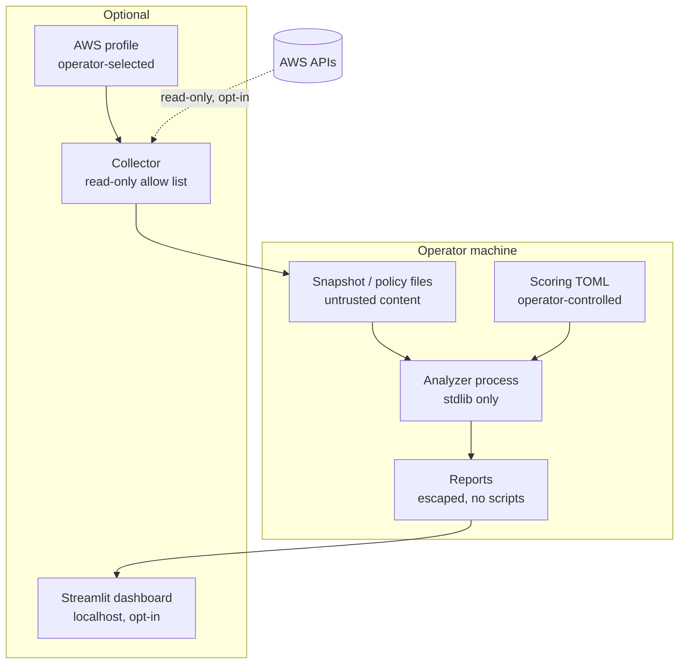

# Threat model

Two models matter: the one the analyzer applies to the environment it analyzes, and the one that
applies to the analyzer itself.

## Part 1: the analyzed environment

### Assets

* **Administrative control of the account**: any principal that can perform the probed set of
  high-impact actions on every resource.
* **Sensitive data**: buckets declared `high` or `medium` sensitivity.
* **Workload integrity**: execution roles and the functions that run under them.
* **Identity configuration itself**: policies, attachments, trust relationships and credentials.

### Starting points considered

| Starting point | Represented as | Why it matters |
|---|---|---|
| Compromised credentials of an IAM user | user node; exposure raised by long-lived access keys and console access without MFA | Phishing, leaked keys in repositories, credential stuffing |
| Compromised workload | function node → execution role; instance node → instance-profile role | Vulnerable application code, dependency compromise, SSRF to the credentials endpoint (IMDSv1) |
| Another AWS account | external account / external principal nodes | Partner or vendor compromise, mistaken trust, typos in account ids |
| Anyone on the internet, as an API caller | anonymous node | `Principal: "*"` in a trust, bucket or function policy |
| Anyone on the internet, as a network attacker | internet node → `network-exposed` edge → instance | Security-group ingress from `0.0.0.0/0` on a host with a public address; brute force or exploitation of the listening service is a stated precondition, never assumed |

### Relationships examined

* Trust relationships (`can-assume`): who can become which role, under what conditions.
* Execution relationships (`executes-as`): which code runs as which role.
* Data access (`can-access`): which identities can read, list, write, delete or re-policy which
  bucket, honouring explicit denies, boundaries, bucket policies and Block Public Access.
* Configuration-changing permissions: broad `iam:PassRole`, IAM policy/attachment/trust writes,
  credential management, function code updates. Reported as findings on the grant itself.
* Inventory gaps: anything the snapshot admits it does not contain.

### Questions the findings answer

1. Which identities hold excessive permissions, and how directly (`ADMIN`, `WILDCARD`)?
2. Which roles can be assumed by whom (`TRUST-*`, `ASSUME-BROAD`, `can-assume` edges)?
3. Which grants create risky relationships (`PASSROLE-BROAD`, `IAM-WRITE`, `CREDENTIAL-WRITE`,
   `LAMBDA-WRITE`)?
4. Which resources are reachable through chains of trust (`PATH-ADMIN`, `PATH-SENSITIVE`)?
5. Which conclusions are proven by configuration and which depend on unknown context
   (`evidence_kind`, preconditions, `EVAL-INDETERMINATE`)?
6. What is the potential impact (each finding's impact statement, scored sensitivity)?
7. Which least-privilege change reduces the risk (remediation, suggested policy)?
8. How to verify that the change worked (verification steps: re-run, policy simulator,
   `get-role`, `get-bucket-policy-status`)?

### Out of scope

Network paths, operating-system compromise, application vulnerabilities, data exfiltration
techniques, detection evasion, and anything that requires interacting with the account. The
analyzer reports configuration relationships; it does not demonstrate exploitation.

## Part 2: the analyzer

### Assets

* The operator's AWS credentials (when `aws-scan` is used).
* Snapshot files, which describe an account's identity configuration in detail.
* Reports, which guide remediation decisions and may be shared.
* The integrity of the analysis itself (a false "safe" is the worst outcome).

### Adversaries and threats

| Adversary | Threat | Mitigation |
|---|---|---|
| Author of a malicious snapshot or policy file | Crash or exhaust the analyzer; inject script into reports; smuggle instructions into evidence text | Size/depth/entity/graph limits; strict schema; escaped Markdown and HTML with CSP and no JavaScript; `json` parsing only (see `docs/security.md`) |
| Compromised dependency | Exfiltrate credentials or alter results | No runtime dependencies for the offline analyzer; optional extras isolated in their packages; Dependabot and `pip-audit`; pinned CI actions |
| Misconfigured CI | Leak secrets, run against a real account | No AWS credentials in CI; read-only workflow token; `persist-credentials: false`; `aws-scan` never executed in CI |
| Careless operator | Scan with root credentials; commit real scan output; expose the dashboard | Root ARN refused; `--confirm` required; scan output written with `0600` into a Git-ignored directory; dashboard bound to localhost and opt-in; `.gitignore` covers common secret files |
| Future contributor | Add a write operation to the collector | botocore allow list raises on anything not listed; contribution guide requires updating the list and the docs; tests assert the read-only policy covers the list |
| The analyzer itself | Report a permission as absent when it exists (false negative), or invent one (false positive) | Explicit-deny-first evaluator; `indeterminate` instead of guesses; regression scenarios; property-based tests; evidence attached to every finding so a reviewer can check it |

### Trust boundaries

### Assumptions

* The operator runs the analyzer on a machine they control; local file permissions are the
  boundary for snapshots and reports.
* The AWS profile used for scanning holds only the documented read-only permissions
  (`docs/aws-setup.md`); the analyzer cannot enforce what a profile is allowed to do beyond
  refusing to call anything outside its own allow list.
* Reports may be shared; they contain account ids and identity names but never credentials.
