# AWS Cloud Attack Path Analyzer report

> **Synthetic environment.** This report was generated from a synthetic fixture. The identities, accounts and resources are fictional; nothing in it describes a real AWS account.
>
> Scores and severities are prioritization heuristics derived from configuration, not proof that an action succeeds in a live account. Findings marked hypothetical or indeterminate depend on context the snapshot does not contain.

## Summary

| Field | Value |
|---|---|
| Input | environment snapshot sample_environment.json |
| Environment | synthetic-demo-account (synthetic) |
| Account | `111111111111` |
| Generated | 2026-10-28T06:12:03+00:00 |
| Tool version | 0.2.0 |
| Analysis time | 0.017 s |
| Findings | 49 |

### Findings by severity

| Severity | Count |
|---|---:|
| CRITICAL | 4 |
| HIGH | 22 |
| MEDIUM | 11 |
| LOW | 8 |
| INFORMATIONAL | 4 |

### Findings by category

| Category | Count |
|---|---:|
| attack-path | 11 |
| evaluation-limitation | 2 |
| excessive-permissions | 5 |
| inventory-coverage | 3 |
| network-exposure | 4 |
| privilege-escalation | 3 |
| resource-exposure | 4 |
| sensitive-data-access | 14 |
| trust-relationship | 3 |

### Inventory

| Entity | Count |
|---|---:|
| users | 5 |
| groups | 1 |
| roles | 10 |
| managed_policies | 4 |
| s3_buckets | 8 |
| lambda_functions | 4 |
| ec2_instances | 4 |
| security_groups | 3 |
| external_principals | 1 |

### Coverage

| Service | Status | Notes |
|---|---|---|
| ec2 | complete |  |
| iam | complete |  |
| lambda | partial | region eu-west-1 was not inventoried: AccessDenied on lambda:ListFunctions |
| s3 | complete |  |

### Graph

44 nodes, 120 edges, 35 path(s) found.

## Findings

| Severity | ID | Title | Confidence | Evidence |
|---|---|---|---|---|
| CRITICAL | `APA-EC2-PUBLIC-EXPOSURE-6ab2178c` | Instance legacy-jump is reachable from the internet on all ports | high | observed |
| CRITICAL | `APA-PATH-ADMIN-3c421bec` | User legacy-automation can reach role ops-admin-legacy in 1 step(s) | high | observed |
| CRITICAL | `APA-TRUST-ANONYMOUS-ee839b9d` | Role vendor-support-access can be assumed by any AWS principal | high | observed |
| CRITICAL | `APA-ADMIN-50535443` | Role ops-admin-legacy has administrative permissions | high | observed |
| HIGH | `APA-ASSUME-BROAD-96c697bf` | User legacy-automation may assume any role matching a broad pattern | high | observed |
| HIGH | `APA-ADMIN-5133d772` | User break-glass-admin has administrative permissions | high | observed |
| HIGH | `APA-PASSROLE-BROAD-51c8c2a1` | User ci-deployer may pass any role to AWS services | high | observed |
| HIGH | `APA-LAMBDA-PUBLIC-INVOKE-bcd469ea` | Function public-webhook can be invoked by anyone | high | observed |
| HIGH | `APA-LAMBDA-WRITE-0f217123` | User ci-deployer may change the code or configuration of any Lambda function | high | observed |
| HIGH | `APA-SENSITIVE-ACCESS-5656d599` | Role vendor-support-access can delete/list/policy/read/write sensitive bucket legacy-backups | high | observed |
| HIGH | `APA-SENSITIVE-ACCESS-5d6562ee` | Role vendor-support-access can delete/list/policy/read/write sensitive bucket customer-pii-exports | high | observed |
| HIGH | `APA-CREDENTIAL-WRITE-7a1e4d2b` | User helpdesk-operator may create or change credentials of other users | high | observed |
| HIGH | `APA-SENSITIVE-ACCESS-7bc7c863` | Workload role lambda-image-resizer can delete/list/policy/read/write sensitive bucket customer-pii-exports | high | observed |
| HIGH | `APA-SENSITIVE-ACCESS-da9eac00` | Workload role lambda-image-resizer can delete/list/policy/read/write sensitive bucket legacy-backups | high | observed |
| HIGH | `APA-PATH-SENSITIVE-11513899` | Any AWS principal / anonymous can reach bucket customer-pii-exports in 2 step(s) | high | inferred |
| HIGH | `APA-PATH-SENSITIVE-e0ef900d` | Any AWS principal / anonymous can reach bucket legacy-backups in 2 step(s) | high | inferred |
| HIGH | `APA-S3-PUBLIC-POLICY-2e4efc8c` | Bucket legacy-backups is publicly accessible through its bucket policy | high | observed |
| HIGH | `APA-SENSITIVE-ACCESS-222cc867` | Role vendor-support-access can delete/list/policy/read/write sensitive bucket finance-reports | high | observed |
| HIGH | `APA-SENSITIVE-ACCESS-451bc78a` | Role vendor-support-access can delete/list/policy/read/write sensitive bucket archive-with-restricted-policy | high | observed |
| HIGH | `APA-PATH-SENSITIVE-ae7c4f7f` | Any AWS principal / anonymous can reach bucket archive-with-restricted-policy in 2 step(s) | high | inferred |
| HIGH | `APA-PATH-SENSITIVE-faca7095` | Any AWS principal / anonymous can reach bucket finance-reports in 2 step(s) | high | inferred |
| HIGH | `APA-SENSITIVE-ACCESS-3a387c3b` | Workload role lambda-image-resizer can delete/list/policy/read/write sensitive bucket finance-reports | high | observed |
| HIGH | `APA-SENSITIVE-ACCESS-56cccbb6` | Workload role lambda-image-resizer can delete/list/policy/read/write sensitive bucket archive-with-restricted-policy | high | observed |
| HIGH | `APA-EC2-IMDSV1-6e61c2c0` | Instance legacy-jump allows IMDSv1 while running as role ec2-jump-host-legacy | high | observed |
| HIGH | `APA-EC2-PUBLIC-EXPOSURE-19b2357f` | Instance web-1 is reachable from the internet on tcp 22, tcp 80, tcp 443; management ports open: 22 (SSH) | high | observed |
| HIGH | `APA-WILDCARD-a54d8e30` | Role vendor-support-access is granted s3:*, s3-object-lambda:* on * | high | observed |
| MEDIUM | `APA-WILDCARD-1904629d` | Role lambda-image-resizer is granted s3:*, s3-object-lambda:* on * | high | observed |
| MEDIUM | `APA-TRUST-CROSS-ACCOUNT-429c0891` | Role partner-integration trusts account arn:aws:iam::222222222222:root without an sts:ExternalId condition | high | observed |
| MEDIUM | `APA-PATH-SENSITIVE-6eaeb196` | User legacy-automation can reach bucket customer-pii-exports in 2 step(s) | high | inferred |
| MEDIUM | `APA-PATH-SENSITIVE-e5761861` | User legacy-automation can reach bucket legacy-backups in 2 step(s) | high | inferred |
| MEDIUM | `APA-S3-PUBLIC-POLICY-3be71d64` | Bucket public-marketing-assets is publicly accessible through its bucket policy | high | observed |
| MEDIUM | `APA-PATH-SENSITIVE-0c050208` | User legacy-automation can reach bucket finance-reports in 2 step(s) | high | inferred |
| MEDIUM | `APA-PATH-SENSITIVE-54bb74f1` | User legacy-automation can reach bucket archive-with-restricted-policy in 2 step(s) | high | inferred |
| MEDIUM | `APA-SENSITIVE-ACCESS-ce12be1f` | Workload role ec2-jump-host-legacy can list/read sensitive bucket customer-pii-exports | high | observed |
| MEDIUM | `APA-SENSITIVE-ACCESS-b5e322ff` | User analyst-readonly can list/read sensitive bucket legacy-backups | high | observed |
| MEDIUM | `APA-PATH-SENSITIVE-25ec7c2a` | The internet can reach bucket customer-pii-exports in 3 step(s) | medium | hypothetical |
| MEDIUM | `APA-SENSITIVE-ACCESS-f6e7f96d` | Role partner-integration can list/read sensitive bucket finance-reports | high | observed |
| LOW | `APA-S3-PUBLIC-POLICY-5c783577` | Bucket archive-with-restricted-policy has a public bucket policy (blocked by Block Public Access) | high | observed |
| LOW | `APA-SENSITIVE-ACCESS-340c7acd` | User analyst-readonly can list/read sensitive bucket finance-reports | high | observed |
| LOW | `APA-SENSITIVE-ACCESS-92d0f375` | User analyst-readonly can list/read sensitive bucket archive-with-restricted-policy | high | observed |
| LOW | `APA-EC2-IMDSV1-52ba8ac3` | Instance web-1 allows IMDSv1 while running as role ec2-web-instance | high | observed |
| LOW | `APA-TRUST-CROSS-ACCOUNT-18919fa9` | Role third-party-monitoring trusts account arn:aws:iam::333333333333:root (sts:ExternalId required) | high | observed |
| LOW | `APA-PATH-SENSITIVE-faae3510` | Account 222222222222 can reach bucket finance-reports in 2 step(s) | medium | hypothetical |
| LOW | `APA-COVERAGE-UNRESOLVED-POLICY-724136a3` | Policy document arn:aws:iam::111111111111:policy/pipeline-unresolved is referenced but not present in the snapshot | high | observed |
| LOW | `APA-COVERAGE-UNRESOLVED-ROLE-03574b40` | Execution role arn:aws:iam::111111111111:role/cleanup-role-missing is used by functions but not present in the snapshot | high | observed |
| INFORMATIONAL | `APA-SENSITIVE-ACCESS-d50401d5` | Role finance-reporting can read sensitive bucket customer-pii-exports | low | indeterminate |
| INFORMATIONAL | `APA-EVAL-INDETERMINATE-32ea52cc` | Statement could not be fully evaluated: inline:arn:aws:iam::111111111111:role/finance-reporting:vpce-only statement[0] (Sid: ReadExportsViaEndpoint) | low | indeterminate |
| INFORMATIONAL | `APA-EVAL-INDETERMINATE-6f6938d6` | Statement could not be fully evaluated: trust:arn:aws:iam::111111111111:role/third-party-monitoring statement[0] | low | indeterminate |
| INFORMATIONAL | `APA-COVERAGE-PARTIAL-923ec07b` | Inventory coverage for lambda is partial | high | observed |

### CRITICAL (4)

#### Instance legacy-jump is reachable from the internet on all ports

| Field | Value |
|---|---|
| ID | `APA-EC2-PUBLIC-EXPOSURE-6ab2178c` |
| Check | `EC2-PUBLIC-EXPOSURE` |
| Category | network-exposure |
| Severity | CRITICAL (score 86.5) |
| Confidence | high |
| Evidence kind | observed |
| Resource | `arn:aws:ec2:us-east-1:111111111111:instance/i-0jump00000000000b` |
| Tags | network, public-access, management-port |

**Description.** i-0jump00000000000b has public address 203.0.113.25 and security group(s) sg-0jump000000000003 allow inbound all ports from any address. It runs as role ec2-jump-host-legacy (reach of the instance role: can access sensitive buckets: customer-pii-exports). IMDSv1 is still allowed, so a server-side request forgery or local file read is enough to retrieve the role credentials.

**Impact.** Exposed management or database ports can be brute-forced or exploited directly, and any compromise of the instance yields its role credentials from the metadata service.

**Evidence**

- `security-group:sg-0jump000000000003`: ingress all ports from 0.0.0.0/0
- `ec2:arn:aws:ec2:us-east-1:111111111111:instance/i-0jump00000000000b`: public IP 203.0.113.25, subnet routes to an internet gateway

<details><summary>Score breakdown</summary>

| Factor | Value | Weight | Rationale |
|---|---:|---:|---|
| permission_breadth | 0.70 | 20 | reach of the instance role: can access sensitive buckets: customer-pii-exports |
| escalation_potential | 0.70 | 25 | the instance role reaches sensitive buckets |
| resource_sensitivity | 1.00 | 20 | bucket sensitivity declared as high |
| trust_boundary | 1.00 | 15 | reachable from any internet address |
| exposure | 1.00 | 10 | every port is open to the internet |
| reachability | 1.00 | 10 | direct |

base 86.5 x evidence/confidence 1.00 x preconditions 1.00 = 86.5

</details>

**Remediation.** Remove the internet-wide ingress rules; reach the instance through SSM Session Manager or a VPN and keep only application ports behind a load balancer.

1. Replace 0.0.0.0/0 and ::/0 sources with the specific CIDR ranges (or a managed prefix list) that need access.
2. Use AWS Systems Manager Session Manager for shell access and delete the SSH/RDP rules.
3. Serve application ports through an Application Load Balancer or CloudFront and move the instance to a private subnet.
4. Require IMDSv2 (HttpTokens=required) and scope the instance role to what the workload needs.

Suggested policy (template, validate before use):

```json
{
  "IpPermissions": [
    {
      "IpProtocol": "tcp",
      "FromPort": 22,
      "ToPort": 22,
      "IpRanges": [
        {
          "CidrIp": "<trusted-source-cidr>",
          "Description": "replace with the range that needs access"
        }
      ]
    }
  ]
}
```

Assumptions:

- The suggested policy is a template: replace placeholder ARNs with the resources the workflow genuinely needs.
- Validate the policy with IAM Access Analyzer policy checks and the policy simulator before deploying it; test in a non-production account first.
- Legitimate functionality that depends on the removed permissions must be identified from usage data before the change is applied.
- Removing an ingress rule interrupts any client that currently connects from the internet; confirm legitimate sources from VPC flow logs first.

Verification:

- aws ec2 describe-security-groups --group-ids sg-0jump000000000003 (expect no 0.0.0.0/0 or ::/0 source)
- aws ec2 describe-instances --instance-ids i-0jump00000000000b --query 'Reservations[].Instances[].[PublicIpAddress,MetadataOptions.HttpTokens]'
- Re-run the analyzer on a fresh snapshot and confirm that no EC2-PUBLIC-EXPOSURE finding remains for instance legacy-jump.

References:

- <https://docs.aws.amazon.com/vpc/latest/userguide/security-group-rules.html>
- <https://docs.aws.amazon.com/systems-manager/latest/userguide/session-manager.html>
- <https://docs.aws.amazon.com/AWSEC2/latest/UserGuide/configuring-instance-metadata-service.html>
- <https://docs.aws.amazon.com/AWSEC2/latest/UserGuide/iam-roles-for-amazon-ec2.html>

#### User legacy-automation can reach role ops-admin-legacy in 1 step(s)

| Field | Value |
|---|---|
| ID | `APA-PATH-ADMIN-3c421bec` |
| Check | `PATH-ADMIN` |
| Category | attack-path |
| Severity | CRITICAL (score 82.0) |
| Confidence | high |
| Evidence kind | observed |
| Principal | `arn:aws:iam::111111111111:user/legacy-automation` |
| Resource | `arn:aws:iam::111111111111:role/ops-admin-legacy` |
| Tags | reachability, single-hop |

**Description.** user legacy-automation can reach role ops-admin-legacy in 1 step(s): user:legacy-automation --[sts:AssumeRole]--&gt; role:ops-admin-legacy. Weakest evidence along the path: observed; confidence: high.

**Impact.** A compromise of the starting identity extends to administrative control of the account.

**Evidence**

- `trust:arn:aws:iam::111111111111:role/ops-admin-legacy`: trust:arn:aws:iam::111111111111:role/ops-admin-legacy statement[0] (Allow) applies
- `inline:arn:aws:iam::111111111111:user/legacy-automation:legacy`: inline:arn:aws:iam::111111111111:user/legacy-automation:legacy statement[0] Sid=AssumeAnything (Allow) applies

**Path**

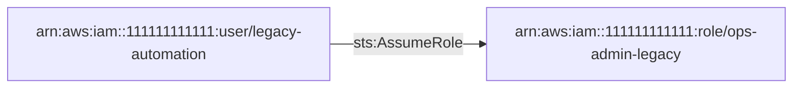

1. `arn:aws:iam::111111111111:user/legacy-automation` -[sts:AssumeRole]-> `arn:aws:iam::111111111111:role/ops-admin-legacy` (confidence high)

<details><summary>Score breakdown</summary>

| Factor | Value | Weight | Rationale |
|---|---:|---:|---|
| permission_breadth | 1.00 | 20 | administrative permissions at the end of the path |
| escalation_potential | 1.00 | 25 | reaches administrative permissions |
| resource_sensitivity | 1.00 | 20 | every resource in the account |
| trust_boundary | 0.00 | 15 | path stays inside the account |
| exposure | 0.70 | 10 | human identity; has active long-lived access keys |
| reachability | 1.00 | 10 | 1 hop(s) |

base 82.0 x evidence/confidence 1.00 x preconditions 1.00 = 82.0

</details>

**Remediation.** Break the path at its weakest hop; the first hop is usually the cheapest to fix.

1. Narrow the trust policy of role ops-admin-legacy so it no longer admits user legacy-automation, or remove user legacy-automation's sts:AssumeRole permission on it.

Assumptions:

- The suggested policy is a template: replace placeholder ARNs with the resources the workflow genuinely needs.
- Validate the policy with IAM Access Analyzer policy checks and the policy simulator before deploying it; test in a non-production account first.
- Legitimate functionality that depends on the removed permissions must be identified from usage data before the change is applied.

Verification:

- Re-run the analyzer on a fresh snapshot and confirm that no PATH-ADMIN finding remains for user legacy-automation -&gt; role ops-admin-legacy.
- Simulate the permission with the IAM policy simulator (read-only): aws iam simulate-principal-policy --policy-source-arn arn:aws:iam::111111111111:user/legacy-automation --action-names sts:AssumeRole --resource-arns arn:aws:iam::111111111111:role/ops-admin-legacy ; expect implicitDeny or explicitDeny.
- Confirm the trust policy: aws iam get-role --role-name ops-admin-legacy --query Role.AssumeRolePolicyDocument

References:

- <https://docs.aws.amazon.com/IAM/latest/UserGuide/reference_policies_evaluation-logic.html>
- <https://docs.aws.amazon.com/IAM/latest/UserGuide/tutorial_cross-account-with-roles.html>
- <https://docs.aws.amazon.com/IAM/latest/UserGuide/best-practices.html#grant-least-privilege>

#### Role vendor-support-access can be assumed by any AWS principal

| Field | Value |
|---|---|
| ID | `APA-TRUST-ANONYMOUS-ee839b9d` |
| Check | `TRUST-ANONYMOUS` |
| Category | trust-relationship |
| Severity | CRITICAL (score 81.8) |
| Confidence | high |
| Evidence kind | observed |
| Principal | `arn:aws:iam::111111111111:role/vendor-support-access` |
| Tags | anonymous-trust |

**Description.** The trust policy names Principal "*" with no condition: any AWS account can call sts:AssumeRole on it. The role's own permissions determine what a caller gains: can access sensitive buckets: archive-with-restricted-policy, customer-pii-exports, finance-reports, legacy-backups.

**Impact.** Anyone able to satisfy the trust policy obtains the role's permissions without any credential of this account.

**Evidence**

- `trust:arn:aws:iam::111111111111:role/vendor-support-access`: statement[0] names Principal * without conditions

<details><summary>Score breakdown</summary>

| Factor | Value | Weight | Rationale |
|---|---:|---:|---|
| permission_breadth | 0.72 | 20 | breadth of the role's own permissions |
| escalation_potential | 0.72 | 25 | can access sensitive buckets: archive-with-restricted-policy, customer-pii-exports, finance-reports, legacy-backups |
| resource_sensitivity | 0.72 | 20 | can access sensitive buckets: archive-with-restricted-policy, customer-pii-exports, finance-reports, legacy-backups |
| trust_boundary | 1.00 | 15 | trust extends beyond the account |
| exposure | 1.00 | 10 | reachable by any AWS principal |
| reachability | 1.00 | 10 | single sts:AssumeRole call |

base 81.8 x evidence/confidence 1.00 x preconditions 1.00 = 81.8

</details>

**Remediation.** Name the specific principals that need the role instead of "*"; for organization-wide access use aws:PrincipalOrgID.

1. List the accounts and roles that legitimately assume this role (CloudTrail AssumeRole events).
2. Replace Principal "*" with those principal ARNs (or account roots plus an sts:ExternalId condition for third parties).
3. If any principal in your organization must assume it, keep a wildcard only together with a StringEquals aws:PrincipalOrgID condition.

Suggested policy (template, validate before use):

```json
{
  "Version": "2012-10-17",
  "Statement": [
    {
      "Effect": "Allow",
      "Principal": {
        "AWS": [
          "arn:aws:iam::<trusted-account-id>:role/<trusted-role>"
        ]
      },
      "Action": "sts:AssumeRole",
      "Condition": {
        "StringEquals": {
          "aws:PrincipalOrgID": "<o-your-org-id>"
        }
      }
    }
  ]
}
```

Assumptions:

- The suggested policy is a template: replace placeholder ARNs with the resources the workflow genuinely needs.
- Validate the policy with IAM Access Analyzer policy checks and the policy simulator before deploying it; test in a non-production account first.
- Legitimate functionality that depends on the removed permissions must be identified from usage data before the change is applied.
- Remove the aws:PrincipalOrgID condition if callers are outside your organization.

Verification:

- Confirm the trust policy: aws iam get-role --role-name vendor-support-access --query Role.AssumeRolePolicyDocument
- If IAM Access Analyzer is enabled, confirm it reports no public finding for the role.
- Re-run the analyzer on a fresh snapshot and confirm that no TRUST-ANONYMOUS finding remains for role vendor-support-access.

References:

- <https://docs.aws.amazon.com/IAM/latest/UserGuide/reference_policies_elements_principal.html>
- <https://docs.aws.amazon.com/IAM/latest/UserGuide/reference_policies_condition-keys.html>
- <https://docs.aws.amazon.com/IAM/latest/UserGuide/tutorial_cross-account-with-roles.html>

#### Role ops-admin-legacy has administrative permissions

| Field | Value |
|---|---|
| ID | `APA-ADMIN-50535443` |
| Check | `ADMIN` |
| Category | excessive-permissions |
| Severity | CRITICAL (score 80.0) |
| Confidence | high |
| Evidence kind | observed |
| Principal | `arn:aws:iam::111111111111:role/ops-admin-legacy` |
| Tags | administrative-access |

**Description.** role ops-admin-legacy is allowed every probed high-impact action (IAM user and policy management, sts:AssumeRole, S3, EC2, Lambda, KMS) on any resource, with no Deny statement or permissions boundary restricting it.

**Impact.** Compromise of this identity's credentials gives complete control over the account: every resource, every other identity and all audit configuration.

**Evidence**

- `inline:arn:aws:iam::111111111111:role/ops-admin-legacy:all`: statement[0] grants administrative access

<details><summary>Score breakdown</summary>

| Factor | Value | Weight | Rationale |
|---|---:|---:|---|
| permission_breadth | 1.00 | 20 | all actions on all resources |
| escalation_potential | 1.00 | 25 | full control of IAM |
| resource_sensitivity | 1.00 | 20 | every resource in the account |
| trust_boundary | 0.00 | 15 | same account |
| exposure | 0.50 | 10 | role; workload execution role |
| reachability | 1.00 | 10 | direct permission |

base 80.0 x evidence/confidence 1.00 x preconditions 1.00 = 80.0

</details>

**Remediation.** Replace administrative access with task-scoped policies; keep a separate, MFA-protected break-glass identity if emergency access is required.

1. Inventory the actions role ops-admin-legacy actually uses (CloudTrail, IAM Access Analyzer policy generation, or IAM last-accessed information).
2. Replace the broad statement with explicit actions scoped to the specific resource ARNs the workflow needs; keep separate statements per service.
3. Add a permissions boundary to the principal if its policies are managed by delegated administrators.
4. Roll the change out through infrastructure-as-code and review it before deployment.
5. If this identity is an intentional break-glass administrator, document it, enforce MFA, remove long-lived access keys and alert on its use.

Assumptions:

- The suggested policy is a template: replace placeholder ARNs with the resources the workflow genuinely needs.
- Validate the policy with IAM Access Analyzer policy checks and the policy simulator before deploying it; test in a non-production account first.
- Legitimate functionality that depends on the removed permissions must be identified from usage data before the change is applied.

Verification:

- Simulate the permission with the IAM policy simulator (read-only): aws iam simulate-principal-policy --policy-source-arn arn:aws:iam::111111111111:role/ops-admin-legacy --action-names iam:AttachUserPolicy iam:CreateAccessKey --resource-arns * ; expect implicitDeny or explicitDeny.
- Re-run the analyzer on a fresh snapshot and confirm that no ADMIN finding remains for role ops-admin-legacy.

References:

- <https://docs.aws.amazon.com/IAM/latest/UserGuide/best-practices.html#grant-least-privilege>
- <https://docs.aws.amazon.com/IAM/latest/UserGuide/reference_policies_evaluation-logic.html>
- <https://docs.aws.amazon.com/IAM/latest/UserGuide/id_credentials_mfa.html>

### HIGH (22)

#### User legacy-automation may assume any role matching a broad pattern

| Field | Value |
|---|---|
| ID | `APA-ASSUME-BROAD-96c697bf` |
| Check | `ASSUME-BROAD` |
| Category | excessive-permissions |
| Severity | HIGH (score 79.5) |
| Confidence | high |
| Evidence kind | observed |
| Principal | `arn:aws:iam::111111111111:user/legacy-automation` |
| Tags | broad-assume-role |

**Description.** user legacy-automation may call sts:AssumeRole on a broad resource pattern (breadth 1.00). Which roles it can actually assume also depends on each role's trust policy; in this snapshot the trust policies admit 4 role(s): role ops-admin-legacy, role vendor-support-access, role finance-reporting, role data-pipeline-worker.

**Impact.** Every role whose trust policy admits this identity (or its whole account) becomes reachable; administrative roles among them: role ops-admin-legacy.

**Evidence**

- `inline:arn:aws:iam::111111111111:user/legacy-automation:legacy`: inline:arn:aws:iam::111111111111:user/legacy-automation:legacy statement[0] Sid=AssumeAnything (Allow) applies

<details><summary>Score breakdown</summary>

| Factor | Value | Weight | Rationale |
|---|---:|---:|---|
| permission_breadth | 1.00 | 20 | resource pattern breadth |
| escalation_potential | 0.90 | 25 | 4 assumable role(s), 1 administrative |
| resource_sensitivity | 1.00 | 20 | reach of assumable roles |
| trust_boundary | 0.00 | 15 | same account |
| exposure | 0.70 | 10 | human identity; has active long-lived access keys |
| reachability | 1.00 | 10 | direct permission |

base 79.5 x evidence/confidence 1.00 x preconditions 1.00 = 79.5

</details>

**Remediation.** List the specific role ARNs this identity needs in the sts:AssumeRole statement.

1. Identify the roles this identity assumes (CloudTrail AssumeRole events).
2. Replace the wildcard Resource with those role ARNs.
3. Review the trust policies of roles that currently rely on account-root trust.

Suggested policy (template, validate before use):

```json
{
  "Version": "2012-10-17",
  "Statement": [
    {
      "Effect": "Allow",
      "Action": "sts:AssumeRole",
      "Resource": [
        "arn:aws:iam::<account-id>:role/<needed-role>"
      ]
    }
  ]
}
```

Assumptions:

- The suggested policy is a template: replace placeholder ARNs with the resources the workflow genuinely needs.
- Validate the policy with IAM Access Analyzer policy checks and the policy simulator before deploying it; test in a non-production account first.
- Legitimate functionality that depends on the removed permissions must be identified from usage data before the change is applied.

Verification:

- Simulate the permission with the IAM policy simulator (read-only): aws iam simulate-principal-policy --policy-source-arn arn:aws:iam::111111111111:user/legacy-automation --action-names sts:AssumeRole --resource-arns arn:aws:iam::111111111111:role/probe-role ; expect implicitDeny or explicitDeny.
- Re-run the analyzer on a fresh snapshot and confirm that no ASSUME-BROAD finding remains for user legacy-automation.

References:

- <https://docs.aws.amazon.com/IAM/latest/UserGuide/best-practices.html#grant-least-privilege>
- <https://docs.aws.amazon.com/IAM/latest/UserGuide/tutorial_cross-account-with-roles.html>

#### User break-glass-admin has administrative permissions

| Field | Value |
|---|---|
| ID | `APA-ADMIN-5133d772` |
| Check | `ADMIN` |
| Category | excessive-permissions |
| Severity | HIGH (score 79.0) |
| Confidence | high |
| Evidence kind | observed |
| Principal | `arn:aws:iam::111111111111:user/break-glass-admin` |
| Tags | administrative-access |

**Description.** user break-glass-admin is allowed every probed high-impact action (IAM user and policy management, sts:AssumeRole, S3, EC2, Lambda, KMS) on any resource, with no Deny statement or permissions boundary restricting it.

**Impact.** Compromise of this identity's credentials gives complete control over the account: every resource, every other identity and all audit configuration.

**Evidence**

- `managed:arn:aws:iam::aws:policy/AdministratorAccess`: statement[0] grants administrative access

<details><summary>Score breakdown</summary>

| Factor | Value | Weight | Rationale |
|---|---:|---:|---|
| permission_breadth | 1.00 | 20 | all actions on all resources |
| escalation_potential | 1.00 | 25 | full control of IAM |
| resource_sensitivity | 1.00 | 20 | every resource in the account |
| trust_boundary | 0.00 | 15 | same account |
| exposure | 0.40 | 10 | human identity |
| reachability | 1.00 | 10 | direct permission |

base 79.0 x evidence/confidence 1.00 x preconditions 1.00 = 79.0

</details>

**Remediation.** Replace administrative access with task-scoped policies; keep a separate, MFA-protected break-glass identity if emergency access is required.

1. Inventory the actions user break-glass-admin actually uses (CloudTrail, IAM Access Analyzer policy generation, or IAM last-accessed information).
2. Replace the broad statement with explicit actions scoped to the specific resource ARNs the workflow needs; keep separate statements per service.
3. Add a permissions boundary to the principal if its policies are managed by delegated administrators.
4. Roll the change out through infrastructure-as-code and review it before deployment.
5. If this identity is an intentional break-glass administrator, document it, enforce MFA, remove long-lived access keys and alert on its use.

Assumptions:

- The suggested policy is a template: replace placeholder ARNs with the resources the workflow genuinely needs.
- Validate the policy with IAM Access Analyzer policy checks and the policy simulator before deploying it; test in a non-production account first.
- Legitimate functionality that depends on the removed permissions must be identified from usage data before the change is applied.

Verification:

- Simulate the permission with the IAM policy simulator (read-only): aws iam simulate-principal-policy --policy-source-arn arn:aws:iam::111111111111:user/break-glass-admin --action-names iam:AttachUserPolicy iam:CreateAccessKey --resource-arns * ; expect implicitDeny or explicitDeny.
- Re-run the analyzer on a fresh snapshot and confirm that no ADMIN finding remains for user break-glass-admin.

References:

- <https://docs.aws.amazon.com/IAM/latest/UserGuide/best-practices.html#grant-least-privilege>
- <https://docs.aws.amazon.com/IAM/latest/UserGuide/reference_policies_evaluation-logic.html>
- <https://docs.aws.amazon.com/IAM/latest/UserGuide/id_credentials_mfa.html>

#### User ci-deployer may pass any role to AWS services

| Field | Value |
|---|---|
| ID | `APA-PASSROLE-BROAD-51c8c2a1` |
| Check | `PASSROLE-BROAD` |
| Category | privilege-escalation |
| Severity | HIGH (score 77.5) |
| Confidence | high |
| Evidence kind | observed |
| Principal | `arn:aws:iam::111111111111:user/ci-deployer` |
| Tags | pass-role |

**Description.** user ci-deployer holds iam:PassRole on a broad resource pattern (breadth 1.00) without an iam:PassedToService condition. It also holds service permissions that consume a passed role: lambda:CreateFunction (lambda.amazonaws.com). Roles in this snapshot that services can run under: ops-admin-legacy, lambda-image-resizer, lambda-thumbnailer-least-priv, ec2-web-instance, ec2-jump-host-legacy; administrative among them: ops-admin-legacy.

**Impact.** Passing a more privileged role to a service the identity controls lets a workload run with that role's permissions; the identity's effective privilege becomes that of the most privileged role any service will accept.

**Evidence**

- `inline:arn:aws:iam::111111111111:user/ci-deployer:deploy`: inline:arn:aws:iam::111111111111:user/ci-deployer:deploy statement[0] Sid=PassAnyRole (Allow) applies

<details><summary>Score breakdown</summary>

| Factor | Value | Weight | Rationale |
|---|---:|---:|---|
| permission_breadth | 1.00 | 20 | resource pattern breadth |
| escalation_potential | 0.90 | 25 | paired service permissions and service-trusted roles |
| resource_sensitivity | 1.00 | 20 | reach of service-trusted roles |
| trust_boundary | 0.00 | 15 | same account |
| exposure | 0.70 | 10 | human identity; has active long-lived access keys |
| reachability | 0.80 | 10 | requires a paired service action |

base 77.5 x evidence/confidence 1.00 x preconditions 1.00 = 77.5

</details>

**Remediation.** Restrict iam:PassRole to the specific role ARN(s) and services the workflow uses.

1. Identify which roles are passed and to which services (CloudTrail PassRole context).
2. Scope the Resource element to those role ARNs.
3. Add a StringEquals iam:PassedToService condition naming the consuming service.

Suggested policy (template, validate before use):

```json
{
  "Version": "2012-10-17",
  "Statement": [
    {
      "Effect": "Allow",
      "Action": "iam:PassRole",
      "Resource": "arn:aws:iam::<account-id>:role/<function-execution-role>",
      "Condition": {
        "StringEquals": {
          "iam:PassedToService": "lambda.amazonaws.com"
        }
      }
    }
  ]
}
```

Assumptions:

- The suggested policy is a template: replace placeholder ARNs with the resources the workflow genuinely needs.
- Validate the policy with IAM Access Analyzer policy checks and the policy simulator before deploying it; test in a non-production account first.
- Legitimate functionality that depends on the removed permissions must be identified from usage data before the change is applied.
- Replace lambda.amazonaws.com with the service that actually consumes the role.

Verification:

- Simulate the permission with the IAM policy simulator (read-only): aws iam simulate-principal-policy --policy-source-arn arn:aws:iam::111111111111:user/ci-deployer --action-names iam:PassRole --resource-arns arn:aws:iam::111111111111:role/probe-role ; expect implicitDeny or explicitDeny.
- Re-run the analyzer on a fresh snapshot and confirm that no PASSROLE-BROAD finding remains for user ci-deployer.

References:

- <https://docs.aws.amazon.com/IAM/latest/UserGuide/id_roles_use_passrole.html>
- <https://docs.aws.amazon.com/IAM/latest/UserGuide/best-practices.html#grant-least-privilege>

#### Function public-webhook can be invoked by anyone

| Field | Value |
|---|---|
| ID | `APA-LAMBDA-PUBLIC-INVOKE-bcd469ea` |
| Check | `LAMBDA-PUBLIC-INVOKE` |
| Category | resource-exposure |
| Severity | HIGH (score 77.4) |
| Confidence | high |
| Evidence kind | observed |
| Resource | `arn:aws:lambda:us-east-1:111111111111:function:public-webhook` |
| Tags | public-access, lambda |

**Description.** The resource policy of public-webhook allows lambda:InvokeFunction for anyone. The function runs under arn:aws:iam::111111111111:role/lambda-image-resizer: can access sensitive buckets: archive-with-restricted-policy, customer-pii-exports, finance-reports, legacy-backups.

**Impact.** Every invocation executes the function's code with its execution role; unauthenticated invocation turns the function into a public entry point into the account.

**Evidence**

- `resource-policy:arn:aws:lambda:us-east-1:111111111111:function:public-webhook`: resource-policy:arn:aws:lambda:us-east-1:111111111111:function:public-webhook statement[0] Sid=AnyoneCanInvoke (Allow) applies

<details><summary>Score breakdown</summary>

| Factor | Value | Weight | Rationale |
|---|---:|---:|---|
| permission_breadth | 0.50 | 20 | invoke only |
| escalation_potential | 0.72 | 25 | can access sensitive buckets: archive-with-restricted-policy, customer-pii-exports, finance-reports, legacy-backups |
| resource_sensitivity | 0.72 | 20 | reach of the execution role |
| trust_boundary | 1.00 | 15 | anonymous |
| exposure | 1.00 | 10 | public entry point |
| reachability | 1.00 | 10 | direct |

base 77.4 x evidence/confidence 1.00 x preconditions 1.00 = 77.4

</details>

**Remediation.** Require authentication for the function URL or API, and restrict the resource policy to the specific caller.

1. If a function URL is used, set AuthType to AWS_IAM, or front the function with API Gateway using an authorizer.
2. Replace Principal "*" with the invoking service or account and add aws:SourceArn / aws:SourceAccount conditions.
3. Minimise the execution role's permissions to what the handler needs.

Assumptions:

- The suggested policy is a template: replace placeholder ARNs with the resources the workflow genuinely needs.
- Validate the policy with IAM Access Analyzer policy checks and the policy simulator before deploying it; test in a non-production account first.
- Legitimate functionality that depends on the removed permissions must be identified from usage data before the change is applied.

Verification:

- aws lambda get-policy --function-name public-webhook (expect no Principal * statement)
- Re-run the analyzer on a fresh snapshot and confirm that no LAMBDA-PUBLIC-INVOKE finding remains for function public-webhook.

References:

- <https://docs.aws.amazon.com/lambda/latest/dg/access-control-resource-based.html>
- <https://docs.aws.amazon.com/lambda/latest/dg/lambda-intro-execution-role.html>

#### User ci-deployer may change the code or configuration of any Lambda function

| Field | Value |
|---|---|
| ID | `APA-LAMBDA-WRITE-0f217123` |
| Check | `LAMBDA-WRITE` |
| Category | privilege-escalation |
| Severity | HIGH (score 75.5) |
| Confidence | high |
| Evidence kind | observed |
| Principal | `arn:aws:iam::111111111111:user/ci-deployer` |
| Tags | workload-configuration |

**Description.** user ci-deployer is allowed lambda:UpdateFunctionCode, lambda:UpdateFunctionConfiguration, lambda:CreateFunction on a broad function pattern. Function code runs with the function's execution role, so changing it changes who effectively holds that role's permissions. Functions whose roles are administrative or reach sensitive buckets: image-resizer (role lambda-image-resizer), public-webhook (role lambda-image-resizer).

**Impact.** A deployment identity with unrestricted write access to functions effectively holds the union of all execution roles' permissions.

**Evidence**

- `inline:arn:aws:iam::111111111111:user/ci-deployer:deploy`: inline:arn:aws:iam::111111111111:user/ci-deployer:deploy statement[1] Sid=ManageFunctions (Allow) applies

<details><summary>Score breakdown</summary>

| Factor | Value | Weight | Rationale |
|---|---:|---:|---|
| permission_breadth | 1.00 | 20 | function pattern breadth |
| escalation_potential | 0.90 | 25 | privilege of the execution roles involved |
| resource_sensitivity | 0.90 | 20 | reach of execution roles |
| trust_boundary | 0.00 | 15 | same account |
| exposure | 0.70 | 10 | human identity; has active long-lived access keys |
| reachability | 0.80 | 10 | requires the function to run |

base 75.5 x evidence/confidence 1.00 x preconditions 1.00 = 75.5

</details>

**Remediation.** Scope deployment permissions to the specific functions each pipeline owns.

1. Scope Resource to the ARNs (or a naming prefix) of the functions this identity deploys.
2. Use separate deployment identities per application so one pipeline cannot modify another's functions.
3. Keep privileged functions behind code signing (lambda:CodeSigningConfig) where possible.

Suggested policy (template, validate before use):

```json
{
  "Version": "2012-10-17",
  "Statement": [
    {
      "Effect": "Allow",
      "Action": [
        "lambda:UpdateFunctionCode",
        "lambda:UpdateFunctionConfiguration"
      ],
      "Resource": "arn:aws:lambda:<region>:<account-id>:function:<app-prefix>-*"
    }
  ]
}
```

Assumptions:

- The suggested policy is a template: replace placeholder ARNs with the resources the workflow genuinely needs.
- Validate the policy with IAM Access Analyzer policy checks and the policy simulator before deploying it; test in a non-production account first.
- Legitimate functionality that depends on the removed permissions must be identified from usage data before the change is applied.

Verification:

- Simulate the permission with the IAM policy simulator (read-only): aws iam simulate-principal-policy --policy-source-arn arn:aws:iam::111111111111:user/ci-deployer --action-names lambda:UpdateFunctionCode --resource-arns arn:aws:lambda:us-east-1:111111111111:function:probe-function ; expect implicitDeny or explicitDeny.
- Re-run the analyzer on a fresh snapshot and confirm that no LAMBDA-WRITE finding remains for user ci-deployer.

References:

- <https://docs.aws.amazon.com/lambda/latest/dg/lambda-permissions.html>
- <https://docs.aws.amazon.com/lambda/latest/dg/lambda-intro-execution-role.html>
- <https://docs.aws.amazon.com/IAM/latest/UserGuide/best-practices.html#grant-least-privilege>

#### Role vendor-support-access can delete/list/policy/read/write sensitive bucket legacy-backups

| Field | Value |
|---|---|
| ID | `APA-SENSITIVE-ACCESS-5656d599` |
| Check | `SENSITIVE-ACCESS` |
| Category | sensitive-data-access |
| Severity | HIGH (score 74.5) |
| Confidence | high |
| Evidence kind | observed |
| Principal | `arn:aws:iam::111111111111:role/vendor-support-access` |
| Resource | `arn:aws:s3:::legacy-backups` |
| Tags | sensitive-data, write-access |

**Description.** Role vendor-support-access can perform delete, list, policy, read, write operations on legacy-backups (declared sensitivity: high).

**Impact.** If this identity's credentials or code are compromised, the sensitive data in the bucket is readable, modifiable or deletable without any further step.

**Evidence**

- `managed:arn:aws:iam::aws:policy/AmazonS3FullAccess`: managed:arn:aws:iam::aws:policy/AmazonS3FullAccess statement[0] (Allow) applies
- `bucket-policy:arn:aws:s3:::legacy-backups`: bucket-policy:arn:aws:s3:::legacy-backups statement[0] Sid=PublicRead (Allow) applies

<details><summary>Score breakdown</summary>

| Factor | Value | Weight | Rationale |
|---|---:|---:|---|
| permission_breadth | 1.00 | 20 | access classes: delete, list, policy, read, write |
| escalation_potential | 0.70 | 25 | bucket policy control |
| resource_sensitivity | 1.00 | 20 | bucket sensitivity declared as high |
| trust_boundary | 0.00 | 15 | same account |
| exposure | 0.70 | 10 | role; trusted by principals outside the account |
| reachability | 1.00 | 10 | direct permission |

base 74.5 x evidence/confidence 1.00 x preconditions 1.00 = 74.5

</details>

**Remediation.** Grant the principal only the actions and object prefixes its workflow needs on this bucket, and deny the rest explicitly.

1. Inventory the actions role vendor-support-access actually uses (CloudTrail, IAM Access Analyzer policy generation, or IAM last-accessed information).
2. Replace the broad statement with explicit actions scoped to the specific resource ARNs the workflow needs; keep separate statements per service.
3. Add a permissions boundary to the principal if its policies are managed by delegated administrators.
4. Roll the change out through infrastructure-as-code and review it before deployment.
5. For workload roles, scope S3 access to the exact bucket and prefix the handler reads or writes.
6. Consider a bucket policy that denies access from principals other than an allow-list (aws:PrincipalArn) for high-sensitivity data.

Suggested policy (template, validate before use):

```json
{
  "Version": "2012-10-17",
  "Statement": [
    {
      "Effect": "Allow",
      "Action": [
        "s3:GetObject"
      ],
      "Resource": "arn:aws:s3:::<needed-bucket>/<needed-prefix>/*"
    },
    {
      "Effect": "Allow",
      "Action": [
        "s3:ListBucket"
      ],
      "Resource": "arn:aws:s3:::<needed-bucket>",
      "Condition": {
        "StringLike": {
          "s3:prefix": [
            "<needed-prefix>/*"
          ]
        }
      }
    }
  ]
}
```

Assumptions:

- The suggested policy is a template: replace placeholder ARNs with the resources the workflow genuinely needs.
- Validate the policy with IAM Access Analyzer policy checks and the policy simulator before deploying it; test in a non-production account first.
- Legitimate functionality that depends on the removed permissions must be identified from usage data before the change is applied.
- Replace s3:GetObject with the write actions if the workflow writes, and remove ListBucket if listing is not required.

Verification:

- Simulate the permission with the IAM policy simulator (read-only): aws iam simulate-principal-policy --policy-source-arn arn:aws:iam::111111111111:role/vendor-support-access --action-names s3:GetObject s3:PutObject --resource-arns arn:aws:s3:::legacy-backups/* ; expect implicitDeny or explicitDeny.
- Re-run the analyzer on a fresh snapshot and confirm that no SENSITIVE-ACCESS finding remains for role vendor-support-access on bucket legacy-backups.

References:

- <https://docs.aws.amazon.com/IAM/latest/UserGuide/best-practices.html#grant-least-privilege>
- <https://docs.aws.amazon.com/AmazonS3/latest/userguide/bucket-policies.html>

#### Role vendor-support-access can delete/list/policy/read/write sensitive bucket customer-pii-exports

| Field | Value |
|---|---|
| ID | `APA-SENSITIVE-ACCESS-5d6562ee` |
| Check | `SENSITIVE-ACCESS` |
| Category | sensitive-data-access |
| Severity | HIGH (score 74.5) |
| Confidence | high |
| Evidence kind | observed |
| Principal | `arn:aws:iam::111111111111:role/vendor-support-access` |
| Resource | `arn:aws:s3:::customer-pii-exports` |
| Tags | sensitive-data, write-access |

**Description.** Role vendor-support-access can perform delete, list, policy, read, write operations on customer-pii-exports (declared sensitivity: high).

**Impact.** If this identity's credentials or code are compromised, the sensitive data in the bucket is readable, modifiable or deletable without any further step.

**Evidence**

- `managed:arn:aws:iam::aws:policy/AmazonS3FullAccess`: managed:arn:aws:iam::aws:policy/AmazonS3FullAccess statement[0] (Allow) applies

<details><summary>Score breakdown</summary>

| Factor | Value | Weight | Rationale |
|---|---:|---:|---|
| permission_breadth | 1.00 | 20 | access classes: delete, list, policy, read, write |
| escalation_potential | 0.70 | 25 | bucket policy control |
| resource_sensitivity | 1.00 | 20 | bucket sensitivity declared as high |
| trust_boundary | 0.00 | 15 | same account |
| exposure | 0.70 | 10 | role; trusted by principals outside the account |
| reachability | 1.00 | 10 | direct permission |

base 74.5 x evidence/confidence 1.00 x preconditions 1.00 = 74.5

</details>

**Remediation.** Grant the principal only the actions and object prefixes its workflow needs on this bucket, and deny the rest explicitly.

1. Inventory the actions role vendor-support-access actually uses (CloudTrail, IAM Access Analyzer policy generation, or IAM last-accessed information).
2. Replace the broad statement with explicit actions scoped to the specific resource ARNs the workflow needs; keep separate statements per service.
3. Add a permissions boundary to the principal if its policies are managed by delegated administrators.
4. Roll the change out through infrastructure-as-code and review it before deployment.
5. For workload roles, scope S3 access to the exact bucket and prefix the handler reads or writes.
6. Consider a bucket policy that denies access from principals other than an allow-list (aws:PrincipalArn) for high-sensitivity data.

Suggested policy (template, validate before use):

```json
{
  "Version": "2012-10-17",
  "Statement": [
    {
      "Effect": "Allow",
      "Action": [
        "s3:GetObject"
      ],
      "Resource": "arn:aws:s3:::<needed-bucket>/<needed-prefix>/*"
    },
    {
      "Effect": "Allow",
      "Action": [
        "s3:ListBucket"
      ],
      "Resource": "arn:aws:s3:::<needed-bucket>",
      "Condition": {
        "StringLike": {
          "s3:prefix": [
            "<needed-prefix>/*"
          ]
        }
      }
    }
  ]
}
```

Assumptions:

- The suggested policy is a template: replace placeholder ARNs with the resources the workflow genuinely needs.
- Validate the policy with IAM Access Analyzer policy checks and the policy simulator before deploying it; test in a non-production account first.
- Legitimate functionality that depends on the removed permissions must be identified from usage data before the change is applied.
- Replace s3:GetObject with the write actions if the workflow writes, and remove ListBucket if listing is not required.

Verification:

- Simulate the permission with the IAM policy simulator (read-only): aws iam simulate-principal-policy --policy-source-arn arn:aws:iam::111111111111:role/vendor-support-access --action-names s3:GetObject s3:PutObject --resource-arns arn:aws:s3:::customer-pii-exports/* ; expect implicitDeny or explicitDeny.
- Re-run the analyzer on a fresh snapshot and confirm that no SENSITIVE-ACCESS finding remains for role vendor-support-access on bucket customer-pii-exports.

References:

- <https://docs.aws.amazon.com/IAM/latest/UserGuide/best-practices.html#grant-least-privilege>
- <https://docs.aws.amazon.com/AmazonS3/latest/userguide/bucket-policies.html>

#### User helpdesk-operator may create or change credentials of other users

| Field | Value |
|---|---|
| ID | `APA-CREDENTIAL-WRITE-7a1e4d2b` |
| Check | `CREDENTIAL-WRITE` |
| Category | privilege-escalation |
| Severity | HIGH (score 74.0) |
| Confidence | high |
| Evidence kind | observed |
| Principal | `arn:aws:iam::111111111111:user/helpdesk-operator` |
| Tags | credential-management |

**Description.** user helpdesk-operator is allowed iam:CreateAccessKey, iam:UpdateAccessKey, iam:CreateLoginProfile, iam:UpdateLoginProfile on a broad user pattern, i.e. for users other than itself. Administrative users in this snapshot: break-glass-admin.

**Impact.** Issuing an access key or console password for another user yields that user's permissions; the identity's effective privilege is the most privileged user it can issue credentials for.

**Evidence**

- `inline:arn:aws:iam::111111111111:user/helpdesk-operator:helpdesk`: inline:arn:aws:iam::111111111111:user/helpdesk-operator:helpdesk statement[0] Sid=ManageUserCredentials (Allow) applies

<details><summary>Score breakdown</summary>

| Factor | Value | Weight | Rationale |
|---|---:|---:|---|
| permission_breadth | 0.70 | 20 | user pattern breadth |
| escalation_potential | 1.00 | 25 | administrative users reachable |
| resource_sensitivity | 1.00 | 20 | credentials of other users |
| trust_boundary | 0.00 | 15 | same account |
| exposure | 0.60 | 10 | human identity; console access without MFA |
| reachability | 0.90 | 10 | direct permission |

base 74.0 x evidence/confidence 1.00 x preconditions 1.00 = 74.0

</details>

**Remediation.** Limit credential management to the identity's own user, or to a dedicated help-desk role with an explicit list of managed users.

1. Scope the Resource to arn:aws:iam::&lt;account-id&gt;:user/${aws:username} for self-service credential rotation.
2. For help-desk workflows, enumerate the managed users explicitly and exclude administrators with a Deny.
3. Require MFA (aws:MultiFactorAuthPresent) for these actions.

Suggested policy (template, validate before use):

```json
{
  "Version": "2012-10-17",
  "Statement": [
    {
      "Effect": "Allow",
      "Action": [
        "iam:CreateAccessKey",
        "iam:UpdateAccessKey",
        "iam:DeleteAccessKey"
      ],
      "Resource": "arn:aws:iam::<account-id>:user/${aws:username}",
      "Condition": {
        "Bool": {
          "aws:MultiFactorAuthPresent": "true"
        }
      }
    }
  ]
}
```

Assumptions:

- The suggested policy is a template: replace placeholder ARNs with the resources the workflow genuinely needs.
- Validate the policy with IAM Access Analyzer policy checks and the policy simulator before deploying it; test in a non-production account first.
- Legitimate functionality that depends on the removed permissions must be identified from usage data before the change is applied.
- ${aws:username} only resolves for IAM users, not roles.

Verification:

- Simulate the permission with the IAM policy simulator (read-only): aws iam simulate-principal-policy --policy-source-arn arn:aws:iam::111111111111:user/helpdesk-operator --action-names iam:CreateAccessKey --resource-arns arn:aws:iam::111111111111:user/probe-user ; expect implicitDeny or explicitDeny.
- Re-run the analyzer on a fresh snapshot and confirm that no CREDENTIAL-WRITE finding remains for user helpdesk-operator.

References:

- <https://docs.aws.amazon.com/IAM/latest/UserGuide/id_credentials_access-keys.html>
- <https://docs.aws.amazon.com/IAM/latest/UserGuide/id_credentials_mfa.html>
- <https://docs.aws.amazon.com/IAM/latest/UserGuide/best-practices.html#grant-least-privilege>

#### Workload role lambda-image-resizer can delete/list/policy/read/write sensitive bucket customer-pii-exports

| Field | Value |
|---|---|
| ID | `APA-SENSITIVE-ACCESS-7bc7c863` |
| Check | `SENSITIVE-ACCESS` |
| Category | sensitive-data-access |
| Severity | HIGH (score 72.5) |
| Confidence | high |
| Evidence kind | observed |
| Principal | `arn:aws:iam::111111111111:role/lambda-image-resizer` |
| Resource | `arn:aws:s3:::customer-pii-exports` |
| Tags | sensitive-data, workload, write-access |

**Description.** Workload role lambda-image-resizer can perform delete, list, policy, read, write operations on customer-pii-exports (declared sensitivity: high). The role is assumed by AWS services (lambda.amazonaws.com) and used by functions image-resizer, public-webhook; its permissions are only as safe as the code that runs under it.

**Impact.** If this identity's credentials or code are compromised, the sensitive data in the bucket is readable, modifiable or deletable without any further step.

**Evidence**

- `managed:arn:aws:iam::aws:policy/AmazonS3FullAccess`: managed:arn:aws:iam::aws:policy/AmazonS3FullAccess statement[0] (Allow) applies

<details><summary>Score breakdown</summary>

| Factor | Value | Weight | Rationale |
|---|---:|---:|---|
| permission_breadth | 1.00 | 20 | access classes: delete, list, policy, read, write |
| escalation_potential | 0.70 | 25 | bucket policy control |
| resource_sensitivity | 1.00 | 20 | bucket sensitivity declared as high |
| trust_boundary | 0.00 | 15 | same account |
| exposure | 0.50 | 10 | role; workload execution role |
| reachability | 1.00 | 10 | direct permission |

base 72.5 x evidence/confidence 1.00 x preconditions 1.00 = 72.5

</details>

**Remediation.** Grant the principal only the actions and object prefixes its workflow needs on this bucket, and deny the rest explicitly.

1. Inventory the actions role lambda-image-resizer actually uses (CloudTrail, IAM Access Analyzer policy generation, or IAM last-accessed information).
2. Replace the broad statement with explicit actions scoped to the specific resource ARNs the workflow needs; keep separate statements per service.
3. Add a permissions boundary to the principal if its policies are managed by delegated administrators.
4. Roll the change out through infrastructure-as-code and review it before deployment.
5. For workload roles, scope S3 access to the exact bucket and prefix the handler reads or writes.
6. Consider a bucket policy that denies access from principals other than an allow-list (aws:PrincipalArn) for high-sensitivity data.

Suggested policy (template, validate before use):

```json
{
  "Version": "2012-10-17",
  "Statement": [
    {
      "Effect": "Allow",
      "Action": [
        "s3:GetObject"
      ],
      "Resource": "arn:aws:s3:::<needed-bucket>/<needed-prefix>/*"
    },
    {
      "Effect": "Allow",
      "Action": [
        "s3:ListBucket"
      ],
      "Resource": "arn:aws:s3:::<needed-bucket>",
      "Condition": {
        "StringLike": {
          "s3:prefix": [
            "<needed-prefix>/*"
          ]
        }
      }
    }
  ]
}
```

Assumptions:

- The suggested policy is a template: replace placeholder ARNs with the resources the workflow genuinely needs.
- Validate the policy with IAM Access Analyzer policy checks and the policy simulator before deploying it; test in a non-production account first.
- Legitimate functionality that depends on the removed permissions must be identified from usage data before the change is applied.
- Replace s3:GetObject with the write actions if the workflow writes, and remove ListBucket if listing is not required.

Verification:

- Simulate the permission with the IAM policy simulator (read-only): aws iam simulate-principal-policy --policy-source-arn arn:aws:iam::111111111111:role/lambda-image-resizer --action-names s3:GetObject s3:PutObject --resource-arns arn:aws:s3:::customer-pii-exports/* ; expect implicitDeny or explicitDeny.
- Re-run the analyzer on a fresh snapshot and confirm that no SENSITIVE-ACCESS finding remains for role lambda-image-resizer on bucket customer-pii-exports.

References:

- <https://docs.aws.amazon.com/IAM/latest/UserGuide/best-practices.html#grant-least-privilege>
- <https://docs.aws.amazon.com/AmazonS3/latest/userguide/bucket-policies.html>
- <https://docs.aws.amazon.com/lambda/latest/dg/lambda-intro-execution-role.html>

#### Workload role lambda-image-resizer can delete/list/policy/read/write sensitive bucket legacy-backups

| Field | Value |
|---|---|
| ID | `APA-SENSITIVE-ACCESS-da9eac00` |
| Check | `SENSITIVE-ACCESS` |
| Category | sensitive-data-access |
| Severity | HIGH (score 72.5) |
| Confidence | high |
| Evidence kind | observed |
| Principal | `arn:aws:iam::111111111111:role/lambda-image-resizer` |
| Resource | `arn:aws:s3:::legacy-backups` |
| Tags | sensitive-data, workload, write-access |

**Description.** Workload role lambda-image-resizer can perform delete, list, policy, read, write operations on legacy-backups (declared sensitivity: high). The role is assumed by AWS services (lambda.amazonaws.com) and used by functions image-resizer, public-webhook; its permissions are only as safe as the code that runs under it.

**Impact.** If this identity's credentials or code are compromised, the sensitive data in the bucket is readable, modifiable or deletable without any further step.

**Evidence**

- `managed:arn:aws:iam::aws:policy/AmazonS3FullAccess`: managed:arn:aws:iam::aws:policy/AmazonS3FullAccess statement[0] (Allow) applies
- `bucket-policy:arn:aws:s3:::legacy-backups`: bucket-policy:arn:aws:s3:::legacy-backups statement[0] Sid=PublicRead (Allow) applies

<details><summary>Score breakdown</summary>

| Factor | Value | Weight | Rationale |
|---|---:|---:|---|
| permission_breadth | 1.00 | 20 | access classes: delete, list, policy, read, write |
| escalation_potential | 0.70 | 25 | bucket policy control |
| resource_sensitivity | 1.00 | 20 | bucket sensitivity declared as high |
| trust_boundary | 0.00 | 15 | same account |
| exposure | 0.50 | 10 | role; workload execution role |
| reachability | 1.00 | 10 | direct permission |

base 72.5 x evidence/confidence 1.00 x preconditions 1.00 = 72.5

</details>

**Remediation.** Grant the principal only the actions and object prefixes its workflow needs on this bucket, and deny the rest explicitly.

1. Inventory the actions role lambda-image-resizer actually uses (CloudTrail, IAM Access Analyzer policy generation, or IAM last-accessed information).
2. Replace the broad statement with explicit actions scoped to the specific resource ARNs the workflow needs; keep separate statements per service.
3. Add a permissions boundary to the principal if its policies are managed by delegated administrators.
4. Roll the change out through infrastructure-as-code and review it before deployment.
5. For workload roles, scope S3 access to the exact bucket and prefix the handler reads or writes.
6. Consider a bucket policy that denies access from principals other than an allow-list (aws:PrincipalArn) for high-sensitivity data.

Suggested policy (template, validate before use):

```json
{
  "Version": "2012-10-17",
  "Statement": [
    {
      "Effect": "Allow",
      "Action": [
        "s3:GetObject"
      ],
      "Resource": "arn:aws:s3:::<needed-bucket>/<needed-prefix>/*"
    },
    {
      "Effect": "Allow",
      "Action": [
        "s3:ListBucket"
      ],
      "Resource": "arn:aws:s3:::<needed-bucket>",
      "Condition": {
        "StringLike": {
          "s3:prefix": [
            "<needed-prefix>/*"
          ]
        }
      }
    }
  ]
}
```

Assumptions:

- The suggested policy is a template: replace placeholder ARNs with the resources the workflow genuinely needs.
- Validate the policy with IAM Access Analyzer policy checks and the policy simulator before deploying it; test in a non-production account first.
- Legitimate functionality that depends on the removed permissions must be identified from usage data before the change is applied.
- Replace s3:GetObject with the write actions if the workflow writes, and remove ListBucket if listing is not required.

Verification:

- Simulate the permission with the IAM policy simulator (read-only): aws iam simulate-principal-policy --policy-source-arn arn:aws:iam::111111111111:role/lambda-image-resizer --action-names s3:GetObject s3:PutObject --resource-arns arn:aws:s3:::legacy-backups/* ; expect implicitDeny or explicitDeny.
- Re-run the analyzer on a fresh snapshot and confirm that no SENSITIVE-ACCESS finding remains for role lambda-image-resizer on bucket legacy-backups.

References:

- <https://docs.aws.amazon.com/IAM/latest/UserGuide/best-practices.html#grant-least-privilege>
- <https://docs.aws.amazon.com/AmazonS3/latest/userguide/bucket-policies.html>
- <https://docs.aws.amazon.com/lambda/latest/dg/lambda-intro-execution-role.html>

#### Any AWS principal / anonymous can reach bucket customer-pii-exports in 2 step(s)

| Field | Value |
|---|---|
| ID | `APA-PATH-SENSITIVE-11513899` |
| Check | `PATH-SENSITIVE` |
| Category | attack-path |
| Severity | HIGH (score 72.5) |
| Confidence | high |
| Evidence kind | inferred |
| Resource | `arn:aws:s3:::customer-pii-exports` |
| Tags | reachability, multi-hop |

**Description.** any AWS principal / anonymous can reach bucket customer-pii-exports in 2 step(s): anonymous:any AWS principal / anonymous --[sts:AssumeRole]--&gt; role:vendor-support-access --[s3 read, list, write, delete, policy]--&gt; s3-bucket:customer-pii-exports. Weakest evidence along the path: inferred; confidence: high.

**Impact.** A compromise of the starting identity extends to the sensitive data at the end of the path, even though it has no direct permission on it.

**Evidence**

- `trust:arn:aws:iam::111111111111:role/vendor-support-access`: trust:arn:aws:iam::111111111111:role/vendor-support-access statement[0] (Allow) applies
- `managed:arn:aws:iam::aws:policy/AmazonS3FullAccess`: managed:arn:aws:iam::aws:policy/AmazonS3FullAccess statement[0] (Allow) applies

**Path**

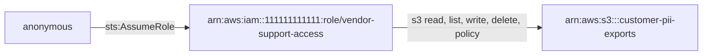

1. `anonymous` -[sts:AssumeRole]-> `arn:aws:iam::111111111111:role/vendor-support-access` (confidence high)
2. `arn:aws:iam::111111111111:role/vendor-support-access` -[s3 read, list, write, delete, policy]-> `arn:aws:s3:::customer-pii-exports` (confidence high)

<details><summary>Score breakdown</summary>

| Factor | Value | Weight | Rationale |
|---|---:|---:|---|
| permission_breadth | 1.00 | 20 | access classes: delete, list, policy, read, write |
| escalation_potential | 0.30 | 25 | data access through intermediate identities |
| resource_sensitivity | 1.00 | 20 | bucket sensitivity declared as high |
| trust_boundary | 1.00 | 15 | path starts outside any account |
| exposure | 1.00 | 10 | reachable by any AWS principal or anonymously |
| reachability | 0.80 | 10 | 2 hop(s) |

base 80.5 x evidence/confidence 0.90 x preconditions 1.00 = 72.5

</details>

**Remediation.** Break the path at its weakest hop; the first hop is usually the cheapest to fix.

1. Narrow the trust policy of role vendor-support-access so it no longer admits any AWS principal / anonymous, or remove any AWS principal / anonymous's sts:AssumeRole permission on it.
2. Scope role vendor-support-access's S3 permissions (and the bucket policy of bucket customer-pii-exports) to the required prefix and actions.

Assumptions:

- The suggested policy is a template: replace placeholder ARNs with the resources the workflow genuinely needs.
- Validate the policy with IAM Access Analyzer policy checks and the policy simulator before deploying it; test in a non-production account first.
- Legitimate functionality that depends on the removed permissions must be identified from usage data before the change is applied.

Verification:

- Re-run the analyzer on a fresh snapshot and confirm that no PATH-SENSITIVE finding remains for any AWS principal / anonymous -&gt; bucket customer-pii-exports.
- Simulate the permission with the IAM policy simulator (read-only): aws iam simulate-principal-policy --policy-source-arn &lt;caller-arn&gt; --action-names sts:AssumeRole --resource-arns arn:aws:iam::111111111111:role/vendor-support-access ; expect implicitDeny or explicitDeny.
- Confirm the trust policy: aws iam get-role --role-name vendor-support-access --query Role.AssumeRolePolicyDocument

References:

- <https://docs.aws.amazon.com/IAM/latest/UserGuide/reference_policies_evaluation-logic.html>
- <https://docs.aws.amazon.com/IAM/latest/UserGuide/tutorial_cross-account-with-roles.html>
- <https://docs.aws.amazon.com/IAM/latest/UserGuide/best-practices.html#grant-least-privilege>

#### Any AWS principal / anonymous can reach bucket legacy-backups in 2 step(s)

| Field | Value |
|---|---|
| ID | `APA-PATH-SENSITIVE-e0ef900d` |
| Check | `PATH-SENSITIVE` |
| Category | attack-path |
| Severity | HIGH (score 72.5) |
| Confidence | high |
| Evidence kind | inferred |
| Resource | `arn:aws:s3:::legacy-backups` |
| Tags | reachability, multi-hop |

**Description.** any AWS principal / anonymous can reach bucket legacy-backups in 2 step(s): anonymous:any AWS principal / anonymous --[sts:AssumeRole]--&gt; role:vendor-support-access --[s3 read, list, write, delete, policy]--&gt; s3-bucket:legacy-backups. Weakest evidence along the path: inferred; confidence: high.

**Impact.** A compromise of the starting identity extends to the sensitive data at the end of the path, even though it has no direct permission on it.

**Evidence**

- `trust:arn:aws:iam::111111111111:role/vendor-support-access`: trust:arn:aws:iam::111111111111:role/vendor-support-access statement[0] (Allow) applies
- `managed:arn:aws:iam::aws:policy/AmazonS3FullAccess`: managed:arn:aws:iam::aws:policy/AmazonS3FullAccess statement[0] (Allow) applies
- `bucket-policy:arn:aws:s3:::legacy-backups`: bucket-policy:arn:aws:s3:::legacy-backups statement[0] Sid=PublicRead (Allow) applies

**Path**

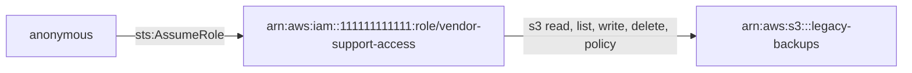

1. `anonymous` -[sts:AssumeRole]-> `arn:aws:iam::111111111111:role/vendor-support-access` (confidence high)
2. `arn:aws:iam::111111111111:role/vendor-support-access` -[s3 read, list, write, delete, policy]-> `arn:aws:s3:::legacy-backups` (confidence high)

<details><summary>Score breakdown</summary>

| Factor | Value | Weight | Rationale |
|---|---:|---:|---|
| permission_breadth | 1.00 | 20 | access classes: delete, list, policy, read, write |
| escalation_potential | 0.30 | 25 | data access through intermediate identities |
| resource_sensitivity | 1.00 | 20 | bucket sensitivity declared as high |
| trust_boundary | 1.00 | 15 | path starts outside any account |
| exposure | 1.00 | 10 | reachable by any AWS principal or anonymously |
| reachability | 0.80 | 10 | 2 hop(s) |

base 80.5 x evidence/confidence 0.90 x preconditions 1.00 = 72.5

</details>

**Remediation.** Break the path at its weakest hop; the first hop is usually the cheapest to fix.

1. Narrow the trust policy of role vendor-support-access so it no longer admits any AWS principal / anonymous, or remove any AWS principal / anonymous's sts:AssumeRole permission on it.
2. Scope role vendor-support-access's S3 permissions (and the bucket policy of bucket legacy-backups) to the required prefix and actions.

Assumptions:

- The suggested policy is a template: replace placeholder ARNs with the resources the workflow genuinely needs.
- Validate the policy with IAM Access Analyzer policy checks and the policy simulator before deploying it; test in a non-production account first.
- Legitimate functionality that depends on the removed permissions must be identified from usage data before the change is applied.

Verification:

- Re-run the analyzer on a fresh snapshot and confirm that no PATH-SENSITIVE finding remains for any AWS principal / anonymous -&gt; bucket legacy-backups.
- Simulate the permission with the IAM policy simulator (read-only): aws iam simulate-principal-policy --policy-source-arn &lt;caller-arn&gt; --action-names sts:AssumeRole --resource-arns arn:aws:iam::111111111111:role/vendor-support-access ; expect implicitDeny or explicitDeny.
- Confirm the trust policy: aws iam get-role --role-name vendor-support-access --query Role.AssumeRolePolicyDocument

References:

- <https://docs.aws.amazon.com/IAM/latest/UserGuide/reference_policies_evaluation-logic.html>
- <https://docs.aws.amazon.com/IAM/latest/UserGuide/tutorial_cross-account-with-roles.html>
- <https://docs.aws.amazon.com/IAM/latest/UserGuide/best-practices.html#grant-least-privilege>

#### Bucket legacy-backups is publicly accessible through its bucket policy

| Field | Value |
|---|---|
| ID | `APA-S3-PUBLIC-POLICY-2e4efc8c` |
| Check | `S3-PUBLIC-POLICY` |
| Category | resource-exposure |
| Severity | HIGH (score 69.5) |
| Confidence | high |
| Evidence kind | observed |
| Resource | `arn:aws:s3:::legacy-backups` |
| Tags | public-access |

**Description.** The bucket policy of legacy-backups grants read to Principal "*". No Block Public Access configuration is recorded for the bucket. Declared sensitivity: high.

**Impact.** Anyone on the internet can perform the granted S3 operations on the bucket without credentials.

**Evidence**

- `bucket-policy:arn:aws:s3:::legacy-backups`: bucket-policy:arn:aws:s3:::legacy-backups statement[0] Sid=PublicRead (Allow) applies

<details><summary>Score breakdown</summary>

| Factor | Value | Weight | Rationale |
|---|---:|---:|---|
| permission_breadth | 0.60 | 20 | read-only access: read |
| escalation_potential | 0.10 | 25 | data access only |
| resource_sensitivity | 1.00 | 20 | bucket sensitivity declared as high |
| trust_boundary | 1.00 | 15 | anonymous access |
| exposure | 1.00 | 10 | no Block Public Access setting prevents the public statement |
| reachability | 1.00 | 10 | direct |

base 69.5 x evidence/confidence 1.00 x preconditions 1.00 = 69.5

</details>

**Remediation.** Enable all four Block Public Access settings and remove the Principal "*" statement; serve genuinely public content through CloudFront with origin access control.

1. Confirm whether any consumer legitimately relies on anonymous access (S3 server access logs or CloudTrail data events).
2. Enable BlockPublicAcls, IgnorePublicAcls, BlockPublicPolicy and RestrictPublicBuckets on the bucket (and at the account level).
3. Replace the anonymous statement with grants to specific principals, or front the bucket with CloudFront using origin access control.

Suggested policy (template, validate before use):

```json
{
  "PublicAccessBlockConfiguration": {
    "BlockPublicAcls": true,
    "IgnorePublicAcls": true,
    "BlockPublicPolicy": true,
    "RestrictPublicBuckets": true
  }
}
```

Assumptions:

- The suggested policy is a template: replace placeholder ARNs with the resources the workflow genuinely needs.
- Validate the policy with IAM Access Analyzer policy checks and the policy simulator before deploying it; test in a non-production account first.
- Legitimate functionality that depends on the removed permissions must be identified from usage data before the change is applied.
- Enabling Block Public Access immediately stops any anonymous consumer; coordinate the change with the content owners.

Verification:

- Confirm the bucket is not public: aws s3api get-bucket-policy-status --bucket legacy-backups (expect IsPublic=false) and aws s3api get-public-access-block --bucket legacy-backups (expect all four settings true).
- If IAM Access Analyzer is enabled, confirm that no external-access finding remains for the resource (aws accessanalyzer list-findings).
- Re-run the analyzer on a fresh snapshot and confirm that no S3-PUBLIC-POLICY finding remains for bucket legacy-backups.

References:

- <https://docs.aws.amazon.com/AmazonS3/latest/userguide/access-control-block-public-access.html>
- <https://docs.aws.amazon.com/AmazonS3/latest/userguide/bucket-policies.html>

#### Role vendor-support-access can delete/list/policy/read/write sensitive bucket finance-reports

| Field | Value |
|---|---|
| ID | `APA-SENSITIVE-ACCESS-222cc867` |
| Check | `SENSITIVE-ACCESS` |
| Category | sensitive-data-access |
| Severity | HIGH (score 66.5) |
| Confidence | high |
| Evidence kind | observed |
| Principal | `arn:aws:iam::111111111111:role/vendor-support-access` |
| Resource | `arn:aws:s3:::finance-reports` |
| Tags | sensitive-data, write-access |

**Description.** Role vendor-support-access can perform delete, list, policy, read, write operations on finance-reports (declared sensitivity: medium).

**Impact.** If this identity's credentials or code are compromised, the sensitive data in the bucket is readable, modifiable or deletable without any further step.

**Evidence**

- `managed:arn:aws:iam::aws:policy/AmazonS3FullAccess`: managed:arn:aws:iam::aws:policy/AmazonS3FullAccess statement[0] (Allow) applies

<details><summary>Score breakdown</summary>

| Factor | Value | Weight | Rationale |
|---|---:|---:|---|
| permission_breadth | 1.00 | 20 | access classes: delete, list, policy, read, write |
| escalation_potential | 0.70 | 25 | bucket policy control |
| resource_sensitivity | 0.60 | 20 | bucket sensitivity declared as medium |
| trust_boundary | 0.00 | 15 | same account |
| exposure | 0.70 | 10 | role; trusted by principals outside the account |
| reachability | 1.00 | 10 | direct permission |

base 66.5 x evidence/confidence 1.00 x preconditions 1.00 = 66.5

</details>

**Remediation.** Grant the principal only the actions and object prefixes its workflow needs on this bucket, and deny the rest explicitly.

1. Inventory the actions role vendor-support-access actually uses (CloudTrail, IAM Access Analyzer policy generation, or IAM last-accessed information).
2. Replace the broad statement with explicit actions scoped to the specific resource ARNs the workflow needs; keep separate statements per service.
3. Add a permissions boundary to the principal if its policies are managed by delegated administrators.
4. Roll the change out through infrastructure-as-code and review it before deployment.
5. For workload roles, scope S3 access to the exact bucket and prefix the handler reads or writes.
6. Consider a bucket policy that denies access from principals other than an allow-list (aws:PrincipalArn) for high-sensitivity data.

Suggested policy (template, validate before use):

```json
{
  "Version": "2012-10-17",
  "Statement": [
    {
      "Effect": "Allow",
      "Action": [
        "s3:GetObject"
      ],
      "Resource": "arn:aws:s3:::<needed-bucket>/<needed-prefix>/*"
    },
    {
      "Effect": "Allow",
      "Action": [
        "s3:ListBucket"
      ],
      "Resource": "arn:aws:s3:::<needed-bucket>",
      "Condition": {
        "StringLike": {
          "s3:prefix": [
            "<needed-prefix>/*"
          ]
        }
      }
    }
  ]
}
```

Assumptions:

- The suggested policy is a template: replace placeholder ARNs with the resources the workflow genuinely needs.
- Validate the policy with IAM Access Analyzer policy checks and the policy simulator before deploying it; test in a non-production account first.
- Legitimate functionality that depends on the removed permissions must be identified from usage data before the change is applied.
- Replace s3:GetObject with the write actions if the workflow writes, and remove ListBucket if listing is not required.

Verification:

- Simulate the permission with the IAM policy simulator (read-only): aws iam simulate-principal-policy --policy-source-arn arn:aws:iam::111111111111:role/vendor-support-access --action-names s3:GetObject s3:PutObject --resource-arns arn:aws:s3:::finance-reports/* ; expect implicitDeny or explicitDeny.
- Re-run the analyzer on a fresh snapshot and confirm that no SENSITIVE-ACCESS finding remains for role vendor-support-access on bucket finance-reports.

References:

- <https://docs.aws.amazon.com/IAM/latest/UserGuide/best-practices.html#grant-least-privilege>
- <https://docs.aws.amazon.com/AmazonS3/latest/userguide/bucket-policies.html>

#### Role vendor-support-access can delete/list/policy/read/write sensitive bucket archive-with-restricted-policy

| Field | Value |
|---|---|
| ID | `APA-SENSITIVE-ACCESS-451bc78a` |
| Check | `SENSITIVE-ACCESS` |
| Category | sensitive-data-access |
| Severity | HIGH (score 66.5) |
| Confidence | high |
| Evidence kind | observed |
| Principal | `arn:aws:iam::111111111111:role/vendor-support-access` |
| Resource | `arn:aws:s3:::archive-with-restricted-policy` |
| Tags | sensitive-data, write-access |

**Description.** Role vendor-support-access can perform delete, list, policy, read, write operations on archive-with-restricted-policy (declared sensitivity: medium).

**Impact.** If this identity's credentials or code are compromised, the sensitive data in the bucket is readable, modifiable or deletable without any further step.

**Evidence**

- `managed:arn:aws:iam::aws:policy/AmazonS3FullAccess`: managed:arn:aws:iam::aws:policy/AmazonS3FullAccess statement[0] (Allow) applies
- `bucket-policy:arn:aws:s3:::archive-with-restricted-policy`: bucket-policy:arn:aws:s3:::archive-with-restricted-policy statement[0] Sid=LegacyPublicRead (Allow) applies

<details><summary>Score breakdown</summary>

| Factor | Value | Weight | Rationale |
|---|---:|---:|---|
| permission_breadth | 1.00 | 20 | access classes: delete, list, policy, read, write |
| escalation_potential | 0.70 | 25 | bucket policy control |
| resource_sensitivity | 0.60 | 20 | bucket sensitivity declared as medium |
| trust_boundary | 0.00 | 15 | same account |
| exposure | 0.70 | 10 | role; trusted by principals outside the account |
| reachability | 1.00 | 10 | direct permission |

base 66.5 x evidence/confidence 1.00 x preconditions 1.00 = 66.5

</details>

**Remediation.** Grant the principal only the actions and object prefixes its workflow needs on this bucket, and deny the rest explicitly.

1. Inventory the actions role vendor-support-access actually uses (CloudTrail, IAM Access Analyzer policy generation, or IAM last-accessed information).
2. Replace the broad statement with explicit actions scoped to the specific resource ARNs the workflow needs; keep separate statements per service.
3. Add a permissions boundary to the principal if its policies are managed by delegated administrators.
4. Roll the change out through infrastructure-as-code and review it before deployment.
5. For workload roles, scope S3 access to the exact bucket and prefix the handler reads or writes.
6. Consider a bucket policy that denies access from principals other than an allow-list (aws:PrincipalArn) for high-sensitivity data.

Suggested policy (template, validate before use):

```json
{
  "Version": "2012-10-17",
  "Statement": [
    {
      "Effect": "Allow",
      "Action": [
        "s3:GetObject"
      ],
      "Resource": "arn:aws:s3:::<needed-bucket>/<needed-prefix>/*"
    },
    {
      "Effect": "Allow",
      "Action": [
        "s3:ListBucket"
      ],
      "Resource": "arn:aws:s3:::<needed-bucket>",
      "Condition": {
        "StringLike": {
          "s3:prefix": [
            "<needed-prefix>/*"
          ]
        }
      }
    }
  ]
}
```

Assumptions:

- The suggested policy is a template: replace placeholder ARNs with the resources the workflow genuinely needs.
- Validate the policy with IAM Access Analyzer policy checks and the policy simulator before deploying it; test in a non-production account first.
- Legitimate functionality that depends on the removed permissions must be identified from usage data before the change is applied.
- Replace s3:GetObject with the write actions if the workflow writes, and remove ListBucket if listing is not required.

Verification:

- Simulate the permission with the IAM policy simulator (read-only): aws iam simulate-principal-policy --policy-source-arn arn:aws:iam::111111111111:role/vendor-support-access --action-names s3:GetObject s3:PutObject --resource-arns arn:aws:s3:::archive-with-restricted-policy/* ; expect implicitDeny or explicitDeny.
- Re-run the analyzer on a fresh snapshot and confirm that no SENSITIVE-ACCESS finding remains for role vendor-support-access on bucket archive-with-restricted-policy.

References:

- <https://docs.aws.amazon.com/IAM/latest/UserGuide/best-practices.html#grant-least-privilege>
- <https://docs.aws.amazon.com/AmazonS3/latest/userguide/bucket-policies.html>

#### Any AWS principal / anonymous can reach bucket archive-with-restricted-policy in 2 step(s)

| Field | Value |
|---|---|
| ID | `APA-PATH-SENSITIVE-ae7c4f7f` |
| Check | `PATH-SENSITIVE` |
| Category | attack-path |
| Severity | HIGH (score 65.2) |
| Confidence | high |
| Evidence kind | inferred |
| Resource | `arn:aws:s3:::archive-with-restricted-policy` |
| Tags | reachability, multi-hop |

**Description.** any AWS principal / anonymous can reach bucket archive-with-restricted-policy in 2 step(s): anonymous:any AWS principal / anonymous --[sts:AssumeRole]--&gt; role:vendor-support-access --[s3 read, list, write, delete, policy]--&gt; s3-bucket:archive-with-restricted-policy. Weakest evidence along the path: inferred; confidence: high.

**Impact.** A compromise of the starting identity extends to the sensitive data at the end of the path, even though it has no direct permission on it.

**Evidence**

- `trust:arn:aws:iam::111111111111:role/vendor-support-access`: trust:arn:aws:iam::111111111111:role/vendor-support-access statement[0] (Allow) applies
- `managed:arn:aws:iam::aws:policy/AmazonS3FullAccess`: managed:arn:aws:iam::aws:policy/AmazonS3FullAccess statement[0] (Allow) applies
- `bucket-policy:arn:aws:s3:::archive-with-restricted-policy`: bucket-policy:arn:aws:s3:::archive-with-restricted-policy statement[0] Sid=LegacyPublicRead (Allow) applies

**Path**

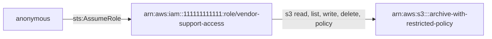

1. `anonymous` -[sts:AssumeRole]-> `arn:aws:iam::111111111111:role/vendor-support-access` (confidence high)
2. `arn:aws:iam::111111111111:role/vendor-support-access` -[s3 read, list, write, delete, policy]-> `arn:aws:s3:::archive-with-restricted-policy` (confidence high)

<details><summary>Score breakdown</summary>

| Factor | Value | Weight | Rationale |
|---|---:|---:|---|
| permission_breadth | 1.00 | 20 | access classes: delete, list, policy, read, write |
| escalation_potential | 0.30 | 25 | data access through intermediate identities |
| resource_sensitivity | 0.60 | 20 | bucket sensitivity declared as medium |
| trust_boundary | 1.00 | 15 | path starts outside any account |
| exposure | 1.00 | 10 | reachable by any AWS principal or anonymously |
| reachability | 0.80 | 10 | 2 hop(s) |

base 72.5 x evidence/confidence 0.90 x preconditions 1.00 = 65.2

</details>

**Remediation.** Break the path at its weakest hop; the first hop is usually the cheapest to fix.

1. Narrow the trust policy of role vendor-support-access so it no longer admits any AWS principal / anonymous, or remove any AWS principal / anonymous's sts:AssumeRole permission on it.
2. Scope role vendor-support-access's S3 permissions (and the bucket policy of bucket archive-with-restricted-policy) to the required prefix and actions.

Assumptions:

- The suggested policy is a template: replace placeholder ARNs with the resources the workflow genuinely needs.
- Validate the policy with IAM Access Analyzer policy checks and the policy simulator before deploying it; test in a non-production account first.
- Legitimate functionality that depends on the removed permissions must be identified from usage data before the change is applied.

Verification:

- Re-run the analyzer on a fresh snapshot and confirm that no PATH-SENSITIVE finding remains for any AWS principal / anonymous -&gt; bucket archive-with-restricted-policy.
- Simulate the permission with the IAM policy simulator (read-only): aws iam simulate-principal-policy --policy-source-arn &lt;caller-arn&gt; --action-names sts:AssumeRole --resource-arns arn:aws:iam::111111111111:role/vendor-support-access ; expect implicitDeny or explicitDeny.
- Confirm the trust policy: aws iam get-role --role-name vendor-support-access --query Role.AssumeRolePolicyDocument

References:

- <https://docs.aws.amazon.com/IAM/latest/UserGuide/reference_policies_evaluation-logic.html>
- <https://docs.aws.amazon.com/IAM/latest/UserGuide/tutorial_cross-account-with-roles.html>
- <https://docs.aws.amazon.com/IAM/latest/UserGuide/best-practices.html#grant-least-privilege>

#### Any AWS principal / anonymous can reach bucket finance-reports in 2 step(s)

| Field | Value |
|---|---|
| ID | `APA-PATH-SENSITIVE-faca7095` |
| Check | `PATH-SENSITIVE` |
| Category | attack-path |
| Severity | HIGH (score 65.2) |
| Confidence | high |
| Evidence kind | inferred |
| Resource | `arn:aws:s3:::finance-reports` |
| Tags | reachability, multi-hop |

**Description.** any AWS principal / anonymous can reach bucket finance-reports in 2 step(s): anonymous:any AWS principal / anonymous --[sts:AssumeRole]--&gt; role:vendor-support-access --[s3 read, list, write, delete, policy]--&gt; s3-bucket:finance-reports. Weakest evidence along the path: inferred; confidence: high.

**Impact.** A compromise of the starting identity extends to the sensitive data at the end of the path, even though it has no direct permission on it.

**Evidence**

- `trust:arn:aws:iam::111111111111:role/vendor-support-access`: trust:arn:aws:iam::111111111111:role/vendor-support-access statement[0] (Allow) applies
- `managed:arn:aws:iam::aws:policy/AmazonS3FullAccess`: managed:arn:aws:iam::aws:policy/AmazonS3FullAccess statement[0] (Allow) applies

**Path**

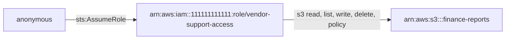

1. `anonymous` -[sts:AssumeRole]-> `arn:aws:iam::111111111111:role/vendor-support-access` (confidence high)
2. `arn:aws:iam::111111111111:role/vendor-support-access` -[s3 read, list, write, delete, policy]-> `arn:aws:s3:::finance-reports` (confidence high)

<details><summary>Score breakdown</summary>

| Factor | Value | Weight | Rationale |
|---|---:|---:|---|
| permission_breadth | 1.00 | 20 | access classes: delete, list, policy, read, write |
| escalation_potential | 0.30 | 25 | data access through intermediate identities |
| resource_sensitivity | 0.60 | 20 | bucket sensitivity declared as medium |
| trust_boundary | 1.00 | 15 | path starts outside any account |
| exposure | 1.00 | 10 | reachable by any AWS principal or anonymously |
| reachability | 0.80 | 10 | 2 hop(s) |

base 72.5 x evidence/confidence 0.90 x preconditions 1.00 = 65.2

</details>

**Remediation.** Break the path at its weakest hop; the first hop is usually the cheapest to fix.

1. Narrow the trust policy of role vendor-support-access so it no longer admits any AWS principal / anonymous, or remove any AWS principal / anonymous's sts:AssumeRole permission on it.
2. Scope role vendor-support-access's S3 permissions (and the bucket policy of bucket finance-reports) to the required prefix and actions.

Assumptions:

- The suggested policy is a template: replace placeholder ARNs with the resources the workflow genuinely needs.
- Validate the policy with IAM Access Analyzer policy checks and the policy simulator before deploying it; test in a non-production account first.
- Legitimate functionality that depends on the removed permissions must be identified from usage data before the change is applied.

Verification:

- Re-run the analyzer on a fresh snapshot and confirm that no PATH-SENSITIVE finding remains for any AWS principal / anonymous -&gt; bucket finance-reports.
- Simulate the permission with the IAM policy simulator (read-only): aws iam simulate-principal-policy --policy-source-arn &lt;caller-arn&gt; --action-names sts:AssumeRole --resource-arns arn:aws:iam::111111111111:role/vendor-support-access ; expect implicitDeny or explicitDeny.
- Confirm the trust policy: aws iam get-role --role-name vendor-support-access --query Role.AssumeRolePolicyDocument

References:

- <https://docs.aws.amazon.com/IAM/latest/UserGuide/reference_policies_evaluation-logic.html>
- <https://docs.aws.amazon.com/IAM/latest/UserGuide/tutorial_cross-account-with-roles.html>
- <https://docs.aws.amazon.com/IAM/latest/UserGuide/best-practices.html#grant-least-privilege>

#### Workload role lambda-image-resizer can delete/list/policy/read/write sensitive bucket finance-reports

| Field | Value |
|---|---|
| ID | `APA-SENSITIVE-ACCESS-3a387c3b` |
| Check | `SENSITIVE-ACCESS` |
| Category | sensitive-data-access |
| Severity | HIGH (score 64.5) |
| Confidence | high |
| Evidence kind | observed |
| Principal | `arn:aws:iam::111111111111:role/lambda-image-resizer` |
| Resource | `arn:aws:s3:::finance-reports` |
| Tags | sensitive-data, workload, write-access |

**Description.** Workload role lambda-image-resizer can perform delete, list, policy, read, write operations on finance-reports (declared sensitivity: medium). The role is assumed by AWS services (lambda.amazonaws.com) and used by functions image-resizer, public-webhook; its permissions are only as safe as the code that runs under it.

**Impact.** If this identity's credentials or code are compromised, the sensitive data in the bucket is readable, modifiable or deletable without any further step.

**Evidence**

- `managed:arn:aws:iam::aws:policy/AmazonS3FullAccess`: managed:arn:aws:iam::aws:policy/AmazonS3FullAccess statement[0] (Allow) applies

<details><summary>Score breakdown</summary>

| Factor | Value | Weight | Rationale |
|---|---:|---:|---|
| permission_breadth | 1.00 | 20 | access classes: delete, list, policy, read, write |
| escalation_potential | 0.70 | 25 | bucket policy control |
| resource_sensitivity | 0.60 | 20 | bucket sensitivity declared as medium |
| trust_boundary | 0.00 | 15 | same account |
| exposure | 0.50 | 10 | role; workload execution role |
| reachability | 1.00 | 10 | direct permission |

base 64.5 x evidence/confidence 1.00 x preconditions 1.00 = 64.5

</details>

**Remediation.** Grant the principal only the actions and object prefixes its workflow needs on this bucket, and deny the rest explicitly.

1. Inventory the actions role lambda-image-resizer actually uses (CloudTrail, IAM Access Analyzer policy generation, or IAM last-accessed information).
2. Replace the broad statement with explicit actions scoped to the specific resource ARNs the workflow needs; keep separate statements per service.
3. Add a permissions boundary to the principal if its policies are managed by delegated administrators.
4. Roll the change out through infrastructure-as-code and review it before deployment.
5. For workload roles, scope S3 access to the exact bucket and prefix the handler reads or writes.
6. Consider a bucket policy that denies access from principals other than an allow-list (aws:PrincipalArn) for high-sensitivity data.

Suggested policy (template, validate before use):

```json
{
  "Version": "2012-10-17",
  "Statement": [
    {
      "Effect": "Allow",
      "Action": [
        "s3:GetObject"
      ],
      "Resource": "arn:aws:s3:::<needed-bucket>/<needed-prefix>/*"
    },
    {
      "Effect": "Allow",
      "Action": [
        "s3:ListBucket"
      ],
      "Resource": "arn:aws:s3:::<needed-bucket>",
      "Condition": {
        "StringLike": {
          "s3:prefix": [
            "<needed-prefix>/*"
          ]
        }
      }
    }
  ]
}
```

Assumptions:

- The suggested policy is a template: replace placeholder ARNs with the resources the workflow genuinely needs.
- Validate the policy with IAM Access Analyzer policy checks and the policy simulator before deploying it; test in a non-production account first.
- Legitimate functionality that depends on the removed permissions must be identified from usage data before the change is applied.
- Replace s3:GetObject with the write actions if the workflow writes, and remove ListBucket if listing is not required.

Verification:

- Simulate the permission with the IAM policy simulator (read-only): aws iam simulate-principal-policy --policy-source-arn arn:aws:iam::111111111111:role/lambda-image-resizer --action-names s3:GetObject s3:PutObject --resource-arns arn:aws:s3:::finance-reports/* ; expect implicitDeny or explicitDeny.
- Re-run the analyzer on a fresh snapshot and confirm that no SENSITIVE-ACCESS finding remains for role lambda-image-resizer on bucket finance-reports.

References:

- <https://docs.aws.amazon.com/IAM/latest/UserGuide/best-practices.html#grant-least-privilege>
- <https://docs.aws.amazon.com/AmazonS3/latest/userguide/bucket-policies.html>
- <https://docs.aws.amazon.com/lambda/latest/dg/lambda-intro-execution-role.html>

#### Workload role lambda-image-resizer can delete/list/policy/read/write sensitive bucket archive-with-restricted-policy

| Field | Value |
|---|---|
| ID | `APA-SENSITIVE-ACCESS-56cccbb6` |
| Check | `SENSITIVE-ACCESS` |
| Category | sensitive-data-access |
| Severity | HIGH (score 64.5) |
| Confidence | high |
| Evidence kind | observed |
| Principal | `arn:aws:iam::111111111111:role/lambda-image-resizer` |
| Resource | `arn:aws:s3:::archive-with-restricted-policy` |
| Tags | sensitive-data, workload, write-access |

**Description.** Workload role lambda-image-resizer can perform delete, list, policy, read, write operations on archive-with-restricted-policy (declared sensitivity: medium). The role is assumed by AWS services (lambda.amazonaws.com) and used by functions image-resizer, public-webhook; its permissions are only as safe as the code that runs under it.

**Impact.** If this identity's credentials or code are compromised, the sensitive data in the bucket is readable, modifiable or deletable without any further step.

**Evidence**

- `managed:arn:aws:iam::aws:policy/AmazonS3FullAccess`: managed:arn:aws:iam::aws:policy/AmazonS3FullAccess statement[0] (Allow) applies
- `bucket-policy:arn:aws:s3:::archive-with-restricted-policy`: bucket-policy:arn:aws:s3:::archive-with-restricted-policy statement[0] Sid=LegacyPublicRead (Allow) applies

<details><summary>Score breakdown</summary>

| Factor | Value | Weight | Rationale |
|---|---:|---:|---|
| permission_breadth | 1.00 | 20 | access classes: delete, list, policy, read, write |
| escalation_potential | 0.70 | 25 | bucket policy control |
| resource_sensitivity | 0.60 | 20 | bucket sensitivity declared as medium |
| trust_boundary | 0.00 | 15 | same account |
| exposure | 0.50 | 10 | role; workload execution role |
| reachability | 1.00 | 10 | direct permission |

base 64.5 x evidence/confidence 1.00 x preconditions 1.00 = 64.5

</details>

**Remediation.** Grant the principal only the actions and object prefixes its workflow needs on this bucket, and deny the rest explicitly.

1. Inventory the actions role lambda-image-resizer actually uses (CloudTrail, IAM Access Analyzer policy generation, or IAM last-accessed information).
2. Replace the broad statement with explicit actions scoped to the specific resource ARNs the workflow needs; keep separate statements per service.
3. Add a permissions boundary to the principal if its policies are managed by delegated administrators.
4. Roll the change out through infrastructure-as-code and review it before deployment.
5. For workload roles, scope S3 access to the exact bucket and prefix the handler reads or writes.
6. Consider a bucket policy that denies access from principals other than an allow-list (aws:PrincipalArn) for high-sensitivity data.

Suggested policy (template, validate before use):

```json
{
  "Version": "2012-10-17",
  "Statement": [
    {
      "Effect": "Allow",
      "Action": [
        "s3:GetObject"
      ],
      "Resource": "arn:aws:s3:::<needed-bucket>/<needed-prefix>/*"
    },
    {
      "Effect": "Allow",
      "Action": [
        "s3:ListBucket"
      ],
      "Resource": "arn:aws:s3:::<needed-bucket>",
      "Condition": {
        "StringLike": {
          "s3:prefix": [
            "<needed-prefix>/*"
          ]
        }
      }
    }
  ]
}
```

Assumptions:

- The suggested policy is a template: replace placeholder ARNs with the resources the workflow genuinely needs.
- Validate the policy with IAM Access Analyzer policy checks and the policy simulator before deploying it; test in a non-production account first.
- Legitimate functionality that depends on the removed permissions must be identified from usage data before the change is applied.
- Replace s3:GetObject with the write actions if the workflow writes, and remove ListBucket if listing is not required.

Verification:

- Simulate the permission with the IAM policy simulator (read-only): aws iam simulate-principal-policy --policy-source-arn arn:aws:iam::111111111111:role/lambda-image-resizer --action-names s3:GetObject s3:PutObject --resource-arns arn:aws:s3:::archive-with-restricted-policy/* ; expect implicitDeny or explicitDeny.
- Re-run the analyzer on a fresh snapshot and confirm that no SENSITIVE-ACCESS finding remains for role lambda-image-resizer on bucket archive-with-restricted-policy.

References:

- <https://docs.aws.amazon.com/IAM/latest/UserGuide/best-practices.html#grant-least-privilege>
- <https://docs.aws.amazon.com/AmazonS3/latest/userguide/bucket-policies.html>
- <https://docs.aws.amazon.com/lambda/latest/dg/lambda-intro-execution-role.html>

#### Instance legacy-jump allows IMDSv1 while running as role ec2-jump-host-legacy

| Field | Value |
|---|---|
| ID | `APA-EC2-IMDSV1-6e61c2c0` |
| Check | `EC2-IMDSV1` |
| Category | network-exposure |
| Severity | HIGH (score 63.0) |
| Confidence | high |
| Evidence kind | observed |
| Principal | `arn:aws:iam::111111111111:role/ec2-jump-host-legacy` |
| Resource | `arn:aws:ec2:us-east-1:111111111111:instance/i-0jump00000000000b` |
| Tags | network, imds, credential-exposure |

**Description.** i-0jump00000000000b does not require session tokens for the instance metadata service (HttpTokens is optional), and it holds the credentials of role ec2-jump-host-legacy. A single unauthenticated GET to 169.254.169.254 from the instance returns those credentials; IMDSv2 requires a PUT-obtained token with a hop limit, which blocks the common SSRF and misconfigured-proxy cases. The instance is also reachable from the internet.

**Impact.** Any request-forgery or local-file-read flaw in software on the instance becomes a direct path to its IAM role credentials.

**Evidence**

- `ec2:arn:aws:ec2:us-east-1:111111111111:instance/i-0jump00000000000b`: MetadataOptions.HttpTokens is optional; instance profile provides arn:aws:iam::111111111111:role/ec2-jump-host-legacy

<details><summary>Score breakdown</summary>

| Factor | Value | Weight | Rationale |
|---|---:|---:|---|
| permission_breadth | 0.70 | 20 | reach of the instance role: can access sensitive buckets: customer-pii-exports |
| escalation_potential | 0.60 | 25 | role credentials retrievable by any SSRF or local request without a session token |
| resource_sensitivity | 1.00 | 20 | bucket sensitivity declared as high |
| trust_boundary | 0.00 | 15 | the metadata service is reachable only from the instance |
| exposure | 0.80 | 10 | instance reachable from the internet |
| reachability | 0.60 | 10 | requires a request-forgery or local-access flaw |

base 63.0 x evidence/confidence 1.00 x preconditions 1.00 = 63.0

</details>

**Remediation.** Require IMDSv2 on the instance (HttpTokens=required) and enforce it for new launches.

1. aws ec2 modify-instance-metadata-options --instance-id i-0jump00000000000b --http-tokens required --http-endpoint enabled
2. Set MetadataOptions.HttpTokens=required in launch templates, and enable the account-level default (ec2 modify-instance-metadata-defaults).
3. Confirm agents and SDKs on the instance support IMDSv2 before enforcing (modern AWS SDKs and the SSM agent do).

Assumptions:

- The suggested policy is a template: replace placeholder ARNs with the resources the workflow genuinely needs.
- Validate the policy with IAM Access Analyzer policy checks and the policy simulator before deploying it; test in a non-production account first.
- Legitimate functionality that depends on the removed permissions must be identified from usage data before the change is applied.
- Software that still uses IMDSv1 calls loses credential access once tokens are required.

Verification:

- aws ec2 describe-instances --instance-ids i-0jump00000000000b --query 'Reservations[].Instances[].MetadataOptions' (expect HttpTokens=required)
- Re-run the analyzer on a fresh snapshot and confirm that no EC2-IMDSV1 finding remains for instance legacy-jump.

References:

- <https://docs.aws.amazon.com/AWSEC2/latest/UserGuide/configuring-instance-metadata-service.html>
- <https://docs.aws.amazon.com/AWSEC2/latest/UserGuide/iam-roles-for-amazon-ec2.html>

#### Instance web-1 is reachable from the internet on tcp 22, tcp 80, tcp 443; management ports open: 22 (SSH)

| Field | Value |
|---|---|
| ID | `APA-EC2-PUBLIC-EXPOSURE-19b2357f` |
| Check | `EC2-PUBLIC-EXPOSURE` |
| Category | network-exposure |
| Severity | HIGH (score 62.2) |
| Confidence | high |
| Evidence kind | observed |
| Resource | `arn:aws:ec2:us-east-1:111111111111:instance/i-0web000000000000a` |
| Tags | network, public-access, management-port |

**Description.** i-0web000000000000a has public address 203.0.113.10 and security group(s) sg-0web0000000000001 allow inbound tcp 22, tcp 80, tcp 443 from any address. It runs as role ec2-web-instance (reach of the instance role: estimated permission breadth 0.11). IMDSv1 is still allowed, so a server-side request forgery or local file read is enough to retrieve the role credentials.

**Impact.** Exposed management or database ports can be brute-forced or exploited directly, and any compromise of the instance yields its role credentials from the metadata service.

**Evidence**

- `security-group:sg-0web0000000000001`: ingress tcp 80 from 0.0.0.0/0, ::/0
- `security-group:sg-0web0000000000001`: ingress tcp 443 from 0.0.0.0/0, ::/0
- `security-group:sg-0web0000000000001`: ingress tcp 22 from 0.0.0.0/0
- `ec2:arn:aws:ec2:us-east-1:111111111111:instance/i-0web000000000000a`: public IP 203.0.113.10, subnet routes to an internet gateway

<details><summary>Score breakdown</summary>

| Factor | Value | Weight | Rationale |
|---|---:|---:|---|
| permission_breadth | 0.11 | 20 | reach of the instance role: estimated permission breadth 0.11 |
| escalation_potential | 0.60 | 25 | an exposed management service offers a direct foothold on the host |
| resource_sensitivity | 0.50 | 20 | the instance itself: compute and network foothold inside the VPC |
| trust_boundary | 1.00 | 15 | reachable from any internet address |
| exposure | 1.00 | 10 | management or database ports open to the internet: SSH |
| reachability | 1.00 | 10 | direct |

base 62.2 x evidence/confidence 1.00 x preconditions 1.00 = 62.2

</details>

**Remediation.** Remove the internet-wide ingress rules; reach the instance through SSM Session Manager or a VPN and keep only application ports behind a load balancer.

1. Replace 0.0.0.0/0 and ::/0 sources with the specific CIDR ranges (or a managed prefix list) that need access.
2. Use AWS Systems Manager Session Manager for shell access and delete the SSH/RDP rules.
3. Serve application ports through an Application Load Balancer or CloudFront and move the instance to a private subnet.
4. Require IMDSv2 (HttpTokens=required) and scope the instance role to what the workload needs.

Suggested policy (template, validate before use):

```json
{
  "IpPermissions": [
    {
      "IpProtocol": "tcp",
      "FromPort": 22,
      "ToPort": 22,
      "IpRanges": [
        {
          "CidrIp": "<trusted-source-cidr>",
          "Description": "replace with the range that needs access"
        }
      ]
    }
  ]
}
```

Assumptions:

- The suggested policy is a template: replace placeholder ARNs with the resources the workflow genuinely needs.
- Validate the policy with IAM Access Analyzer policy checks and the policy simulator before deploying it; test in a non-production account first.
- Legitimate functionality that depends on the removed permissions must be identified from usage data before the change is applied.
- Removing an ingress rule interrupts any client that currently connects from the internet; confirm legitimate sources from VPC flow logs first.

Verification:

- aws ec2 describe-security-groups --group-ids sg-0web0000000000001 (expect no 0.0.0.0/0 or ::/0 source)
- aws ec2 describe-instances --instance-ids i-0web000000000000a --query 'Reservations[].Instances[].[PublicIpAddress,MetadataOptions.HttpTokens]'
- Re-run the analyzer on a fresh snapshot and confirm that no EC2-PUBLIC-EXPOSURE finding remains for instance web-1.

References:

- <https://docs.aws.amazon.com/vpc/latest/userguide/security-group-rules.html>
- <https://docs.aws.amazon.com/systems-manager/latest/userguide/session-manager.html>
- <https://docs.aws.amazon.com/AWSEC2/latest/UserGuide/configuring-instance-metadata-service.html>
- <https://docs.aws.amazon.com/AWSEC2/latest/UserGuide/iam-roles-for-amazon-ec2.html>

#### Role vendor-support-access is granted s3:*, s3-object-lambda:* on *

| Field | Value |
|---|---|
| ID | `APA-WILDCARD-a54d8e30` |
| Check | `WILDCARD` |
| Category | excessive-permissions |
| Severity | HIGH (score 61.4) |
| Confidence | high |
| Evidence kind | observed |
| Principal | `arn:aws:iam::111111111111:role/vendor-support-access` |
| Tags | wildcard, service:s3, service:s3-object-lambda |

**Description.** managed:arn:aws:iam::aws:policy/AmazonS3FullAccess statement[0] allows s3:*, s3-object-lambda:* on *. Wildcard grants cover actions the workload does not need, including any that AWS adds to the service in the future.

**Impact.** Unrestricted access to data services lets the identity read, modify or delete every object of that service in the account, not only the data its workflow needs.

**Evidence**

- `managed:arn:aws:iam::aws:policy/AmazonS3FullAccess`: statement[0] grants s3:*, s3-object-lambda:* on *

<details><summary>Score breakdown</summary>

| Factor | Value | Weight | Rationale |
|---|---:|---:|---|
| permission_breadth | 0.72 | 20 | actions 0.72 x resources 1.00 |
| escalation_potential | 0.40 | 25 | services: s3, s3-object-lambda |
| resource_sensitivity | 1.00 | 20 | sensitivity of reachable data |
| trust_boundary | 0.00 | 15 | same account |
| exposure | 0.70 | 10 | role; trusted by principals outside the account |
| reachability | 1.00 | 10 | direct permission |

base 61.4 x evidence/confidence 1.00 x preconditions 1.00 = 61.4

</details>

**Remediation.** Scope the statement to the explicit actions and resource ARNs the workflow needs.

1. Inventory the actions role vendor-support-access actually uses (CloudTrail, IAM Access Analyzer policy generation, or IAM last-accessed information).
2. Replace the broad statement with explicit actions scoped to the specific resource ARNs the workflow needs; keep separate statements per service.
3. Add a permissions boundary to the principal if its policies are managed by delegated administrators.
4. Roll the change out through infrastructure-as-code and review it before deployment.

Assumptions:

- The suggested policy is a template: replace placeholder ARNs with the resources the workflow genuinely needs.
- Validate the policy with IAM Access Analyzer policy checks and the policy simulator before deploying it; test in a non-production account first.
- Legitimate functionality that depends on the removed permissions must be identified from usage data before the change is applied.

Verification:

- Simulate the permission with the IAM policy simulator (read-only): aws iam simulate-principal-policy --policy-source-arn arn:aws:iam::111111111111:role/vendor-support-access --action-names s3:* --resource-arns * ; expect implicitDeny or explicitDeny.
- Re-run the analyzer on a fresh snapshot and confirm that no WILDCARD finding remains for role vendor-support-access.

References:

- <https://docs.aws.amazon.com/IAM/latest/UserGuide/best-practices.html#grant-least-privilege>
- <https://docs.aws.amazon.com/service-authorization/latest/reference/list_awsidentityandaccessmanagementiam.html>

### MEDIUM (11)

#### Role lambda-image-resizer is granted s3:*, s3-object-lambda:* on *

| Field | Value |
|---|---|
| ID | `APA-WILDCARD-1904629d` |
| Check | `WILDCARD` |
| Category | excessive-permissions |
| Severity | MEDIUM (score 59.4) |
| Confidence | high |
| Evidence kind | observed |
| Principal | `arn:aws:iam::111111111111:role/lambda-image-resizer` |
| Tags | wildcard, service:s3, service:s3-object-lambda |

**Description.** managed:arn:aws:iam::aws:policy/AmazonS3FullAccess statement[0] allows s3:*, s3-object-lambda:* on *. Wildcard grants cover actions the workload does not need, including any that AWS adds to the service in the future.

**Impact.** Unrestricted access to data services lets the identity read, modify or delete every object of that service in the account, not only the data its workflow needs.

**Evidence**

- `managed:arn:aws:iam::aws:policy/AmazonS3FullAccess`: statement[0] grants s3:*, s3-object-lambda:* on *

<details><summary>Score breakdown</summary>

| Factor | Value | Weight | Rationale |
|---|---:|---:|---|
| permission_breadth | 0.72 | 20 | actions 0.72 x resources 1.00 |
| escalation_potential | 0.40 | 25 | services: s3, s3-object-lambda |
| resource_sensitivity | 1.00 | 20 | sensitivity of reachable data |
| trust_boundary | 0.00 | 15 | same account |
| exposure | 0.50 | 10 | role; workload execution role |
| reachability | 1.00 | 10 | direct permission |

base 59.4 x evidence/confidence 1.00 x preconditions 1.00 = 59.4

</details>

**Remediation.** Scope the statement to the explicit actions and resource ARNs the workflow needs.

1. Inventory the actions role lambda-image-resizer actually uses (CloudTrail, IAM Access Analyzer policy generation, or IAM last-accessed information).
2. Replace the broad statement with explicit actions scoped to the specific resource ARNs the workflow needs; keep separate statements per service.
3. Add a permissions boundary to the principal if its policies are managed by delegated administrators.
4. Roll the change out through infrastructure-as-code and review it before deployment.

Assumptions:

- The suggested policy is a template: replace placeholder ARNs with the resources the workflow genuinely needs.
- Validate the policy with IAM Access Analyzer policy checks and the policy simulator before deploying it; test in a non-production account first.
- Legitimate functionality that depends on the removed permissions must be identified from usage data before the change is applied.

Verification:

- Simulate the permission with the IAM policy simulator (read-only): aws iam simulate-principal-policy --policy-source-arn arn:aws:iam::111111111111:role/lambda-image-resizer --action-names s3:* --resource-arns * ; expect implicitDeny or explicitDeny.
- Re-run the analyzer on a fresh snapshot and confirm that no WILDCARD finding remains for role lambda-image-resizer.

References:

- <https://docs.aws.amazon.com/IAM/latest/UserGuide/best-practices.html#grant-least-privilege>
- <https://docs.aws.amazon.com/service-authorization/latest/reference/list_awsidentityandaccessmanagementiam.html>

#### Role partner-integration trusts account arn:aws:iam::222222222222:root without an sts:ExternalId condition

| Field | Value |
|---|---|
| ID | `APA-TRUST-CROSS-ACCOUNT-429c0891` |
| Check | `TRUST-CROSS-ACCOUNT` |
| Category | trust-relationship |
| Severity | MEDIUM (score 56.9) |
| Confidence | high |
| Evidence kind | observed |
| Principal | `arn:aws:iam::111111111111:role/partner-integration` |
| Tags | cross-account-trust, missing-external-id |

**Description.** trust:arn:aws:iam::111111111111:role/partner-integration statement[0] allows arn:aws:iam::222222222222:root to assume the role. Trusting an entire account delegates the decision of who may assume the role to that account's administrators. The trusted account is declared as a known partner in the snapshot. What a caller gains: can access sensitive buckets: finance-reports.

**Impact.** Principals in the trusted account can obtain this role's permissions; the security of this account then depends on the other account's identity management.

**Preconditions**

- a principal in the trusted account must hold an identity-policy Allow for sts:AssumeRole on arn:aws:iam::111111111111:role/partner-integration

**Evidence**

- `trust:arn:aws:iam::111111111111:role/partner-integration`: statement[0] names arn:aws:iam::222222222222:root

<details><summary>Score breakdown</summary>

| Factor | Value | Weight | Rationale |
|---|---:|---:|---|
| permission_breadth | 0.12 | 20 | breadth of the role's own permissions |
| escalation_potential | 0.70 | 25 | can access sensitive buckets: finance-reports |
| resource_sensitivity | 0.70 | 20 | can access sensitive buckets: finance-reports |
| trust_boundary | 0.80 | 15 | trust crosses an account boundary |
| exposure | 0.60 | 10 | known partner account |
| reachability | 1.00 | 10 | single sts:AssumeRole call |

base 61.9 x evidence/confidence 1.00 x preconditions 0.92 = 56.9

</details>

**Remediation.** Trust the specific external role rather than the account root, and require an sts:ExternalId for third-party access.

1. Confirm with the owner of the trusted account which role or user needs access and why.
2. Replace the account-root principal with that principal's ARN.
3. For vendor or third-party access add a Condition with StringEquals sts:ExternalId set to a value only the vendor knows.
4. Limit the role's own permissions to what the integration needs and set a short MaxSessionDuration.

Suggested policy (template, validate before use):

```json
{
  "Version": "2012-10-17",
  "Statement": [
    {
      "Effect": "Allow",
      "Principal": {
        "AWS": "arn:aws:iam::<trusted-account-id>:role/<integration-role>"
      },
      "Action": "sts:AssumeRole",
      "Condition": {
        "StringEquals": {
          "sts:ExternalId": "<unique-external-id>"
        }
      }
    }
  ]
}
```

Assumptions:

- The suggested policy is a template: replace placeholder ARNs with the resources the workflow genuinely needs.
- Validate the policy with IAM Access Analyzer policy checks and the policy simulator before deploying it; test in a non-production account first.
- Legitimate functionality that depends on the removed permissions must be identified from usage data before the change is applied.
- The ExternalId condition is only meaningful for third parties; omit it for roles your own organization controls.

Verification:

- Confirm the trust policy: aws iam get-role --role-name partner-integration --query Role.AssumeRolePolicyDocument
- Re-run the analyzer on a fresh snapshot and confirm that no TRUST-CROSS-ACCOUNT finding remains for role partner-integration.

References:

- <https://docs.aws.amazon.com/IAM/latest/UserGuide/tutorial_cross-account-with-roles.html>
- <https://docs.aws.amazon.com/IAM/latest/UserGuide/id_roles_create_for-user_externalid.html>
- <https://docs.aws.amazon.com/IAM/latest/UserGuide/reference_policies_elements_principal.html>

#### User legacy-automation can reach bucket customer-pii-exports in 2 step(s)

| Field | Value |
|---|---|
| ID | `APA-PATH-SENSITIVE-6eaeb196` |
| Check | `PATH-SENSITIVE` |
| Category | attack-path |
| Severity | MEDIUM (score 56.2) |
| Confidence | high |
| Evidence kind | inferred |
| Principal | `arn:aws:iam::111111111111:user/legacy-automation` |
| Resource | `arn:aws:s3:::customer-pii-exports` |
| Tags | reachability, multi-hop |

**Description.** user legacy-automation can reach bucket customer-pii-exports in 2 step(s): user:legacy-automation --[sts:AssumeRole]--&gt; role:vendor-support-access --[s3 read, list, write, delete, policy]--&gt; s3-bucket:customer-pii-exports. 1 alternative path(s) with the same endpoints exist. Weakest evidence along the path: inferred; confidence: high.

**Impact.** A compromise of the starting identity extends to the sensitive data at the end of the path, even though it has no direct permission on it.

**Evidence**

- `trust:arn:aws:iam::111111111111:role/vendor-support-access`: trust:arn:aws:iam::111111111111:role/vendor-support-access statement[0] (Allow) applies
- `inline:arn:aws:iam::111111111111:user/legacy-automation:legacy`: inline:arn:aws:iam::111111111111:user/legacy-automation:legacy statement[0] Sid=AssumeAnything (Allow) applies
- `managed:arn:aws:iam::aws:policy/AmazonS3FullAccess`: managed:arn:aws:iam::aws:policy/AmazonS3FullAccess statement[0] (Allow) applies

**Path**

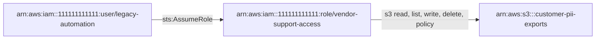

1. `arn:aws:iam::111111111111:user/legacy-automation` -[sts:AssumeRole]-> `arn:aws:iam::111111111111:role/vendor-support-access` (confidence high)
2. `arn:aws:iam::111111111111:role/vendor-support-access` -[s3 read, list, write, delete, policy]-> `arn:aws:s3:::customer-pii-exports` (confidence high)

<details><summary>Score breakdown</summary>

| Factor | Value | Weight | Rationale |
|---|---:|---:|---|
| permission_breadth | 1.00 | 20 | access classes: delete, list, policy, read, write |
| escalation_potential | 0.30 | 25 | data access through intermediate identities |
| resource_sensitivity | 1.00 | 20 | bucket sensitivity declared as high |
| trust_boundary | 0.00 | 15 | path stays inside the account |
| exposure | 0.70 | 10 | human identity; has active long-lived access keys |
| reachability | 0.80 | 10 | 2 hop(s) |

base 62.5 x evidence/confidence 0.90 x preconditions 1.00 = 56.2

</details>

**Remediation.** Break the path at its weakest hop; the first hop is usually the cheapest to fix.

1. Narrow the trust policy of role vendor-support-access so it no longer admits user legacy-automation, or remove user legacy-automation's sts:AssumeRole permission on it.
2. Scope role vendor-support-access's S3 permissions (and the bucket policy of bucket customer-pii-exports) to the required prefix and actions.

Assumptions:

- The suggested policy is a template: replace placeholder ARNs with the resources the workflow genuinely needs.
- Validate the policy with IAM Access Analyzer policy checks and the policy simulator before deploying it; test in a non-production account first.
- Legitimate functionality that depends on the removed permissions must be identified from usage data before the change is applied.

Verification:

- Re-run the analyzer on a fresh snapshot and confirm that no PATH-SENSITIVE finding remains for user legacy-automation -&gt; bucket customer-pii-exports.
- Simulate the permission with the IAM policy simulator (read-only): aws iam simulate-principal-policy --policy-source-arn arn:aws:iam::111111111111:user/legacy-automation --action-names sts:AssumeRole --resource-arns arn:aws:iam::111111111111:role/vendor-support-access ; expect implicitDeny or explicitDeny.
- Confirm the trust policy: aws iam get-role --role-name vendor-support-access --query Role.AssumeRolePolicyDocument

References:

- <https://docs.aws.amazon.com/IAM/latest/UserGuide/reference_policies_evaluation-logic.html>
- <https://docs.aws.amazon.com/IAM/latest/UserGuide/tutorial_cross-account-with-roles.html>
- <https://docs.aws.amazon.com/IAM/latest/UserGuide/best-practices.html#grant-least-privilege>

#### User legacy-automation can reach bucket legacy-backups in 2 step(s)

| Field | Value |
|---|---|
| ID | `APA-PATH-SENSITIVE-e5761861` |
| Check | `PATH-SENSITIVE` |
| Category | attack-path |
| Severity | MEDIUM (score 56.2) |
| Confidence | high |
| Evidence kind | inferred |
| Principal | `arn:aws:iam::111111111111:user/legacy-automation` |
| Resource | `arn:aws:s3:::legacy-backups` |
| Tags | reachability, multi-hop |

**Description.** user legacy-automation can reach bucket legacy-backups in 2 step(s): user:legacy-automation --[sts:AssumeRole]--&gt; role:vendor-support-access --[s3 read, list, write, delete, policy]--&gt; s3-bucket:legacy-backups. Weakest evidence along the path: inferred; confidence: high.

**Impact.** A compromise of the starting identity extends to the sensitive data at the end of the path, even though it has no direct permission on it.

**Evidence**

- `trust:arn:aws:iam::111111111111:role/vendor-support-access`: trust:arn:aws:iam::111111111111:role/vendor-support-access statement[0] (Allow) applies
- `inline:arn:aws:iam::111111111111:user/legacy-automation:legacy`: inline:arn:aws:iam::111111111111:user/legacy-automation:legacy statement[0] Sid=AssumeAnything (Allow) applies
- `managed:arn:aws:iam::aws:policy/AmazonS3FullAccess`: managed:arn:aws:iam::aws:policy/AmazonS3FullAccess statement[0] (Allow) applies
- `bucket-policy:arn:aws:s3:::legacy-backups`: bucket-policy:arn:aws:s3:::legacy-backups statement[0] Sid=PublicRead (Allow) applies

**Path**

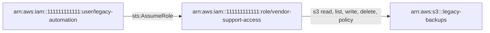

1. `arn:aws:iam::111111111111:user/legacy-automation` -[sts:AssumeRole]-> `arn:aws:iam::111111111111:role/vendor-support-access` (confidence high)
2. `arn:aws:iam::111111111111:role/vendor-support-access` -[s3 read, list, write, delete, policy]-> `arn:aws:s3:::legacy-backups` (confidence high)

<details><summary>Score breakdown</summary>

| Factor | Value | Weight | Rationale |
|---|---:|---:|---|
| permission_breadth | 1.00 | 20 | access classes: delete, list, policy, read, write |
| escalation_potential | 0.30 | 25 | data access through intermediate identities |
| resource_sensitivity | 1.00 | 20 | bucket sensitivity declared as high |
| trust_boundary | 0.00 | 15 | path stays inside the account |
| exposure | 0.70 | 10 | human identity; has active long-lived access keys |
| reachability | 0.80 | 10 | 2 hop(s) |

base 62.5 x evidence/confidence 0.90 x preconditions 1.00 = 56.2

</details>

**Remediation.** Break the path at its weakest hop; the first hop is usually the cheapest to fix.

1. Narrow the trust policy of role vendor-support-access so it no longer admits user legacy-automation, or remove user legacy-automation's sts:AssumeRole permission on it.
2. Scope role vendor-support-access's S3 permissions (and the bucket policy of bucket legacy-backups) to the required prefix and actions.

Assumptions:

- The suggested policy is a template: replace placeholder ARNs with the resources the workflow genuinely needs.
- Validate the policy with IAM Access Analyzer policy checks and the policy simulator before deploying it; test in a non-production account first.
- Legitimate functionality that depends on the removed permissions must be identified from usage data before the change is applied.

Verification:

- Re-run the analyzer on a fresh snapshot and confirm that no PATH-SENSITIVE finding remains for user legacy-automation -&gt; bucket legacy-backups.
- Simulate the permission with the IAM policy simulator (read-only): aws iam simulate-principal-policy --policy-source-arn arn:aws:iam::111111111111:user/legacy-automation --action-names sts:AssumeRole --resource-arns arn:aws:iam::111111111111:role/vendor-support-access ; expect implicitDeny or explicitDeny.
- Confirm the trust policy: aws iam get-role --role-name vendor-support-access --query Role.AssumeRolePolicyDocument

References:

- <https://docs.aws.amazon.com/IAM/latest/UserGuide/reference_policies_evaluation-logic.html>
- <https://docs.aws.amazon.com/IAM/latest/UserGuide/tutorial_cross-account-with-roles.html>
- <https://docs.aws.amazon.com/IAM/latest/UserGuide/best-practices.html#grant-least-privilege>

#### Bucket public-marketing-assets is publicly accessible through its bucket policy

| Field | Value |
|---|---|
| ID | `APA-S3-PUBLIC-POLICY-3be71d64` |
| Check | `S3-PUBLIC-POLICY` |
| Category | resource-exposure |
| Severity | MEDIUM (score 53.5) |
| Confidence | high |
| Evidence kind | observed |
| Resource | `arn:aws:s3:::public-marketing-assets` |
| Tags | public-access |

**Description.** The bucket policy of public-marketing-assets grants read to Principal "*". No Block Public Access configuration is recorded for the bucket. Declared sensitivity: low.

**Impact.** Anyone on the internet can perform the granted S3 operations on the bucket without credentials.

**Evidence**

- `bucket-policy:arn:aws:s3:::public-marketing-assets`: bucket-policy:arn:aws:s3:::public-marketing-assets statement[0] Sid=PublicRead (Allow) applies

<details><summary>Score breakdown</summary>

| Factor | Value | Weight | Rationale |
|---|---:|---:|---|
| permission_breadth | 0.60 | 20 | read-only access: read |
| escalation_potential | 0.10 | 25 | data access only |
| resource_sensitivity | 0.20 | 20 | bucket sensitivity declared as low |
| trust_boundary | 1.00 | 15 | anonymous access |
| exposure | 1.00 | 10 | no Block Public Access setting prevents the public statement |
| reachability | 1.00 | 10 | direct |

base 53.5 x evidence/confidence 1.00 x preconditions 1.00 = 53.5

</details>

**Remediation.** Enable all four Block Public Access settings and remove the Principal "*" statement; serve genuinely public content through CloudFront with origin access control.

1. Confirm whether any consumer legitimately relies on anonymous access (S3 server access logs or CloudTrail data events).
2. Enable BlockPublicAcls, IgnorePublicAcls, BlockPublicPolicy and RestrictPublicBuckets on the bucket (and at the account level).
3. Replace the anonymous statement with grants to specific principals, or front the bucket with CloudFront using origin access control.

Suggested policy (template, validate before use):

```json
{
  "PublicAccessBlockConfiguration": {
    "BlockPublicAcls": true,
    "IgnorePublicAcls": true,
    "BlockPublicPolicy": true,
    "RestrictPublicBuckets": true
  }
}
```

Assumptions:

- The suggested policy is a template: replace placeholder ARNs with the resources the workflow genuinely needs.
- Validate the policy with IAM Access Analyzer policy checks and the policy simulator before deploying it; test in a non-production account first.
- Legitimate functionality that depends on the removed permissions must be identified from usage data before the change is applied.
- Enabling Block Public Access immediately stops any anonymous consumer; coordinate the change with the content owners.

Verification:

- Confirm the bucket is not public: aws s3api get-bucket-policy-status --bucket public-marketing-assets (expect IsPublic=false) and aws s3api get-public-access-block --bucket public-marketing-assets (expect all four settings true).
- If IAM Access Analyzer is enabled, confirm that no external-access finding remains for the resource (aws accessanalyzer list-findings).
- Re-run the analyzer on a fresh snapshot and confirm that no S3-PUBLIC-POLICY finding remains for bucket public-marketing-assets.

References:

- <https://docs.aws.amazon.com/AmazonS3/latest/userguide/access-control-block-public-access.html>
- <https://docs.aws.amazon.com/AmazonS3/latest/userguide/bucket-policies.html>

#### User legacy-automation can reach bucket finance-reports in 2 step(s)

| Field | Value |
|---|---|
| ID | `APA-PATH-SENSITIVE-0c050208` |
| Check | `PATH-SENSITIVE` |
| Category | attack-path |
| Severity | MEDIUM (score 49.0) |
| Confidence | high |
| Evidence kind | inferred |
| Principal | `arn:aws:iam::111111111111:user/legacy-automation` |
| Resource | `arn:aws:s3:::finance-reports` |
| Tags | reachability, multi-hop |

**Description.** user legacy-automation can reach bucket finance-reports in 2 step(s): user:legacy-automation --[sts:AssumeRole]--&gt; role:vendor-support-access --[s3 read, list, write, delete, policy]--&gt; s3-bucket:finance-reports. Weakest evidence along the path: inferred; confidence: high.

**Impact.** A compromise of the starting identity extends to the sensitive data at the end of the path, even though it has no direct permission on it.

**Evidence**

- `trust:arn:aws:iam::111111111111:role/vendor-support-access`: trust:arn:aws:iam::111111111111:role/vendor-support-access statement[0] (Allow) applies
- `inline:arn:aws:iam::111111111111:user/legacy-automation:legacy`: inline:arn:aws:iam::111111111111:user/legacy-automation:legacy statement[0] Sid=AssumeAnything (Allow) applies
- `managed:arn:aws:iam::aws:policy/AmazonS3FullAccess`: managed:arn:aws:iam::aws:policy/AmazonS3FullAccess statement[0] (Allow) applies

**Path**

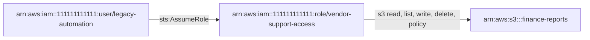

1. `arn:aws:iam::111111111111:user/legacy-automation` -[sts:AssumeRole]-> `arn:aws:iam::111111111111:role/vendor-support-access` (confidence high)
2. `arn:aws:iam::111111111111:role/vendor-support-access` -[s3 read, list, write, delete, policy]-> `arn:aws:s3:::finance-reports` (confidence high)

<details><summary>Score breakdown</summary>

| Factor | Value | Weight | Rationale |
|---|---:|---:|---|
| permission_breadth | 1.00 | 20 | access classes: delete, list, policy, read, write |
| escalation_potential | 0.30 | 25 | data access through intermediate identities |
| resource_sensitivity | 0.60 | 20 | bucket sensitivity declared as medium |
| trust_boundary | 0.00 | 15 | path stays inside the account |
| exposure | 0.70 | 10 | human identity; has active long-lived access keys |
| reachability | 0.80 | 10 | 2 hop(s) |

base 54.5 x evidence/confidence 0.90 x preconditions 1.00 = 49.0

</details>

**Remediation.** Break the path at its weakest hop; the first hop is usually the cheapest to fix.

1. Narrow the trust policy of role vendor-support-access so it no longer admits user legacy-automation, or remove user legacy-automation's sts:AssumeRole permission on it.
2. Scope role vendor-support-access's S3 permissions (and the bucket policy of bucket finance-reports) to the required prefix and actions.

Assumptions:

- The suggested policy is a template: replace placeholder ARNs with the resources the workflow genuinely needs.
- Validate the policy with IAM Access Analyzer policy checks and the policy simulator before deploying it; test in a non-production account first.
- Legitimate functionality that depends on the removed permissions must be identified from usage data before the change is applied.

Verification:

- Re-run the analyzer on a fresh snapshot and confirm that no PATH-SENSITIVE finding remains for user legacy-automation -&gt; bucket finance-reports.
- Simulate the permission with the IAM policy simulator (read-only): aws iam simulate-principal-policy --policy-source-arn arn:aws:iam::111111111111:user/legacy-automation --action-names sts:AssumeRole --resource-arns arn:aws:iam::111111111111:role/vendor-support-access ; expect implicitDeny or explicitDeny.
- Confirm the trust policy: aws iam get-role --role-name vendor-support-access --query Role.AssumeRolePolicyDocument

References:

- <https://docs.aws.amazon.com/IAM/latest/UserGuide/reference_policies_evaluation-logic.html>
- <https://docs.aws.amazon.com/IAM/latest/UserGuide/tutorial_cross-account-with-roles.html>
- <https://docs.aws.amazon.com/IAM/latest/UserGuide/best-practices.html#grant-least-privilege>

#### User legacy-automation can reach bucket archive-with-restricted-policy in 2 step(s)

| Field | Value |
|---|---|
| ID | `APA-PATH-SENSITIVE-54bb74f1` |
| Check | `PATH-SENSITIVE` |
| Category | attack-path |
| Severity | MEDIUM (score 49.0) |
| Confidence | high |
| Evidence kind | inferred |
| Principal | `arn:aws:iam::111111111111:user/legacy-automation` |
| Resource | `arn:aws:s3:::archive-with-restricted-policy` |
| Tags | reachability, multi-hop |

**Description.** user legacy-automation can reach bucket archive-with-restricted-policy in 2 step(s): user:legacy-automation --[sts:AssumeRole]--&gt; role:vendor-support-access --[s3 read, list, write, delete, policy]--&gt; s3-bucket:archive-with-restricted-policy. Weakest evidence along the path: inferred; confidence: high.

**Impact.** A compromise of the starting identity extends to the sensitive data at the end of the path, even though it has no direct permission on it.

**Evidence**

- `trust:arn:aws:iam::111111111111:role/vendor-support-access`: trust:arn:aws:iam::111111111111:role/vendor-support-access statement[0] (Allow) applies
- `inline:arn:aws:iam::111111111111:user/legacy-automation:legacy`: inline:arn:aws:iam::111111111111:user/legacy-automation:legacy statement[0] Sid=AssumeAnything (Allow) applies
- `managed:arn:aws:iam::aws:policy/AmazonS3FullAccess`: managed:arn:aws:iam::aws:policy/AmazonS3FullAccess statement[0] (Allow) applies
- `bucket-policy:arn:aws:s3:::archive-with-restricted-policy`: bucket-policy:arn:aws:s3:::archive-with-restricted-policy statement[0] Sid=LegacyPublicRead (Allow) applies

**Path**

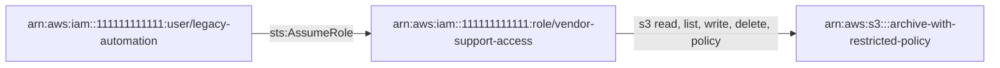

1. `arn:aws:iam::111111111111:user/legacy-automation` -[sts:AssumeRole]-> `arn:aws:iam::111111111111:role/vendor-support-access` (confidence high)
2. `arn:aws:iam::111111111111:role/vendor-support-access` -[s3 read, list, write, delete, policy]-> `arn:aws:s3:::archive-with-restricted-policy` (confidence high)

<details><summary>Score breakdown</summary>

| Factor | Value | Weight | Rationale |
|---|---:|---:|---|
| permission_breadth | 1.00 | 20 | access classes: delete, list, policy, read, write |
| escalation_potential | 0.30 | 25 | data access through intermediate identities |
| resource_sensitivity | 0.60 | 20 | bucket sensitivity declared as medium |
| trust_boundary | 0.00 | 15 | path stays inside the account |
| exposure | 0.70 | 10 | human identity; has active long-lived access keys |
| reachability | 0.80 | 10 | 2 hop(s) |

base 54.5 x evidence/confidence 0.90 x preconditions 1.00 = 49.0

</details>

**Remediation.** Break the path at its weakest hop; the first hop is usually the cheapest to fix.

1. Narrow the trust policy of role vendor-support-access so it no longer admits user legacy-automation, or remove user legacy-automation's sts:AssumeRole permission on it.
2. Scope role vendor-support-access's S3 permissions (and the bucket policy of bucket archive-with-restricted-policy) to the required prefix and actions.

Assumptions:

- The suggested policy is a template: replace placeholder ARNs with the resources the workflow genuinely needs.
- Validate the policy with IAM Access Analyzer policy checks and the policy simulator before deploying it; test in a non-production account first.
- Legitimate functionality that depends on the removed permissions must be identified from usage data before the change is applied.

Verification:

- Re-run the analyzer on a fresh snapshot and confirm that no PATH-SENSITIVE finding remains for user legacy-automation -&gt; bucket archive-with-restricted-policy.
- Simulate the permission with the IAM policy simulator (read-only): aws iam simulate-principal-policy --policy-source-arn arn:aws:iam::111111111111:user/legacy-automation --action-names sts:AssumeRole --resource-arns arn:aws:iam::111111111111:role/vendor-support-access ; expect implicitDeny or explicitDeny.
- Confirm the trust policy: aws iam get-role --role-name vendor-support-access --query Role.AssumeRolePolicyDocument

References:

- <https://docs.aws.amazon.com/IAM/latest/UserGuide/reference_policies_evaluation-logic.html>
- <https://docs.aws.amazon.com/IAM/latest/UserGuide/tutorial_cross-account-with-roles.html>
- <https://docs.aws.amazon.com/IAM/latest/UserGuide/best-practices.html#grant-least-privilege>

#### Workload role ec2-jump-host-legacy can list/read sensitive bucket customer-pii-exports

| Field | Value |
|---|---|
| ID | `APA-SENSITIVE-ACCESS-ce12be1f` |
| Check | `SENSITIVE-ACCESS` |
| Category | sensitive-data-access |
| Severity | MEDIUM (score 47.5) |
| Confidence | high |
| Evidence kind | observed |
| Principal | `arn:aws:iam::111111111111:role/ec2-jump-host-legacy` |
| Resource | `arn:aws:s3:::customer-pii-exports` |
| Tags | sensitive-data, workload |

**Description.** Workload role ec2-jump-host-legacy can perform list, read operations on customer-pii-exports (declared sensitivity: high). The role is assumed by AWS services (ec2.amazonaws.com); its permissions are only as safe as the code that runs under it.

**Impact.** If this identity's credentials or code are compromised, the sensitive data in the bucket is readable without any further step.

**Evidence**

- `inline:arn:aws:iam::111111111111:role/ec2-jump-host-legacy:legacy-exports`: inline:arn:aws:iam::111111111111:role/ec2-jump-host-legacy:legacy-exports statement[0] (Allow) applies

<details><summary>Score breakdown</summary>

| Factor | Value | Weight | Rationale |
|---|---:|---:|---|
| permission_breadth | 0.50 | 20 | access classes: list, read |
| escalation_potential | 0.10 | 25 | data access |
| resource_sensitivity | 1.00 | 20 | bucket sensitivity declared as high |
| trust_boundary | 0.00 | 15 | same account |
| exposure | 0.50 | 10 | role; workload execution role |
| reachability | 1.00 | 10 | direct permission |

base 47.5 x evidence/confidence 1.00 x preconditions 1.00 = 47.5

</details>

**Remediation.** Grant the principal only the actions and object prefixes its workflow needs on this bucket, and deny the rest explicitly.

1. Inventory the actions role ec2-jump-host-legacy actually uses (CloudTrail, IAM Access Analyzer policy generation, or IAM last-accessed information).
2. Replace the broad statement with explicit actions scoped to the specific resource ARNs the workflow needs; keep separate statements per service.
3. Add a permissions boundary to the principal if its policies are managed by delegated administrators.
4. Roll the change out through infrastructure-as-code and review it before deployment.
5. For workload roles, scope S3 access to the exact bucket and prefix the handler reads or writes.
6. Consider a bucket policy that denies access from principals other than an allow-list (aws:PrincipalArn) for high-sensitivity data.

Suggested policy (template, validate before use):

```json
{
  "Version": "2012-10-17",
  "Statement": [
    {
      "Effect": "Allow",
      "Action": [
        "s3:GetObject"
      ],
      "Resource": "arn:aws:s3:::<needed-bucket>/<needed-prefix>/*"
    },
    {
      "Effect": "Allow",
      "Action": [
        "s3:ListBucket"
      ],
      "Resource": "arn:aws:s3:::<needed-bucket>",
      "Condition": {
        "StringLike": {
          "s3:prefix": [
            "<needed-prefix>/*"
          ]
        }
      }
    }
  ]
}
```

Assumptions:

- The suggested policy is a template: replace placeholder ARNs with the resources the workflow genuinely needs.
- Validate the policy with IAM Access Analyzer policy checks and the policy simulator before deploying it; test in a non-production account first.
- Legitimate functionality that depends on the removed permissions must be identified from usage data before the change is applied.
- Replace s3:GetObject with the write actions if the workflow writes, and remove ListBucket if listing is not required.

Verification:

- Simulate the permission with the IAM policy simulator (read-only): aws iam simulate-principal-policy --policy-source-arn arn:aws:iam::111111111111:role/ec2-jump-host-legacy --action-names s3:GetObject s3:PutObject --resource-arns arn:aws:s3:::customer-pii-exports/* ; expect implicitDeny or explicitDeny.
- Re-run the analyzer on a fresh snapshot and confirm that no SENSITIVE-ACCESS finding remains for role ec2-jump-host-legacy on bucket customer-pii-exports.

References:

- <https://docs.aws.amazon.com/IAM/latest/UserGuide/best-practices.html#grant-least-privilege>
- <https://docs.aws.amazon.com/AmazonS3/latest/userguide/bucket-policies.html>
- <https://docs.aws.amazon.com/lambda/latest/dg/lambda-intro-execution-role.html>

#### User analyst-readonly can list/read sensitive bucket legacy-backups

| Field | Value |
|---|---|
| ID | `APA-SENSITIVE-ACCESS-b5e322ff` |
| Check | `SENSITIVE-ACCESS` |
| Category | sensitive-data-access |
| Severity | MEDIUM (score 46.5) |
| Confidence | high |
| Evidence kind | observed |
| Principal | `arn:aws:iam::111111111111:user/analyst-readonly` |
| Resource | `arn:aws:s3:::legacy-backups` |
| Tags | sensitive-data |

**Description.** User analyst-readonly can perform list, read operations on legacy-backups (declared sensitivity: high). Explicit Deny statements prevent: delete, policy.

**Impact.** If this identity's credentials or code are compromised, the sensitive data in the bucket is readable without any further step.

**Evidence**

- `managed:arn:aws:iam::111111111111:policy/analyst-read-only`: managed:arn:aws:iam::111111111111:policy/analyst-read-only statement[0] Sid=ReadAnyBucket (Allow) applies
- `bucket-policy:arn:aws:s3:::legacy-backups`: bucket-policy:arn:aws:s3:::legacy-backups statement[0] Sid=PublicRead (Allow) applies

<details><summary>Score breakdown</summary>

| Factor | Value | Weight | Rationale |
|---|---:|---:|---|
| permission_breadth | 0.50 | 20 | access classes: list, read |
| escalation_potential | 0.10 | 25 | data access |
| resource_sensitivity | 1.00 | 20 | bucket sensitivity declared as high |
| trust_boundary | 0.00 | 15 | same account |
| exposure | 0.40 | 10 | human identity |
| reachability | 1.00 | 10 | direct permission |

base 46.5 x evidence/confidence 1.00 x preconditions 1.00 = 46.5

</details>

**Remediation.** Grant the principal only the actions and object prefixes its workflow needs on this bucket, and deny the rest explicitly.

1. Inventory the actions user analyst-readonly actually uses (CloudTrail, IAM Access Analyzer policy generation, or IAM last-accessed information).
2. Replace the broad statement with explicit actions scoped to the specific resource ARNs the workflow needs; keep separate statements per service.
3. Add a permissions boundary to the principal if its policies are managed by delegated administrators.
4. Roll the change out through infrastructure-as-code and review it before deployment.
5. For workload roles, scope S3 access to the exact bucket and prefix the handler reads or writes.
6. Consider a bucket policy that denies access from principals other than an allow-list (aws:PrincipalArn) for high-sensitivity data.

Suggested policy (template, validate before use):

```json
{
  "Version": "2012-10-17",
  "Statement": [
    {
      "Effect": "Allow",
      "Action": [
        "s3:GetObject"
      ],
      "Resource": "arn:aws:s3:::<needed-bucket>/<needed-prefix>/*"
    },
    {
      "Effect": "Allow",
      "Action": [
        "s3:ListBucket"
      ],
      "Resource": "arn:aws:s3:::<needed-bucket>",
      "Condition": {
        "StringLike": {
          "s3:prefix": [
            "<needed-prefix>/*"
          ]
        }
      }
    }
  ]
}
```

Assumptions:

- The suggested policy is a template: replace placeholder ARNs with the resources the workflow genuinely needs.
- Validate the policy with IAM Access Analyzer policy checks and the policy simulator before deploying it; test in a non-production account first.
- Legitimate functionality that depends on the removed permissions must be identified from usage data before the change is applied.
- Replace s3:GetObject with the write actions if the workflow writes, and remove ListBucket if listing is not required.

Verification:

- Simulate the permission with the IAM policy simulator (read-only): aws iam simulate-principal-policy --policy-source-arn arn:aws:iam::111111111111:user/analyst-readonly --action-names s3:GetObject s3:PutObject --resource-arns arn:aws:s3:::legacy-backups/* ; expect implicitDeny or explicitDeny.
- Re-run the analyzer on a fresh snapshot and confirm that no SENSITIVE-ACCESS finding remains for user analyst-readonly on bucket legacy-backups.

References:

- <https://docs.aws.amazon.com/IAM/latest/UserGuide/best-practices.html#grant-least-privilege>
- <https://docs.aws.amazon.com/AmazonS3/latest/userguide/bucket-policies.html>

#### The internet can reach bucket customer-pii-exports in 3 step(s)

| Field | Value |
|---|---|
| ID | `APA-PATH-SENSITIVE-25ec7c2a` |
| Check | `PATH-SENSITIVE` |
| Category | attack-path |
| Severity | MEDIUM (score 44.0) |
| Confidence | medium |
| Evidence kind | hypothetical |
| Resource | `arn:aws:s3:::customer-pii-exports` |
| Tags | reachability, multi-hop, network, multi-service |

**Description.** the internet can reach bucket customer-pii-exports in 3 step(s): internet:the internet --[reachable on all ports]--&gt; ec2-instance:legacy-jump --[runs as]--&gt; role:ec2-jump-host-legacy --[s3 read, list]--&gt; s3-bucket:customer-pii-exports. Weakest evidence along the path: hypothetical; confidence: medium.

**Impact.** Anyone on the internet who compromises a service on the exposed instance obtains the instance role's credentials from the metadata service and, from there, the sensitive data at the end of the path.

**Preconditions**

- a service listening on an exposed port must be exploitable or accept weak or leaked credentials

**Evidence**

- `security-group:sg-0jump000000000003`: ingress all ports from 0.0.0.0/0
- `ec2:arn:aws:ec2:us-east-1:111111111111:instance/i-0jump00000000000b`: public IP 203.0.113.25, subnet routes to an internet gateway
- `ec2:arn:aws:ec2:us-east-1:111111111111:instance/i-0jump00000000000b`: arn:aws:iam::111111111111:instance-profile/ec2-jump-host-legacy provides the credentials of arn:aws:iam::111111111111:role/ec2-jump-host-legacy
- `inline:arn:aws:iam::111111111111:role/ec2-jump-host-legacy:legacy-exports`: inline:arn:aws:iam::111111111111:role/ec2-jump-host-legacy:legacy-exports statement[0] (Allow) applies

**Path**

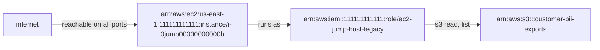

1. `internet` -[reachable on all ports]-> `arn:aws:ec2:us-east-1:111111111111:instance/i-0jump00000000000b` (confidence medium)
2. `arn:aws:ec2:us-east-1:111111111111:instance/i-0jump00000000000b` -[runs as]-> `arn:aws:iam::111111111111:role/ec2-jump-host-legacy` (confidence high)
3. `arn:aws:iam::111111111111:role/ec2-jump-host-legacy` -[s3 read, list]-> `arn:aws:s3:::customer-pii-exports` (confidence high)

<details><summary>Score breakdown</summary>

| Factor | Value | Weight | Rationale |
|---|---:|---:|---|
| permission_breadth | 0.50 | 20 | access classes: list, read |
| escalation_potential | 0.60 | 25 | a foothold on the instance yields its role credentials |
| resource_sensitivity | 1.00 | 20 | bucket sensitivity declared as high |
| trust_boundary | 1.00 | 15 | path starts outside any account |
| exposure | 1.00 | 10 | reachable from any internet address |
| reachability | 0.60 | 10 | 3 hop(s) |

base 76.0 x evidence/confidence 0.63 x preconditions 0.92 = 44.0

</details>

**Remediation.** Break the path at its weakest hop; the first hop is usually the cheapest to fix.

1. Restrict the security-group ingress of instance legacy-jump to known source ranges or remove its public address; use SSM Session Manager instead of exposed management ports.
2. Reduce the permissions of instance role role ec2-jump-host-legacy to what instance legacy-jump needs, and require IMDSv2 so that its credentials cannot be read through SSRF.
3. Scope role ec2-jump-host-legacy's S3 permissions (and the bucket policy of bucket customer-pii-exports) to the required prefix and actions.

Assumptions:

- The suggested policy is a template: replace placeholder ARNs with the resources the workflow genuinely needs.
- Validate the policy with IAM Access Analyzer policy checks and the policy simulator before deploying it; test in a non-production account first.
- Legitimate functionality that depends on the removed permissions must be identified from usage data before the change is applied.

Verification:

- Re-run the analyzer on a fresh snapshot and confirm that no PATH-SENSITIVE finding remains for the internet -&gt; bucket customer-pii-exports.
- aws ec2 describe-instances --instance-ids i-0jump00000000000b --query 'Reservations[].Instances[].[PublicIpAddress,SecurityGroups,MetadataOptions.HttpTokens]' (expect no public address or no internet-wide ingress)

References:

- <https://docs.aws.amazon.com/IAM/latest/UserGuide/reference_policies_evaluation-logic.html>
- <https://docs.aws.amazon.com/IAM/latest/UserGuide/tutorial_cross-account-with-roles.html>
- <https://docs.aws.amazon.com/IAM/latest/UserGuide/best-practices.html#grant-least-privilege>
- <https://docs.aws.amazon.com/vpc/latest/userguide/security-group-rules.html>
- <https://docs.aws.amazon.com/AWSEC2/latest/UserGuide/configuring-instance-metadata-service.html>

#### Role partner-integration can list/read sensitive bucket finance-reports

| Field | Value |
|---|---|
| ID | `APA-SENSITIVE-ACCESS-f6e7f96d` |
| Check | `SENSITIVE-ACCESS` |
| Category | sensitive-data-access |
| Severity | MEDIUM (score 41.5) |
| Confidence | high |
| Evidence kind | observed |
| Principal | `arn:aws:iam::111111111111:role/partner-integration` |
| Resource | `arn:aws:s3:::finance-reports` |
| Tags | sensitive-data |

**Description.** Role partner-integration can perform list, read operations on finance-reports (declared sensitivity: medium).

**Impact.** If this identity's credentials or code are compromised, the sensitive data in the bucket is readable without any further step.

**Evidence**

- `inline:arn:aws:iam::111111111111:role/partner-integration:read-reports`: inline:arn:aws:iam::111111111111:role/partner-integration:read-reports statement[0] (Allow) applies

<details><summary>Score breakdown</summary>

| Factor | Value | Weight | Rationale |
|---|---:|---:|---|
| permission_breadth | 0.50 | 20 | access classes: list, read |
| escalation_potential | 0.10 | 25 | data access |
| resource_sensitivity | 0.60 | 20 | bucket sensitivity declared as medium |
| trust_boundary | 0.00 | 15 | same account |
| exposure | 0.70 | 10 | role; trusted by principals outside the account |
| reachability | 1.00 | 10 | direct permission |

base 41.5 x evidence/confidence 1.00 x preconditions 1.00 = 41.5

</details>

**Remediation.** Grant the principal only the actions and object prefixes its workflow needs on this bucket, and deny the rest explicitly.

1. Inventory the actions role partner-integration actually uses (CloudTrail, IAM Access Analyzer policy generation, or IAM last-accessed information).
2. Replace the broad statement with explicit actions scoped to the specific resource ARNs the workflow needs; keep separate statements per service.
3. Add a permissions boundary to the principal if its policies are managed by delegated administrators.
4. Roll the change out through infrastructure-as-code and review it before deployment.
5. For workload roles, scope S3 access to the exact bucket and prefix the handler reads or writes.
6. Consider a bucket policy that denies access from principals other than an allow-list (aws:PrincipalArn) for high-sensitivity data.

Suggested policy (template, validate before use):

```json
{
  "Version": "2012-10-17",
  "Statement": [
    {
      "Effect": "Allow",
      "Action": [
        "s3:GetObject"
      ],
      "Resource": "arn:aws:s3:::<needed-bucket>/<needed-prefix>/*"
    },
    {
      "Effect": "Allow",
      "Action": [
        "s3:ListBucket"
      ],
      "Resource": "arn:aws:s3:::<needed-bucket>",
      "Condition": {
        "StringLike": {
          "s3:prefix": [
            "<needed-prefix>/*"
          ]
        }
      }
    }
  ]
}
```

Assumptions:

- The suggested policy is a template: replace placeholder ARNs with the resources the workflow genuinely needs.
- Validate the policy with IAM Access Analyzer policy checks and the policy simulator before deploying it; test in a non-production account first.
- Legitimate functionality that depends on the removed permissions must be identified from usage data before the change is applied.
- Replace s3:GetObject with the write actions if the workflow writes, and remove ListBucket if listing is not required.

Verification:

- Simulate the permission with the IAM policy simulator (read-only): aws iam simulate-principal-policy --policy-source-arn arn:aws:iam::111111111111:role/partner-integration --action-names s3:GetObject s3:PutObject --resource-arns arn:aws:s3:::finance-reports/* ; expect implicitDeny or explicitDeny.
- Re-run the analyzer on a fresh snapshot and confirm that no SENSITIVE-ACCESS finding remains for role partner-integration on bucket finance-reports.

References:

- <https://docs.aws.amazon.com/IAM/latest/UserGuide/best-practices.html#grant-least-privilege>
- <https://docs.aws.amazon.com/AmazonS3/latest/userguide/bucket-policies.html>

### LOW (8)

#### Bucket archive-with-restricted-policy has a public bucket policy (blocked by Block Public Access)

| Field | Value |
|---|---|
| ID | `APA-S3-PUBLIC-POLICY-5c783577` |
| Check | `S3-PUBLIC-POLICY` |
| Category | resource-exposure |
| Severity | LOW (score 39.0) |
| Confidence | high |
| Evidence kind | observed |
| Resource | `arn:aws:s3:::archive-with-restricted-policy` |
| Tags | public-access, mitigated-by-block-public-access |

**Description.** The bucket policy of archive-with-restricted-policy grants read to Principal "*". Block Public Access: BlockPublicAcls=True, IgnorePublicAcls=True, BlockPublicPolicy=True, RestrictPublicBuckets=True. Declared sensitivity: medium.

**Impact.** No public access is possible while RestrictPublicBuckets stays enabled, but the policy would become effective the moment the setting is relaxed.

**Evidence**

- `bucket-policy:arn:aws:s3:::archive-with-restricted-policy`: bucket-policy:arn:aws:s3:::archive-with-restricted-policy statement[0] Sid=LegacyPublicRead (Allow) applies

<details><summary>Score breakdown</summary>

| Factor | Value | Weight | Rationale |
|---|---:|---:|---|
| permission_breadth | 0.60 | 20 | read-only access: read |
| escalation_potential | 0.10 | 25 | data access only |
| resource_sensitivity | 0.60 | 20 | bucket sensitivity declared as medium |
| trust_boundary | 0.30 | 15 | boundary crossing blocked while RestrictPublicBuckets stays enabled |
| exposure | 0.30 | 10 | RestrictPublicBuckets is enabled; the public statement is inert while it stays enabled |
| reachability | 0.50 | 10 | inert until the Block Public Access setting is relaxed |

base 39.0 x evidence/confidence 1.00 x preconditions 1.00 = 39.0

</details>

**Remediation.** Enable all four Block Public Access settings and remove the Principal "*" statement; serve genuinely public content through CloudFront with origin access control.

1. Confirm whether any consumer legitimately relies on anonymous access (S3 server access logs or CloudTrail data events).
2. Enable BlockPublicAcls, IgnorePublicAcls, BlockPublicPolicy and RestrictPublicBuckets on the bucket (and at the account level).
3. Replace the anonymous statement with grants to specific principals, or front the bucket with CloudFront using origin access control.

Suggested policy (template, validate before use):

```json
{
  "PublicAccessBlockConfiguration": {
    "BlockPublicAcls": true,
    "IgnorePublicAcls": true,
    "BlockPublicPolicy": true,
    "RestrictPublicBuckets": true
  }
}
```

Assumptions:

- The suggested policy is a template: replace placeholder ARNs with the resources the workflow genuinely needs.
- Validate the policy with IAM Access Analyzer policy checks and the policy simulator before deploying it; test in a non-production account first.
- Legitimate functionality that depends on the removed permissions must be identified from usage data before the change is applied.
- Enabling Block Public Access immediately stops any anonymous consumer; coordinate the change with the content owners.

Verification:

- Confirm the bucket is not public: aws s3api get-bucket-policy-status --bucket archive-with-restricted-policy (expect IsPublic=false) and aws s3api get-public-access-block --bucket archive-with-restricted-policy (expect all four settings true).
- If IAM Access Analyzer is enabled, confirm that no external-access finding remains for the resource (aws accessanalyzer list-findings).
- Re-run the analyzer on a fresh snapshot and confirm that no S3-PUBLIC-POLICY finding remains for bucket archive-with-restricted-policy.

References:

- <https://docs.aws.amazon.com/AmazonS3/latest/userguide/access-control-block-public-access.html>
- <https://docs.aws.amazon.com/AmazonS3/latest/userguide/bucket-policies.html>

#### User analyst-readonly can list/read sensitive bucket finance-reports

| Field | Value |
|---|---|
| ID | `APA-SENSITIVE-ACCESS-340c7acd` |
| Check | `SENSITIVE-ACCESS` |
| Category | sensitive-data-access |
| Severity | LOW (score 38.5) |
| Confidence | high |
| Evidence kind | observed |
| Principal | `arn:aws:iam::111111111111:user/analyst-readonly` |
| Resource | `arn:aws:s3:::finance-reports` |
| Tags | sensitive-data |

**Description.** User analyst-readonly can perform list, read operations on finance-reports (declared sensitivity: medium). Explicit Deny statements prevent: delete, policy.

**Impact.** If this identity's credentials or code are compromised, the sensitive data in the bucket is readable without any further step.

**Evidence**

- `managed:arn:aws:iam::111111111111:policy/analyst-read-only`: managed:arn:aws:iam::111111111111:policy/analyst-read-only statement[0] Sid=ReadAnyBucket (Allow) applies

<details><summary>Score breakdown</summary>

| Factor | Value | Weight | Rationale |
|---|---:|---:|---|
| permission_breadth | 0.50 | 20 | access classes: list, read |
| escalation_potential | 0.10 | 25 | data access |
| resource_sensitivity | 0.60 | 20 | bucket sensitivity declared as medium |
| trust_boundary | 0.00 | 15 | same account |
| exposure | 0.40 | 10 | human identity |
| reachability | 1.00 | 10 | direct permission |

base 38.5 x evidence/confidence 1.00 x preconditions 1.00 = 38.5

</details>

**Remediation.** Grant the principal only the actions and object prefixes its workflow needs on this bucket, and deny the rest explicitly.

1. Inventory the actions user analyst-readonly actually uses (CloudTrail, IAM Access Analyzer policy generation, or IAM last-accessed information).
2. Replace the broad statement with explicit actions scoped to the specific resource ARNs the workflow needs; keep separate statements per service.
3. Add a permissions boundary to the principal if its policies are managed by delegated administrators.
4. Roll the change out through infrastructure-as-code and review it before deployment.
5. For workload roles, scope S3 access to the exact bucket and prefix the handler reads or writes.
6. Consider a bucket policy that denies access from principals other than an allow-list (aws:PrincipalArn) for high-sensitivity data.

Suggested policy (template, validate before use):

```json
{
  "Version": "2012-10-17",
  "Statement": [
    {
      "Effect": "Allow",
      "Action": [
        "s3:GetObject"
      ],
      "Resource": "arn:aws:s3:::<needed-bucket>/<needed-prefix>/*"
    },
    {
      "Effect": "Allow",
      "Action": [
        "s3:ListBucket"
      ],
      "Resource": "arn:aws:s3:::<needed-bucket>",
      "Condition": {
        "StringLike": {
          "s3:prefix": [
            "<needed-prefix>/*"
          ]
        }
      }
    }
  ]
}
```

Assumptions:

- The suggested policy is a template: replace placeholder ARNs with the resources the workflow genuinely needs.
- Validate the policy with IAM Access Analyzer policy checks and the policy simulator before deploying it; test in a non-production account first.
- Legitimate functionality that depends on the removed permissions must be identified from usage data before the change is applied.
- Replace s3:GetObject with the write actions if the workflow writes, and remove ListBucket if listing is not required.

Verification:

- Simulate the permission with the IAM policy simulator (read-only): aws iam simulate-principal-policy --policy-source-arn arn:aws:iam::111111111111:user/analyst-readonly --action-names s3:GetObject s3:PutObject --resource-arns arn:aws:s3:::finance-reports/* ; expect implicitDeny or explicitDeny.
- Re-run the analyzer on a fresh snapshot and confirm that no SENSITIVE-ACCESS finding remains for user analyst-readonly on bucket finance-reports.

References:

- <https://docs.aws.amazon.com/IAM/latest/UserGuide/best-practices.html#grant-least-privilege>
- <https://docs.aws.amazon.com/AmazonS3/latest/userguide/bucket-policies.html>

#### User analyst-readonly can list/read sensitive bucket archive-with-restricted-policy

| Field | Value |
|---|---|
| ID | `APA-SENSITIVE-ACCESS-92d0f375` |
| Check | `SENSITIVE-ACCESS` |
| Category | sensitive-data-access |
| Severity | LOW (score 38.5) |
| Confidence | high |
| Evidence kind | observed |
| Principal | `arn:aws:iam::111111111111:user/analyst-readonly` |
| Resource | `arn:aws:s3:::archive-with-restricted-policy` |
| Tags | sensitive-data |

**Description.** User analyst-readonly can perform list, read operations on archive-with-restricted-policy (declared sensitivity: medium). Explicit Deny statements prevent: delete, policy.

**Impact.** If this identity's credentials or code are compromised, the sensitive data in the bucket is readable without any further step.

**Evidence**

- `managed:arn:aws:iam::111111111111:policy/analyst-read-only`: managed:arn:aws:iam::111111111111:policy/analyst-read-only statement[0] Sid=ReadAnyBucket (Allow) applies
- `bucket-policy:arn:aws:s3:::archive-with-restricted-policy`: bucket-policy:arn:aws:s3:::archive-with-restricted-policy statement[0] Sid=LegacyPublicRead (Allow) applies

<details><summary>Score breakdown</summary>

| Factor | Value | Weight | Rationale |
|---|---:|---:|---|
| permission_breadth | 0.50 | 20 | access classes: list, read |
| escalation_potential | 0.10 | 25 | data access |
| resource_sensitivity | 0.60 | 20 | bucket sensitivity declared as medium |
| trust_boundary | 0.00 | 15 | same account |
| exposure | 0.40 | 10 | human identity |
| reachability | 1.00 | 10 | direct permission |

base 38.5 x evidence/confidence 1.00 x preconditions 1.00 = 38.5

</details>

**Remediation.** Grant the principal only the actions and object prefixes its workflow needs on this bucket, and deny the rest explicitly.

1. Inventory the actions user analyst-readonly actually uses (CloudTrail, IAM Access Analyzer policy generation, or IAM last-accessed information).
2. Replace the broad statement with explicit actions scoped to the specific resource ARNs the workflow needs; keep separate statements per service.
3. Add a permissions boundary to the principal if its policies are managed by delegated administrators.
4. Roll the change out through infrastructure-as-code and review it before deployment.
5. For workload roles, scope S3 access to the exact bucket and prefix the handler reads or writes.
6. Consider a bucket policy that denies access from principals other than an allow-list (aws:PrincipalArn) for high-sensitivity data.

Suggested policy (template, validate before use):

```json
{
  "Version": "2012-10-17",
  "Statement": [
    {
      "Effect": "Allow",
      "Action": [
        "s3:GetObject"
      ],
      "Resource": "arn:aws:s3:::<needed-bucket>/<needed-prefix>/*"
    },
    {
      "Effect": "Allow",
      "Action": [
        "s3:ListBucket"
      ],
      "Resource": "arn:aws:s3:::<needed-bucket>",
      "Condition": {
        "StringLike": {
          "s3:prefix": [
            "<needed-prefix>/*"
          ]
        }
      }
    }
  ]
}
```

Assumptions:

- The suggested policy is a template: replace placeholder ARNs with the resources the workflow genuinely needs.
- Validate the policy with IAM Access Analyzer policy checks and the policy simulator before deploying it; test in a non-production account first.
- Legitimate functionality that depends on the removed permissions must be identified from usage data before the change is applied.
- Replace s3:GetObject with the write actions if the workflow writes, and remove ListBucket if listing is not required.

Verification:

- Simulate the permission with the IAM policy simulator (read-only): aws iam simulate-principal-policy --policy-source-arn arn:aws:iam::111111111111:user/analyst-readonly --action-names s3:GetObject s3:PutObject --resource-arns arn:aws:s3:::archive-with-restricted-policy/* ; expect implicitDeny or explicitDeny.
- Re-run the analyzer on a fresh snapshot and confirm that no SENSITIVE-ACCESS finding remains for user analyst-readonly on bucket archive-with-restricted-policy.

References:

- <https://docs.aws.amazon.com/IAM/latest/UserGuide/best-practices.html#grant-least-privilege>
- <https://docs.aws.amazon.com/AmazonS3/latest/userguide/bucket-policies.html>

#### Instance web-1 allows IMDSv1 while running as role ec2-web-instance

| Field | Value |
|---|---|
| ID | `APA-EC2-IMDSV1-52ba8ac3` |
| Check | `EC2-IMDSV1` |
| Category | network-exposure |
| Severity | LOW (score 35.2) |
| Confidence | high |
| Evidence kind | observed |
| Principal | `arn:aws:iam::111111111111:role/ec2-web-instance` |
| Resource | `arn:aws:ec2:us-east-1:111111111111:instance/i-0web000000000000a` |
| Tags | network, imds, credential-exposure |

**Description.** i-0web000000000000a does not require session tokens for the instance metadata service (HttpTokens is optional), and it holds the credentials of role ec2-web-instance. A single unauthenticated GET to 169.254.169.254 from the instance returns those credentials; IMDSv2 requires a PUT-obtained token with a hop limit, which blocks the common SSRF and misconfigured-proxy cases. The instance is also reachable from the internet.

**Impact.** Any request-forgery or local-file-read flaw in software on the instance becomes a direct path to its IAM role credentials.

**Evidence**

- `ec2:arn:aws:ec2:us-east-1:111111111111:instance/i-0web000000000000a`: MetadataOptions.HttpTokens is optional; instance profile provides arn:aws:iam::111111111111:role/ec2-web-instance

<details><summary>Score breakdown</summary>

| Factor | Value | Weight | Rationale |
|---|---:|---:|---|
| permission_breadth | 0.11 | 20 | reach of the instance role: estimated permission breadth 0.11 |
| escalation_potential | 0.60 | 25 | role credentials retrievable by any SSRF or local request without a session token |
| resource_sensitivity | 0.20 | 20 | bucket sensitivity declared as low |
| trust_boundary | 0.00 | 15 | the metadata service is reachable only from the instance |
| exposure | 0.80 | 10 | instance reachable from the internet |
| reachability | 0.60 | 10 | requires a request-forgery or local-access flaw |

base 35.2 x evidence/confidence 1.00 x preconditions 1.00 = 35.2

</details>

**Remediation.** Require IMDSv2 on the instance (HttpTokens=required) and enforce it for new launches.

1. aws ec2 modify-instance-metadata-options --instance-id i-0web000000000000a --http-tokens required --http-endpoint enabled
2. Set MetadataOptions.HttpTokens=required in launch templates, and enable the account-level default (ec2 modify-instance-metadata-defaults).
3. Confirm agents and SDKs on the instance support IMDSv2 before enforcing (modern AWS SDKs and the SSM agent do).

Assumptions:

- The suggested policy is a template: replace placeholder ARNs with the resources the workflow genuinely needs.
- Validate the policy with IAM Access Analyzer policy checks and the policy simulator before deploying it; test in a non-production account first.
- Legitimate functionality that depends on the removed permissions must be identified from usage data before the change is applied.
- Software that still uses IMDSv1 calls loses credential access once tokens are required.

Verification:

- aws ec2 describe-instances --instance-ids i-0web000000000000a --query 'Reservations[].Instances[].MetadataOptions' (expect HttpTokens=required)
- Re-run the analyzer on a fresh snapshot and confirm that no EC2-IMDSV1 finding remains for instance web-1.

References:

- <https://docs.aws.amazon.com/AWSEC2/latest/UserGuide/configuring-instance-metadata-service.html>
- <https://docs.aws.amazon.com/AWSEC2/latest/UserGuide/iam-roles-for-amazon-ec2.html>

#### Role third-party-monitoring trusts account arn:aws:iam::333333333333:root (sts:ExternalId required)

| Field | Value |
|---|---|
| ID | `APA-TRUST-CROSS-ACCOUNT-18919fa9` |
| Check | `TRUST-CROSS-ACCOUNT` |
| Category | trust-relationship |
| Severity | LOW (score 34.5) |
| Confidence | high |
| Evidence kind | observed |
| Principal | `arn:aws:iam::111111111111:role/third-party-monitoring` |
| Tags | cross-account-trust, external-id-required |

**Description.** trust:arn:aws:iam::111111111111:role/third-party-monitoring statement[0] allows arn:aws:iam::333333333333:root to assume the role subject to conditions (StringEquals sts:ExternalId = [synthetic-external-id-0000]). Trusting an entire account delegates the decision of who may assume the role to that account's administrators. The trusted account is not declared as a known partner in the snapshot. What a caller gains: estimated permission breadth 0.17.

**Impact.** Principals in the trusted account can obtain this role's permissions; the security of this account then depends on the other account's identity management.

**Preconditions**

- a principal in the trusted account must hold an identity-policy Allow for sts:AssumeRole on arn:aws:iam::111111111111:role/third-party-monitoring
- the caller must present the configured sts:ExternalId

**Evidence**

- `trust:arn:aws:iam::111111111111:role/third-party-monitoring`: statement[0] names arn:aws:iam::333333333333:root with conditions StringEquals sts:ExternalId = [synthetic-external-id-0000]

<details><summary>Score breakdown</summary>

| Factor | Value | Weight | Rationale |
|---|---:|---:|---|
| permission_breadth | 0.17 | 20 | breadth of the role's own permissions |
| escalation_potential | 0.17 | 25 | estimated permission breadth 0.17 |
| resource_sensitivity | 0.17 | 20 | estimated permission breadth 0.17 |
| trust_boundary | 0.80 | 15 | trust crosses an account boundary |
| exposure | 0.80 | 10 | account not declared as a known partner |
| reachability | 1.00 | 10 | single sts:AssumeRole call |

base 41.0 x evidence/confidence 1.00 x preconditions 0.84 = 34.5

</details>

**Remediation.** Trust the specific external role rather than the account root, and require an sts:ExternalId for third-party access.

1. Confirm with the owner of the trusted account which role or user needs access and why.
2. Replace the account-root principal with that principal's ARN.
3. For vendor or third-party access add a Condition with StringEquals sts:ExternalId set to a value only the vendor knows.
4. Limit the role's own permissions to what the integration needs and set a short MaxSessionDuration.

Suggested policy (template, validate before use):

```json
{
  "Version": "2012-10-17",
  "Statement": [
    {
      "Effect": "Allow",
      "Principal": {
        "AWS": "arn:aws:iam::<trusted-account-id>:role/<integration-role>"
      },
      "Action": "sts:AssumeRole",
      "Condition": {
        "StringEquals": {
          "sts:ExternalId": "<unique-external-id>"
        }
      }
    }
  ]
}
```

Assumptions:

- The suggested policy is a template: replace placeholder ARNs with the resources the workflow genuinely needs.
- Validate the policy with IAM Access Analyzer policy checks and the policy simulator before deploying it; test in a non-production account first.
- Legitimate functionality that depends on the removed permissions must be identified from usage data before the change is applied.
- The ExternalId condition is only meaningful for third parties; omit it for roles your own organization controls.

Verification:

- Confirm the trust policy: aws iam get-role --role-name third-party-monitoring --query Role.AssumeRolePolicyDocument
- Re-run the analyzer on a fresh snapshot and confirm that no TRUST-CROSS-ACCOUNT finding remains for role third-party-monitoring.

References:

- <https://docs.aws.amazon.com/IAM/latest/UserGuide/tutorial_cross-account-with-roles.html>
- <https://docs.aws.amazon.com/IAM/latest/UserGuide/id_roles_create_for-user_externalid.html>
- <https://docs.aws.amazon.com/IAM/latest/UserGuide/reference_policies_elements_principal.html>

#### Account 222222222222 can reach bucket finance-reports in 2 step(s)

| Field | Value |
|---|---|
| ID | `APA-PATH-SENSITIVE-faae3510` |
| Check | `PATH-SENSITIVE` |
| Category | attack-path |
| Severity | LOW (score 32.2) |
| Confidence | medium |
| Evidence kind | hypothetical |
| Resource | `arn:aws:s3:::finance-reports` |
| Tags | reachability, multi-hop |

**Description.** account 222222222222 can reach bucket finance-reports in 2 step(s): external-account:account 222222222222 --[sts:AssumeRole (conditional)]--&gt; role:partner-integration --[s3 read, list]--&gt; s3-bucket:finance-reports. Weakest evidence along the path: hypothetical; confidence: medium.

**Impact.** A compromise of the starting identity extends to the sensitive data at the end of the path, even though it has no direct permission on it.

**Preconditions**

- a principal in account 222222222222 must hold an identity-policy Allow for sts:AssumeRole on this role (that account's policies are outside the snapshot)

**Evidence**

- `trust:arn:aws:iam::111111111111:role/partner-integration`: trust:arn:aws:iam::111111111111:role/partner-integration statement[0] (Allow) applies
- `inline:arn:aws:iam::111111111111:role/partner-integration:read-reports`: inline:arn:aws:iam::111111111111:role/partner-integration:read-reports statement[0] (Allow) applies

**Path**

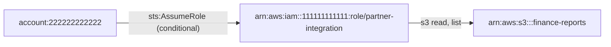

1. `account:222222222222` -[sts:AssumeRole (conditional)]-> `arn:aws:iam::111111111111:role/partner-integration` (confidence medium)
2. `arn:aws:iam::111111111111:role/partner-integration` -[s3 read, list]-> `arn:aws:s3:::finance-reports` (confidence high)

<details><summary>Score breakdown</summary>

| Factor | Value | Weight | Rationale |
|---|---:|---:|---|
| permission_breadth | 0.50 | 20 | access classes: list, read |
| escalation_potential | 0.30 | 25 | data access through intermediate identities |
| resource_sensitivity | 0.60 | 20 | bucket sensitivity declared as medium |
| trust_boundary | 0.80 | 15 | path starts in another account |
| exposure | 0.60 | 10 | identity in a known partner account outside the snapshot |
| reachability | 0.80 | 10 | 2 hop(s) |

base 55.5 x evidence/confidence 0.63 x preconditions 0.92 = 32.2

</details>

**Remediation.** Break the path at its weakest hop; the first hop is usually the cheapest to fix.

1. Narrow the trust policy of role partner-integration so it no longer admits account 222222222222, or remove account 222222222222's sts:AssumeRole permission on it.
2. Scope role partner-integration's S3 permissions (and the bucket policy of bucket finance-reports) to the required prefix and actions.

Assumptions:

- The suggested policy is a template: replace placeholder ARNs with the resources the workflow genuinely needs.
- Validate the policy with IAM Access Analyzer policy checks and the policy simulator before deploying it; test in a non-production account first.
- Legitimate functionality that depends on the removed permissions must be identified from usage data before the change is applied.

Verification:

- Re-run the analyzer on a fresh snapshot and confirm that no PATH-SENSITIVE finding remains for account 222222222222 -&gt; bucket finance-reports.
- Simulate the permission with the IAM policy simulator (read-only): aws iam simulate-principal-policy --policy-source-arn &lt;caller-arn&gt; --action-names sts:AssumeRole --resource-arns arn:aws:iam::111111111111:role/partner-integration ; expect implicitDeny or explicitDeny.
- Confirm the trust policy: aws iam get-role --role-name partner-integration --query Role.AssumeRolePolicyDocument

References:

- <https://docs.aws.amazon.com/IAM/latest/UserGuide/reference_policies_evaluation-logic.html>
- <https://docs.aws.amazon.com/IAM/latest/UserGuide/tutorial_cross-account-with-roles.html>
- <https://docs.aws.amazon.com/IAM/latest/UserGuide/best-practices.html#grant-least-privilege>

#### Policy document arn:aws:iam::111111111111:policy/pipeline-unresolved is referenced but not present in the snapshot

| Field | Value |
|---|---|
| ID | `APA-COVERAGE-UNRESOLVED-POLICY-724136a3` |
| Check | `COVERAGE-UNRESOLVED-POLICY` |
| Category | inventory-coverage |
| Severity | LOW (score 0.0) |
| Confidence | high |
| Evidence kind | observed |
| Resource | `arn:aws:iam::111111111111:policy/pipeline-unresolved` |
| Tags | coverage, unresolved-policy |

**Description.** role data-pipeline-worker reference arn:aws:iam::111111111111:policy/pipeline-unresolved, but its document is not in the snapshot. Evaluations for these identities are marked indeterminate where the missing document could change the outcome.

**Impact.** Permissions granted by the missing document are invisible; the affected identities may be more privileged than reported.

**Evidence**

- `snapshot`: referenced by role data-pipeline-worker

<details><summary>Score breakdown</summary>

| Factor | Value | Weight | Rationale |
|---|---:|---:|---|
| permission_breadth | 0.00 | 20 | not applicable |
| escalation_potential | 0.00 | 25 | not applicable |
| resource_sensitivity | 0.00 | 20 | not applicable |
| trust_boundary | 0.00 | 15 | not applicable |
| exposure | 0.00 | 10 | not applicable |
| reachability | 0.00 | 10 | not applicable |

base 0.0 x evidence/confidence 1.00 x preconditions 1.00 = 0.0; fixed at low by check override

</details>

**Remediation.** Include the policy document in the snapshot (the AWS collector fetches attached managed policies automatically when iam:GetPolicyVersion is permitted).

Verification:

- Re-run the analysis after adding the document; the finding disappears and dependent findings gain confidence.

References:

- <https://docs.aws.amazon.com/IAM/latest/APIReference/API_GetAccountAuthorizationDetails.html>
- <https://docs.aws.amazon.com/IAM/latest/UserGuide/reference_policies_evaluation-logic.html>

#### Execution role arn:aws:iam::111111111111:role/cleanup-role-missing is used by functions but not present in the snapshot

| Field | Value |
|---|---|
| ID | `APA-COVERAGE-UNRESOLVED-ROLE-03574b40` |
| Check | `COVERAGE-UNRESOLVED-ROLE` |
| Category | inventory-coverage |
| Severity | LOW (score 0.0) |
| Confidence | high |
| Evidence kind | observed |
| Resource | `arn:aws:iam::111111111111:role/cleanup-role-missing` |
| Tags | coverage, unresolved-role |

**Description.** Functions orphan-cleanup run under arn:aws:iam::111111111111:role/cleanup-role-missing, whose policies are not in the snapshot; what those functions can reach is unknown.

**Impact.** The permissions of the affected workloads cannot be assessed.

**Evidence**

- `snapshot`: used by orphan-cleanup

<details><summary>Score breakdown</summary>

| Factor | Value | Weight | Rationale |
|---|---:|---:|---|
| permission_breadth | 0.00 | 20 | not applicable |
| escalation_potential | 0.00 | 25 | not applicable |
| resource_sensitivity | 0.00 | 20 | not applicable |
| trust_boundary | 0.00 | 15 | not applicable |
| exposure | 0.00 | 10 | not applicable |
| reachability | 0.00 | 10 | not applicable |

base 0.0 x evidence/confidence 1.00 x preconditions 1.00 = 0.0; fixed at low by check override

</details>

**Remediation.** Include the role in the snapshot (check IAM coverage and whether the role lives in another account).

Verification:

- Re-run the analysis after adding the role.

References:

- <https://docs.aws.amazon.com/lambda/latest/dg/lambda-intro-execution-role.html>

### INFORMATIONAL (4)

#### Role finance-reporting can read sensitive bucket customer-pii-exports

| Field | Value |
|---|---|
| ID | `APA-SENSITIVE-ACCESS-d50401d5` |
| Check | `SENSITIVE-ACCESS` |
| Category | sensitive-data-access |
| Severity | INFORMATIONAL (score 15.7) |
| Confidence | low |
| Evidence kind | indeterminate |
| Principal | `arn:aws:iam::111111111111:role/finance-reporting` |
| Resource | `arn:aws:s3:::customer-pii-exports` |
| Tags | sensitive-data |

**Description.** Role finance-reporting can perform no definite operations on customer-pii-exports (declared sensitivity: high); read depend on conditions the analyzer could not evaluate.

**Impact.** If this identity's credentials or code are compromised, the sensitive data in the bucket is readable without any further step.

**Preconditions**

- request context key aws:SourceVpce is not known from static configuration

**Evidence**

- `inline:arn:aws:iam::111111111111:role/finance-reporting:vpce-only`: inline:arn:aws:iam::111111111111:role/finance-reporting:vpce-only statement[0] Sid=ReadExportsViaEndpoint (Allow) applies only if: request context key aws:SourceVpce is not known from static configuration

<details><summary>Score breakdown</summary>

| Factor | Value | Weight | Rationale |
|---|---:|---:|---|
| permission_breadth | 0.50 | 20 | access classes: read |
| escalation_potential | 0.10 | 25 | data access |
| resource_sensitivity | 1.00 | 20 | bucket sensitivity declared as high |
| trust_boundary | 0.00 | 15 | same account |
| exposure | 0.30 | 10 | role |
| reachability | 1.00 | 10 | direct permission |

base 45.5 x evidence/confidence 0.38 x preconditions 0.92 = 15.7

</details>

**Remediation.** Grant the principal only the actions and object prefixes its workflow needs on this bucket, and deny the rest explicitly.

1. Inventory the actions role finance-reporting actually uses (CloudTrail, IAM Access Analyzer policy generation, or IAM last-accessed information).
2. Replace the broad statement with explicit actions scoped to the specific resource ARNs the workflow needs; keep separate statements per service.
3. Add a permissions boundary to the principal if its policies are managed by delegated administrators.
4. Roll the change out through infrastructure-as-code and review it before deployment.
5. For workload roles, scope S3 access to the exact bucket and prefix the handler reads or writes.
6. Consider a bucket policy that denies access from principals other than an allow-list (aws:PrincipalArn) for high-sensitivity data.

Suggested policy (template, validate before use):

```json
{
  "Version": "2012-10-17",
  "Statement": [
    {
      "Effect": "Allow",
      "Action": [
        "s3:GetObject"
      ],
      "Resource": "arn:aws:s3:::<needed-bucket>/<needed-prefix>/*"
    },
    {
      "Effect": "Allow",
      "Action": [
        "s3:ListBucket"
      ],
      "Resource": "arn:aws:s3:::<needed-bucket>",
      "Condition": {
        "StringLike": {
          "s3:prefix": [
            "<needed-prefix>/*"
          ]
        }
      }
    }
  ]
}
```

Assumptions:

- The suggested policy is a template: replace placeholder ARNs with the resources the workflow genuinely needs.
- Validate the policy with IAM Access Analyzer policy checks and the policy simulator before deploying it; test in a non-production account first.
- Legitimate functionality that depends on the removed permissions must be identified from usage data before the change is applied.
- Replace s3:GetObject with the write actions if the workflow writes, and remove ListBucket if listing is not required.

Verification:

- Simulate the permission with the IAM policy simulator (read-only): aws iam simulate-principal-policy --policy-source-arn arn:aws:iam::111111111111:role/finance-reporting --action-names s3:GetObject s3:PutObject --resource-arns arn:aws:s3:::customer-pii-exports/* ; expect implicitDeny or explicitDeny.
- Re-run the analyzer on a fresh snapshot and confirm that no SENSITIVE-ACCESS finding remains for role finance-reporting on bucket customer-pii-exports.

References:

- <https://docs.aws.amazon.com/IAM/latest/UserGuide/best-practices.html#grant-least-privilege>
- <https://docs.aws.amazon.com/AmazonS3/latest/userguide/bucket-policies.html>

#### Statement could not be fully evaluated: inline:arn:aws:iam::111111111111:role/finance-reporting:vpce-only statement[0] (Sid: ReadExportsViaEndpoint)

| Field | Value |
|---|---|
| ID | `APA-EVAL-INDETERMINATE-32ea52cc` |
| Check | `EVAL-INDETERMINATE` |
| Category | evaluation-limitation |
| Severity | INFORMATIONAL (score 9.6) |
| Confidence | low |
| Evidence kind | indeterminate |
| Resource | `inline:arn:aws:iam::111111111111:role/finance-reporting:vpce-only statement[0] (Sid: ReadExportsViaEndpoint)` |
| Tags | indeterminate |

**Description.** inline:arn:aws:iam::111111111111:role/finance-reporting:vpce-only statement[0] (Sid: ReadExportsViaEndpoint) contains elements whose effect depends on request-time context or on constructs the analyzer does not implement: request context key aws:SourceVpce is not known from static configuration. Findings that depend on it are marked indeterminate rather than reported as allowed or denied.

**Impact.** The real permission may be broader or narrower than reported; a human review of the statement, or a policy-simulator run with the real context values, is required.

**Evidence**

- `inline:arn:aws:iam::111111111111:role/finance-reporting:vpce-only statement[0] (Sid: ReadExportsViaEndpoint)`: request context key aws:SourceVpce is not known from static configuration

<details><summary>Score breakdown</summary>

| Factor | Value | Weight | Rationale |
|---|---:|---:|---|
| permission_breadth | 0.30 | 20 | unknown |
| escalation_potential | 0.30 | 25 | unknown |
| resource_sensitivity | 0.30 | 20 | unknown |
| trust_boundary | 0.00 | 15 | not applicable |
| exposure | 0.30 | 10 | unknown |
| reachability | 0.30 | 10 | unknown |

base 25.5 x evidence/confidence 0.38 x preconditions 1.00 = 9.6

</details>

**Remediation.** Review the statement manually and prefer condition keys whose values are static (aws:PrincipalArn, aws:PrincipalOrgID, aws:SourceAccount) over request-time keys.

1. Run the IAM policy simulator with the context keys set to the values a real request would carry.
2. If the condition is meant as a safeguard, verify that a request without the key is denied as intended.

Verification:

- Re-run the analyzer; the finding remains until the statement is simplified or the analyzer gains support for the construct.

References:

- <https://docs.aws.amazon.com/IAM/latest/UserGuide/reference_policies_condition-keys.html>
- <https://docs.aws.amazon.com/IAM/latest/UserGuide/access_policies_testing-policies.html>

#### Statement could not be fully evaluated: trust:arn:aws:iam::111111111111:role/third-party-monitoring statement[0]

| Field | Value |
|---|---|
| ID | `APA-EVAL-INDETERMINATE-6f6938d6` |
| Check | `EVAL-INDETERMINATE` |
| Category | evaluation-limitation |
| Severity | INFORMATIONAL (score 9.6) |
| Confidence | low |
| Evidence kind | indeterminate |
| Resource | `trust:arn:aws:iam::111111111111:role/third-party-monitoring statement[0]` |
| Tags | indeterminate |

**Description.** trust:arn:aws:iam::111111111111:role/third-party-monitoring statement[0] contains elements whose effect depends on request-time context or on constructs the analyzer does not implement: request context key sts:ExternalId is not known from static configuration. Findings that depend on it are marked indeterminate rather than reported as allowed or denied.

**Impact.** The real permission may be broader or narrower than reported; a human review of the statement, or a policy-simulator run with the real context values, is required.

**Evidence**

- `trust:arn:aws:iam::111111111111:role/third-party-monitoring statement[0]`: request context key sts:ExternalId is not known from static configuration

<details><summary>Score breakdown</summary>

| Factor | Value | Weight | Rationale |
|---|---:|---:|---|
| permission_breadth | 0.30 | 20 | unknown |
| escalation_potential | 0.30 | 25 | unknown |
| resource_sensitivity | 0.30 | 20 | unknown |
| trust_boundary | 0.00 | 15 | not applicable |
| exposure | 0.30 | 10 | unknown |
| reachability | 0.30 | 10 | unknown |

base 25.5 x evidence/confidence 0.38 x preconditions 1.00 = 9.6

</details>

**Remediation.** Review the statement manually and prefer condition keys whose values are static (aws:PrincipalArn, aws:PrincipalOrgID, aws:SourceAccount) over request-time keys.

1. Run the IAM policy simulator with the context keys set to the values a real request would carry.
2. If the condition is meant as a safeguard, verify that a request without the key is denied as intended.

Verification:

- Re-run the analyzer; the finding remains until the statement is simplified or the analyzer gains support for the construct.

References:

- <https://docs.aws.amazon.com/IAM/latest/UserGuide/reference_policies_condition-keys.html>
- <https://docs.aws.amazon.com/IAM/latest/UserGuide/access_policies_testing-policies.html>

#### Inventory coverage for lambda is partial

| Field | Value |
|---|---|
| ID | `APA-COVERAGE-PARTIAL-923ec07b` |
| Check | `COVERAGE-PARTIAL` |
| Category | inventory-coverage |
| Severity | INFORMATIONAL (score 0.0) |
| Confidence | high |
| Evidence kind | observed |
| Resource | `lambda` |
| Tags | coverage |

**Description.** The snapshot records lambda coverage as partial. region eu-west-1 was not inventoried: AccessDenied on lambda:ListFunctions. Findings about resources or identities that were not inventoried cannot be produced, so the absence of findings for them is not evidence of safety.

**Impact.** Risk in the uninventoried parts of the account is unknown, not absent.

**Evidence**

- `coverage`: lambda: partial - region eu-west-1 was not inventoried: AccessDenied on lambda:ListFunctions

<details><summary>Score breakdown</summary>

| Factor | Value | Weight | Rationale |
|---|---:|---:|---|
| permission_breadth | 0.00 | 20 | not applicable |
| escalation_potential | 0.00 | 25 | not applicable |
| resource_sensitivity | 0.00 | 20 | not applicable |
| trust_boundary | 0.00 | 15 | not applicable |
| exposure | 0.00 | 10 | not applicable |
| reachability | 0.00 | 10 | not applicable |

base 0.0 x evidence/confidence 1.00 x preconditions 1.00 = 0.0; fixed at informational by check override

</details>

**Remediation.** Grant the inventory identity the documented read-only permissions and re-run the collection for the affected service and regions.

1. See docs/aws-setup.md for the least-privilege read-only policy.

Verification:

- Re-run the collection and confirm the coverage section reports complete.

References:

- <https://docs.aws.amazon.com/IAM/latest/APIReference/API_GetAccountAuthorizationDetails.html>

## Limitations and warnings

- unresolved-policy: arn:aws:iam::111111111111:policy/pipeline-unresolved (1 reference(s))

## Scoring model

Source: built-in. Weights: permission_breadth=20, escalation_potential=25, resource_sensitivity=20, trust_boundary=15, exposure=10, reachability=10.

